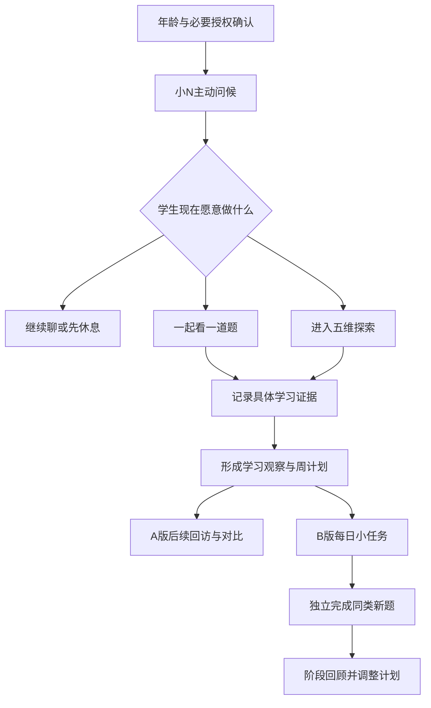
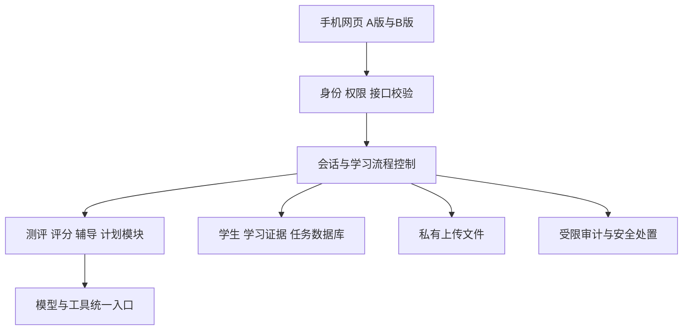

# 历次方案与提示词，属助手提案，需结合用户确认使用

首个可用版本准备先在哪个平台试用？我会先按“手机竖屏、你独立开发、先做一个平台”规划，平台选择只影响技术栈和部分交互。
- Android 手机
- iPhone / iPad
- 先用手机网页验证

---

我完整读了《开发APP需求.docx》的正文和两张配图，也找回了先前[「学习agent的探究」](chatgpt-conversation://6ad09c4a-2448-83e9-b8e1-b3bc22dda051)中的《数学学习支持Agent｜产品定位与出发点》。

**我的建议：先按队友方案做版本 A，再加入你原方案的日常学习与阶段检验，形成版本 B。两个版本共用技术底座，先用手机网页验证。**

队友方案把“小N怎样陪学生进入产品”描述得更具体；你的方案把“学生接下来怎样练习、怎样看见变化”描述得更完整。两者适合前后衔接。

下面涉及测评规则、界面和架构的内容都是**设计建议**，还没有经过学生试用或教育测量验证。

---

**先准确比较两份方案，避免把它们理解成完全不同的产品。**

| 比较项 | 队友《开发APP需求》 | 先前《数学学习支持Agent》 |
|---|---|---|
| 起点 | 初一学生考差后打开 App | 初中生考后失落、自责、不愿面对错题 |
| 第一阶段 | 综合模式，主动交流、舒缓情绪 | 倾诉缓冲，尊重学生是否愿意开始 |
| 五维观察 | 理解、逻辑、计算、建模、空间；要求理解和逻辑先测 | 已包含理解、逻辑、计算、想象、建模 |
| 交互方式 | 宠物小N、气泡选择、面试式问答、地图探索 | 对话、轻量游戏、共同制定小任务 |
| 学习计划 | 周任务为主，月任务为阶段 | 每天少量练习，持续反馈 |
| 长期跟踪 | 记忆历次评价，进行对比 | 日常成长、阶段检验、原错题及同类新题 |
| 结果呈现 | 测评报告、建议、计划、宝箱和秘籍 | 学习掌握，以及面对困难时的行动变化 |
| 写得较少的部分 | 计划如何变成实际练习，怎样验证建议有效 | 学生端页面、地图、角色和具体操作 |

一个需要澄清的事实是：**找回的先前方案已经包含五维观察。**目前更需要补的是题目设计、评分依据和后续教学过程。

两张配图分别表达了“宠物陪伴空间”和“地图探索”的视觉意向。图中的喂食、洗澡、PK等按钮不能直接视为你们已经确定的功能，首版也没有必要一并开发。

队友方案值得保留的地方，是一个稳定的角色、主动但温和的开场、学生确认后切换模式，以及把测评变成容易进入的探索过程。

需要调整的地方主要有四个：

- **“旁敲侧击”可以体现在自然的提问方式上，但测评目的应当透明。**学生需要知道，对话中的哪些学习表现可能被记录。
- **几道题只能支持局部学习判断。**不能从“没有听懂一个故事”直接得出“理解能力差”。
- **推荐阅读、规则游戏可以作为兴趣建议，不能直接当作经过验证的数学干预。**
- **计划必须连接具体练习和复测。**否则产品只能告诉学生“接下来应该做什么”，无法知道这些建议有没有帮助。

---

**两个版本应当分别验证一个清楚的问题。**

| 版本 | 产品定位 | 主要验证的问题 | 首版交付范围 |
|---|---|---|---|
| **A：学伴小N探索版** | 考后支持与五维学习观察 | 学生是否愿意在小N陪伴下，开始面对学习困难？ | 综合模式、探索模式、五站地图、观察报告、周计划、再次来访对比 |
| **B：数学学习支持版** | 从考后支持持续走向学习行动 | 学生能否通过适合自己的练习，改善具体错误，并独立完成新题？ | A的公共能力，加每日任务、分级提示、错题记录、同类新题、阶段回顾 |

A原文已经提出长期跟踪，因此不能把它简化成“一次性测试”。两个版本的主要差别，应当是**学习支持的深度**：

- A重点把观察、建议、计划和后续回访做好。
- B进一步承担练习组织、教学反馈、迁移检验和计划调整。

开发上，建议一个代码仓库、一套账户和权限体系、一套题库与证据模型，通过两个入口或版本配置保留两种体验。版本名称、流程配置、提示词和测评规则都要有版本号，这样才能回看“当时学生实际体验的是哪一版”。

共同的主流程可以这样理解：

暂停和退出需要贯穿整个流程。学生不必先完成测评，才能获得基本支持。

---

**学生端 UI 应围绕当下的一件事展开，减少“聊天、考试、任务”同时争夺注意力。**

你选择先用手机网页，我建议优先设计下面这些页面。

| 页面 | 主要内容 | 关键设计 |
|---|---|---|
| 首次进入 | 小N介绍、适用范围、必要授权、年级与教材 | 只收集当前必需的信息；不一开始索取学校、班级、真实姓名 |
| 综合模式 | 小N、对话、少量快捷选择 | 开场主动问候，一次只问一个问题 |
| 一起看题 | 题目、学生的尝试、小N的提示 | 题目持续可见，避免在长聊天中反复寻找 |
| 探索地图 | 五个地点、当前进度、继续入口 | 标明未开始、进行中、已完成、暂时跳过 |
| 探索任务 | 一道题或一个交互活动 | 清楚区分作答、求提示、不确定、暂停 |
| 学习观察 | 具体表现、依据、尚不确定的部分 | 每个判断能够追溯到题目与回答 |
| 周计划 | 一个主要目标、少量任务、预计投入 | 学生可以接受、减量或改期 |
| 成长回顾 | 历次表现与代表性例子 | 展示“哪里变了”，避免只给一个总分 |
| 隐私与帮助 | 我的记忆、删除、授权、求助与反馈 | 入口稳定、容易找到 |

**综合模式可以保留“宠物占上半屏”的欢迎效果。**但对话开始后，特别是手机键盘弹出时，小N应缩成较小的头像或半身形象，让学生看得见问题和自己的输入。原文的比例要求适合欢迎状态，不宜固定应用到所有状态。

开场可以呈现三个选择：

> 我是小N，可以陪你整理这次数学考试后的想法。你想先聊聊，还是一起看一道题？

按钮是“先聊聊”“看一道题”“今天先休息”。不预设学生一定难过，也不假装已经知道他的考试结果。

**探索地图负责导航，具体作答进入简洁页面。**五个地点可以采用理解书屋、推理桥、计算工坊、建模集市、空间小屋等主题。地点名称只是表达层，后台仍使用清楚的五维和技能标识。

按队友要求，理解和逻辑排在前面；学生仍可以暂停。其他地点未完成时，报告必须显示“尚未观察”，不能补出一个估计分数。

宝箱可以保留，但里面应是自己的学习成果，例如“本周发现”“下一步练习卡”“已经学会的方法”。不建议加入随机奖励、付费抽取、断签惩罚，或“不来学习小N就会伤心”的机制。

A版导航可以是“小N—探索—成长”。B版则把“今日任务”放到更直接的位置，例如“今日—小N—成长”，探索地图从学习观察中进入。

手机网页还要提前设计几个容易被忽略的细节：

- 数学输入提供负号、括号、分数等常用辅助键，避免要求学生输入复杂公式格式。
- 图片上传后先裁剪，再确认识别出的题目；不能默认识别结果正确。
- 低网速、刷新、返回、键盘遮挡都不能导致答案丢失。
- 动效可以关闭，地图同时提供列表入口，所有任务都能通过普通点击完成。

首版采用图片上传和文字输入即可。若后续增加网页内录音或实时相机，需要处理安全连接和权限；浏览器的 `getUserMedia()` 要求安全上下文，并向用户申请权限。[MDN 文档](https://developer.mozilla.org/en-US/docs/Web/API/MediaDevices/getUserMedia)

---

**五维测评最先要确定的，是“我们准备依据什么，作出多大范围的判断”。**

建议把对外名称暂定为**五维学习观察**。你们可以做得认真、结构化，但在没有建立效度、信度和适用范围之前，不宜把报告宣传为标准化的专业能力测评。

这五个维度也不完全独立。例如一道应用题做错，可能涉及读题、数量关系、计算或先前知识缺失，不能强行归到一个维度。

可以借鉴教育测评中的“证据中心设计”：先写清想判断什么，再决定需要看到什么表现，最后设计能产生这些表现的任务。这个思路来自测评设计框架，并不能自动证明你们的题目有效。[ETS 相关研究](https://www.ets.org/research/policy_research_reports/publications/report/2011/imbu.html)

| 维度 | 首版可观察的具体表现 | 适合的任务 | 需要避免的误判 |
|---|---|---|---|
| 理解 | 找全条件、区分已知与所求、解释数量关系 | 用自己的话复述题意、选出遗漏条件 | 不懂笑话，不等于数学阅读有困难 |
| 逻辑 | 根据条件推导、区分结论与猜测、检查理由 | 简短情境推理、判断某一步是否成立 | 没玩过某种游戏，不等于推理弱 |
| 计算 | 运算顺序、符号、去括号、步骤执行 | 提交中间步骤、定位错误、完成变式 | 答错不能一律归为粗心 |
| 建模 | 找出变量、建立生活情境与算式的关系 | 比较方案、选表达式并解释含义 | 不熟悉生活情境，可能影响作答 |
| 空间 | 相对位置、旋转、展开与组合关系 | 图形选择、简单旋转或展开图活动 | 纯口述同时考查语言和记忆 |

队友文档中的故事、脑筋急转弯和骰子题，可以作为候选素材，但都需要审核它们到底测到了什么。空间任务尤其应明确：允许看图、旋转或借助实物时，观察目标发生了什么变化。

每道正式任务至少需要记录：

- 对应年级、教材版本、知识点、主要观察维度。
- 题干、图形、参考答案、允许的等价答案。
- 评分标准、典型错误，以及什么情况无法判断。
- 提示层级，以及提示后还能支持什么结论。
- 后续分支、预计时间、来源与使用权。
- 题目及评分标准的版本。

**计算模块不超过10题，应成为后台硬规则。**一次探索中的实际计算任务，包括自适应补充题，都计入数量；普通澄清和重复展示不算新题，但不能通过追问连续增加新的计算任务来绕过限制。

没有必要让初一学生全部从最简单的加减乘除做起。可以先给与当前学习相关的入口题，发现特定困难后，再回到需要核查的基础环节。

五维探索也不必一次完成。首轮可以先做理解、逻辑的小任务，后续再完成其余模块。时间和题量先作为设计假设，在真实手机试用中调整。

---

**评分要区分“独立做到”“提示后做到”和“还不能判断”。**

首版比起五个百分制分数，更适合采用这样的状态：

| 状态 | 含义 |
|---|---|
| 尚未观察 | 没有可用证据 |
| 需要继续观察 | 证据少、相互矛盾或存在干扰 |
| 在提示下完成 | 已表现出部分理解，仍需要帮助 |
| 本次独立完成 | 当前任务中无需提示完成 |
| 多次独立完成 | 在不同任务或时间中重复表现出来 |

这些状态仍然是产品规则，需要后续验证，不能理解成已经建立的测量等级。

每次作答至少保留：第一次回答、中间步骤、提示使用、修改过程、最终结果及是否独立。响应时间可以用于了解体验，但不宜直接作为能力评分依据。

报告应写：

> 在本次两道含括号的任务中，你都在括号前为负号时漏改了一个符号。下一步可以专门练这个环节。

避免写：

> 你的计算能力较差。

同样，模型自报“我有90%把握”不能当作可信度。证据充分程度应由题目覆盖、独立性、重复表现和已知干扰因素共同决定。

聊天中出现的线索，只能先形成**待验证假设**。比如学生说“应用题都看不懂”，可以邀请一起找条件，不能立即写入“理解弱”的长期画像。沉默、退出、语音识别失败、图片不清晰，也都不是负面的能力证据。

---

**Agent 分工应先落实为职责清楚的模块，五个维度不必各自拥有一个独立 Agent。**

学生面对的是同一个小N。后台可以分工，但首版不需要让多个角色自由讨论、相互转交和无限重试。

| 模块 | 负责什么 | 输出什么 | 权限边界 |
|---|---|---|---|
| 流程编排器 | 当前模式、下一步、暂停、题量、重试 | 明确的流程状态 | 依据程序规则执行，不让模型自行越过授权 |
| 对话支持模块 | 倾听、回应、了解当前意愿 | 对话和少量可选行动 | 不作心理诊断，不秘密启动正式测评 |
| 测评模块 | 根据范围和已有证据提出下一题建议 | 候选题、观察目标 | 不能自行突破题库、顺序和题量规则 |
| 评分与证据模块 | 对照评分标准分析作答 | 得分项、错误线索、证据候选 | 不直接改长期画像 |
| 教学辅导模块 | 提供分级提示和解释 | 下一条适合的提示 | 不把提示后的成功算作独立掌握 |
| 计划与回顾模块 | 把困难转成任务，比较前后表现 | 计划草案、回顾草案 | 调整计划需保留依据和历史 |
| 记忆服务 | 筛选、检索、更新、删除 | 有来源的相关记忆 | 不允许各模块随意存入人格标签 |
| 安全与权限层 | 数据访问、内容边界、风险处置 | 放行、限制或进入保护流程 | 必须由服务端执行，不能只依赖提示词 |

五维更适合成为测评模块中的**五套任务规范和评分规则**。只有以后确实发现某个维度需要不同工具、独立维护或单独评测，再考虑拆成独立 Agent。

首版通常可控制为：一次主要对话调用；遇到学生作答时，再调用必要的评分模块。报告和记忆整理按需要执行，避免每条消息都运行整套角色。

每个模块都要定义输入、输出格式、允许工具、失败处理、最大调用次数、提示词版本和验收样例。

例如评分模块的输入是“题目版本＋评分标准＋学生作答＋提示记录”，输出是“哪些评分点成立、依据是什么、还缺什么信息”。它的任务不是自由评价学生。

---

**编排需要能恢复、能暂停、能解释，而不能依靠一条长提示词记住所有规则。**

建议定义明确状态：

`综合交流 → 邀请探索 → 学生确认 → 作答 → 必要澄清 → 记录证据 → 阶段观察 → 计划确认`

其中有几条关键约束：

1. 模式切换以学生的明确选择为准。
2. 只有有效作答才能进入评分，输入识别不清先确认。
3. 先保存原始尝试，再记录评分和证据，避免模型出错时丢掉学生回答。
4. 评分存在分歧时，进入“待核查”，不强行生成确定结论。
5. 网络重试不重复计题、发奖励或生成相同任务。
6. 暂停后保存当前位置，恢复时说明做到哪里。
7. 安全风险进入专门流程，停止普通测评和任务催促。

B版的教学流程可以具体到：

> 学生提交一道去括号题  
> → 确认题目识别无误  
> → 看学生第一步  
> → 发现符号处理线索  
> → 给一条提示  
> → 学生修正  
> → 下一次用同类新题检验是否能独立完成。

这比“辅导 Agent 帮助学生提高数学”更容易开发，也更容易验收。

---

**记忆应当服务于接续学习，并让学生知道记了什么。**

| 记忆类型 | 示例 | 建议处理方式 |
|---|---|---|
| 当前会话 | 正在讨论第几题、学生选择暂停 | 保存必要状态，避免中断后丢进度 |
| 明确偏好 | 喜欢先看图；每次想练几分钟 | 让学生查看、更正或取消 |
| 学习证据 | 某题第一步漏改符号、使用了一级提示 | 关联题目、时间和版本，作为判断依据 |
| 当前学习状态 | 去括号仍需观察 | 从证据汇总，支持更新和纠正 |
| 计划与履行 | 本周目标、完成任务、下次回顾 | 长期接续，但不把“未完成”写成人格评价 |
| 情绪相关内容 | 这次考试后不愿看卷子 | 默认谨慎、短期使用，避免形成永久标签 |

长期记忆至少带有：来源、记录时间、用途、有效期、敏感级别、可见范围，以及由什么证据更新或否定。

要避免存入“懒惰”“自律差”“玻璃心”“数学天赋低”这类判断。一次低落不能变成长期身份。

检索也应围绕当前任务。例如进入去括号练习，只读取有关的学习证据、当前计划和必要偏好，不把全部聊天记录发送给模型。

**向量数据库不是首版必需品。**先把结构化记录和来源关系做好，后续确有检索需求时再增加。向量索引即使加入，也只能帮助查找，不能代替原始记录。

隐私页面需要提供“我的学习记忆”，区分学生明确提供的信息与系统提出的观察，并支持纠正、停止长期记忆及依法删除。原始图片、聊天、学习证据和安全日志分别制定保存期限，不能用一个“永久保存”覆盖全部数据。

---

**工具要帮助核查和执行，权限越具体越好。**

| 工具 | 用途 | 首版约束 |
|---|---|---|
| 审核后的题库检索 | 按范围选题、寻找变式 | 只返回已发布版本 |
| 数学计算与等价检查 | 核查运算、部分表达式 | 限制输入和计算资源；不能宣称覆盖所有数学证明 |
| 图片识别 | 提取题目和部分作答 | 学生确认关键符号、数字和图形条件 |
| 图形交互组件 | 空间活动、数轴、简单关系表达 | 固定能力范围，提供无障碍替代 |
| 学习记录查询 | 获取相关证据和任务 | 服务端限定当前学生 |
| 计划保存 | 保存已确认的学习计划 | 有版本、可撤销、不覆盖历史 |
| 报告生成 | 从证据制作观察报告 | 每项结论有来源，缺项明确展示 |

首版学生会话不需要开放任意网页搜索，也不需要执行模型自由生成的代码。教材和题库的准备可以在开发、教研环节完成审核。

数学答案优先采用确定性规则核查；开放性解释由模型辅助，保留评分标准和人工复核入口。不能让“出题模型再次认可自己的答案”成为唯一校验。

上传的试卷和识别文本都属于待分析的数据，其中即使出现“忽略规则”“读取其他学生记录”，也不能变成系统指令。

---

**数据模型要把“发生过什么”和“现在怎样理解它”分开。**

下面是概念模型，暂时不用急着把每一项都做成独立数据库表。

| 数据对象 | 主要内容 |
|---|---|
| 学生资料 | 随机标识、年级、教材版本、必要偏好 |
| 监护关系与授权 | 授权主体、范围、规则版本、时间及撤回状态 |
| 会话 | 产品版本、模式、当前流程状态、暂停位置 |
| 消息 | 内容、发送方、敏感级别、保存策略 |
| 上传材料 | 所有者、私有文件位置、识别结果、学生确认状态 |
| 题目与评分规范 | 版本、知识点、维度、参考答案、提示、来源 |
| 作答尝试 | 初次回答、步骤、提示、修改及最终表现 |
| 学习证据 | 来源尝试、观察项、判断依据、有效状态 |
| 学习状态 | 按具体技能汇总的当前结论和证据集合 |
| 计划与任务 | 目标、任务安排、依据、确认状态和完成记录 |
| 测评与报告 | 覆盖范围、缺失部分、证据快照、规则版本 |
| 记忆条目 | 内容、来源、用途、有效期和可见范围 |
| 运行与审计记录 | 调用版本、工具、耗时、成本、错误与访问记录 |
| 安全事件及删除请求 | 受限记录、处理状态、责任人及执行结果 |

最重要的关系是：

**题目 → 作答 → 证据 → 学习状态 → 计划 → 后续作答。**

报告应保存生成时的证据快照。后续发现评分错误，可以标记旧结论失效并生成修订版，不能悄悄改掉历史。

学生的知识掌握，与五维观察也应分别保存。例如“去括号符号处理”是具体技能；它可能主要涉及计算，也可能受到理解、规则推理的影响。不能只保存五个总分，否则很难生成针对性任务。

---

**软件架构建议采用模块化单体，先保证一条学习流程可靠运行。**

对手机网页验证，一个可行候选是 React＋TypeScript 前端、FastAPI 后端、PostgreSQL 数据库，以及私有文件存储。React适合把对话、题目、地图和报告组织成可复用组件；FastAPI可承担接口和后端业务。这是候选组合，最终还应考虑你最熟悉的技术。[React 官方文档](https://react.dev/learn)、[FastAPI 官方文档](https://fastapi.tiangolo.com/)

逻辑结构可以保持简单：

这里最关键的分界是：

- 前端负责展示和收集操作。
- 后端控制身份、授权、题量、流程与写入。
- 模型提出对话和结构化建议。
- 工具核查可确定的结果。
- 数据库保存正式状态。

模型密钥不能放到网页里；学生身份必须从登录状态确定，不能相信请求里随意传入的学生编号。

模型服务应通过统一入口调用，记录使用的模型、提示词和规则版本，设置超时、调用预算和失败回退。首版可以先完整生成并检查回答，再展示给学生，避免为了打字效果而让未经检查的内容直接持续输出。

网络中断时应明确显示“未提交”或“已保存”，不能一边显示失败，一边已经更新任务。图片识别、报告整理等耗时工作可以稍后增加后台任务机制，不必一开始引入复杂微服务。

---

**未成年人保护会影响产品定义、交互和数据架构，需要从首版开始设计。**

截至2026年10月20日，下面几项规则与这个产品直接相关。

不满十四周岁未成年人的个人信息属于敏感个人信息；处理时需取得监护人同意并制定专门规则。处理敏感个人信息、利用个人信息进行自动化决策等情形，还涉及事前个人信息保护影响评估。[《个人信息保护法》第二十八、三十一、五十五条](https://www.cac.gov.cn/2021-08/20/c_1631050028355286.htm)

产品不能强制捆绑非必要个人信息处理，也需要提供便捷的查阅、更正、删除等权利入口，并落实未成年人信息访问控制及合规审计。[《未成年人网络保护条例》第三十二至三十七条](https://www.cac.gov.cn/2023-10/24/c_1699806932316206.htm)

另一个与你们定位有关的新情况是：2026年7月15日起施行的拟人化互动服务规则，覆盖持续的情感互动；不涉及持续情感互动的学习教育服务不在其适用范围内。若小N实际承担长期情感陪伴，需要进一步核定适用性；一旦适用，还涉及未成年人模式、亲密关系限制、安全评估和备案等要求。[《人工智能拟人化互动服务管理暂行办法》](https://www.cac.gov.cn/2026-04/10/c_1777558395078289.htm)

**不能仅凭“学习App”这个名称判断适用范围，要看实际功能和运营方式。**这项边界应在真实学生试用前确认。

落实到产品，我建议：

- 小N明确说明自己是AI，提供日常学习支持，不作心理疾病诊断，不承诺治疗。
- 不诱导排他关系，不说“只有我理解你”，不因学生离开而施加负罪感。
- 基本学习服务、长期记忆、研究用途分别说明和管理；拒绝非必要功能时仍保留合理的基本服务。
- 学习概览与敏感聊天采用不同访问权限；监护人依法行使信息权利时有明确处理流程。
- 试卷先裁剪姓名、学校等无关内容；必要的数据处理关系、模型供应商保存政策和跨境情况要核清。
- 真实学生数据默认不用于模型训练，也不放进公开演示或开发助手的测试材料。
- 出现严重安全风险时，进入预先制定、有人负责的保护流程；不能只靠一句“请找大人”，也不能把未发送成功的通知显示成已通知。
- 涉及监护人可能实施侵害时，需要专门的保护路径，避免机械通知可能造成风险的一方。

AI交互与生成内容还要考虑显式提示、导出等环节的标识要求。[《人工智能生成合成内容标识办法》](https://www.cac.gov.cn/2025-03/14/c_1743654684782215.htm)

目前不需要把所有上线手续展开成大型工程，但**真实未成年人试用前的授权、数据保护和风险处置不能后补**。公开发布时再依据实际服务形态完成相应核查。

---

**你亲自全程开发，最值得使用的软件工程方法，是让每个需求都能追到设计和验收证据。**

先准备一套精简但持续更新的文档：

| 文档 | 需要解决的问题 |
|---|---|
| 产品定位与范围 | 为谁解决什么问题，A/B分别做什么，首期不做什么 |
| 软件需求规格 | 正常流程、异常流程、权限、性能和数据要求 |
| 页面流程与交互说明 | 每屏的入口、操作、状态、退出与恢复 |
| 五维观察规范 | 观察目标、任务、评分、限制和报告措辞 |
| Agent与工具契约 | 输入输出、权限、预算、失败与安全边界 |
| 数据字典与隐私设计 | 保存什么、为什么保存、谁能看、何时删除 |
| 架构与决策记录 | 为什么采用当前方案，何时才需要改变 |
| 验收与试用记录 | 用什么案例检验，失败发生在哪里，哪些仍未验证 |

需求最好有编号。例如：

| 需求 | 对应设计 | 验收示例 |
|---|---|---|
| 学生确认后才能进入探索 | 模式切换状态与确认记录 | 学生拒绝后，不能通过后续自动跳转进入 |
| 计算任务不超过10题 | 后端题量规则 | 自适应补题、刷新和恢复后仍不超限 |
| 判断有依据 | 报告关联证据 | 每个结论都能打开对应任务与表现 |
| 提示后完成不能记为独立完成 | 作答记录区分提示 | 查看答案后重做，不触发独立掌握状态 |
| 学生资料隔离 | 服务端访问控制 | 修改请求中的记录编号，无法访问他人数据 |

你的学习顺序也可以跟着交付走：需求分析、页面状态、接口契约、数据关系、测试、部署、运行观察，每一步都服务于当前要完成的功能。

借助AI开发时，把任务切成可以检查的小块。例如“完成暂停后恢复当前任务，并处理重复提交”，比“把测评系统写好”更容易理解和验收。你需要能解释每块的输入、状态变化、存储和失败结果，再合入主版本。

如果仍然是原先四人团队，你可以继续负责全程开发，另外三人分别承担题目与评分素材、学生访谈与交互验证、测试与文档整理；教学和测评内容仍应请有相关经验的人审核。

---

**开发里程碑建议从一个具体学习困难开始，再扩到完整五维。**

先沿用原方案“初中、首期七年级数学”的边界，教材年份与具体版本还需确认。B版首个教学闭环可以选择“去括号时的符号处理”等一个小技能，不从整本教材开始。

| 阶段 | 主要交付 | 通过条件 |
|---|---|---|
| M0 需求与内容定义 | A/B范围、五维规范初稿、候选题与评分例子 | 团队能一致解释产品做什么、怎样判断 |
| M1 手机交互验证 | 主要页面与可点击流程 | 能完成开始、拒绝、暂停、恢复和看结果 |
| M2 第一条完整流程 | 一次交流、一个任务、评分、证据与反馈 | 刷新和失败不丢回答，不产生重复记录 |
| M3 A版完成 | 双模式、五站地图、部分与完整报告、周计划、回访 | 顺序、题量、证据和授权规则可核查 |
| M4 A版受监督试用 | 真实手机观察、问题记录、必要修订 | 学生理解操作和报告，关键问题得到处理 |
| M5 B版完成 | 一个技能的日常任务、提示、同类新题与回顾 | 能区分提示后成功与后续独立完成 |
| M6 持续跟踪 | 一至数周试用记录、教学及产品修订 | 有依据地决定继续、缩小或改变方向 |

排期可以先按**约10—16周开发与试用**估算；如果同时学习前后端和部署，需要延长。这是范围估算，M0后应根据你的熟悉程度重新安排。

测试分成三层：

- **工程测试：**授权、隔离、断网、恢复、题量、重复提交、删除、上传安全。
- **模型与内容评测：**正确答案、典型错误、歧义回答、评分分歧、不适当标签、提示泄题和恶意输入。
- **真实体验：**学生是否懂问题、是否感到压力、是否知道能暂停、是否能看懂报告。

少量学生试用适合发现可用性和明显教学问题，不能证明测评科学性或学习效果。A版先观察“是否愿意进入、能否理解、是否完成一次有效观察”；B版再观察“同类新题是否能独立完成、重复错误是否减少”。聊天时间和连续打卡不宜作为主要成功指标。

**你现在最先要定下来的，是首批观察任务和一条完整学生路径。**选定一个具体困难，把“考后开场—学生选择—做题—提示—证据—周计划—新题复测”逐屏走通。等这条路径能被学生理解、能被你解释、能被测试复现，再扩展地图、美术和更丰富的Agent能力。

---

下面这段可以直接发给 MiniMax。我把范围设为**小N学生端手机网页**，包含核心学习页面，并重点落实你认可的隐私和安全设计。

:::writing{variant="standard" id="73419"}
请为「学伴小N」设计一套完整、可点击的手机网页高保真原型。请直接开始设计，合理补全非关键细节，并说明设计假设。

一、产品背景

小N是一款面向初中生的数学学习支持产品，典型场景是：学生考试失利，暂时不愿面对错题，希望先聊聊，再逐渐开始学习。

核心流程：
小N问候 → 学生选择聊聊、看题或休息 → 自愿进入五维探索 → 形成有证据的学习观察 → 确认周计划 → 完成日常小任务 → 通过同类新题回看进步。

五个观察维度为：理解、逻辑、计算、建模、空间想象。它们用于观察具体学习表现，不用于诊断智力、人格或心理疾病。

本次以学生端为主，补充必要的监护人授权与求助流程页面。目标是验证产品体验，暂不设计完整教师后台、运营后台、支付或社交系统。

二、设计方向

整体感觉：温暖、安静、可信赖，有适合初中生的探索感。

小N是一个原创、亲切、有辨识度的AI学伴形象。可以可爱，但不要过度幼儿化。允许学生选择更简洁的界面。

采用柔和的奶油色、浅绿色等低饱和配色，保证文字对比度和阅读舒适度。通过排版、留白、插画和细节建立品质感。

欢迎状态可以让小N占据约半屏；进入长对话或弹出键盘后，小N缩小，优先保证对话、题目和输入区域可见。

地图负责探索导航；具体答题页面保持清楚、专注。奖励采用固定、透明的学习成果反馈，例如解锁自己的学习卡片或方法笔记。

三、必须落实的产品原则

1. 明确AI身份与能力范围

在首次介绍和对话界面提供清晰、自然的AI身份提示。

可参考：
「我是小N，一个AI学习助手，可以陪你整理想法、一起看数学题。我的回答可能有误，你可以随时提出疑问。」

说明小N提供日常学习支持，不作心理疾病诊断，不承诺治疗。

避免把完整免责声明反复插入普通对话。必要说明应容易找到，并在相关操作发生时出现。

2. 尊重学生选择和退出

提供继续聊天、一起看题、暂停和退出的清楚入口。

不使用“只有我理解你”等排他表达，不以小N伤心、生病、饥饿等方式要求学生回来，不设置断签惩罚。

正式探索必须由学生明确选择进入。学生暂停或退出后，小N简短回应并停止催促。

3. 分别管理不同用途

分别设计：
- 基本学习服务所需的信息处理说明。
- 可选的跨会话长期记忆。
- 可选的研究用途授权。

可选授权默认关闭，不能捆绑勾选。

拒绝长期记忆或研究用途后，学生仍可使用合理的基本学习功能；界面说明因此减少了哪些个性化能力。

对基本服务必需的信息，解释必要性及拒绝后的实际影响，不使用模糊的“不同意就无法使用全部产品”。

研究用途不作为首版学习流程的必经步骤。

4. 学习概览与敏感聊天分开

监护人默认概览展示学习目标、任务进度和具体学习表现，不默认把完整倾诉内容或敏感聊天展示出来。

补充依法申请查阅、更正、删除信息的处理入口，展示身份核验、申请范围、处理中和处理结果等状态。

不要把这一设计表达为“家长永远不能查看”，也不要提供无需核验就能查看全部聊天的入口。

5. 题目上传时保护隐私

上传流程包含：
选择图片 → 裁剪 → 提醒检查姓名、学校、班级等信息 → 确认上传 → 识别题目 → 学生核对。

支持手动遮挡无关信息。若设计自动识别隐私区域，必须标为辅助检查，并允许人工修正，不能宣称保证全部识别。

图片未上传前，应让学生知道将发送什么、用于什么。

在适当位置提供模型及第三方服务说明入口。供应商、保存期限和跨境情况尚未确定的内容使用明确待配置项，不编造安全承诺。

6. 真实学生数据保护

设计说明中明确：本原型使用虚构人物、合成聊天和示例题目。

真实学生数据默认不用于模型训练，不用于公开演示，也不用于开发助手的测试材料。

不要使用“绝对安全”“完全匿名”“永久不泄露”等承诺。

7. 严重安全风险有清楚的求助路径

设计普通聊天进入安全支持状态的界面：
- 暂停测评和任务催促。
- 使用简短、平静、非评判的文字。
- 帮助学生联系现实中的可信赖成年人或适当支持。
- 如产品具备人工处理服务，说明由谁处理、服务时间和实际响应能力。

通知状态必须区分：
尚未发起、等待确认、发送中、已发送、发送失败。

“已发送”不能表达为“对方已读”或“已经获得帮助”。

没有真实人工服务或通知能力时，不得展示真实接通、已报警、24小时人工守护等承诺。

提供“这个联系人可能让我不安全”的入口。若风险可能来自监护人，应展示其他可信成年人或专门保护路径，避免机械通知可能造成风险的一方。

所有求助交互在原型中均为演示，不实际联系任何人。不要编造求助号码或机构信息。

四、需要设计的页面

A. 首次介绍与必要授权

包含小N介绍、AI身份、适用范围、年龄段和年级选择、必要信息说明，以及需要时的监护人确认流程。

避免收集学校、班级、真实姓名、精确住址等非必要信息。监护确认需要表现待确认、完成、失败和取消状态；演示不能冒充真实核验。

B. 小N综合对话

开场参考：
「这次数学考试之后，你现在最想做什么？」

提供：
「先聊聊」「一起看一道题」「今天先休息」。

展示普通交流、快捷选择、输入中、等待回复、网络失败、暂停和恢复状态。一次只提出一个主要问题。

C. 一起看题

题目与对话合理分区，支持图片题目和简单数学输入。

学生可以选择：
「我先试试」「给一点提示」「这道题识别错了」「先暂停」。

保留第一次尝试与提示记录。提示后做对的结果不能显示成独立掌握。

D. 五维探索地图

五个地点分别对应理解、逻辑、计算、建模、空间。

理解和逻辑先进行。显示未开始、进行中、已完成、暂未完成等状态。提供列表模式，避免只能通过地图操作。

进入前说明：
「我们会通过几个小任务看看你现在怎样理解和解决问题。你可以随时暂停，结果只代表这些任务中的表现。」

E. 探索任务页面

一次展示一个清楚的任务。

支持作答、提交、不确定、请求提示、暂停。计算模块本次探索累计最多10题，在界面和交互逻辑中体现限制。

加入一道空间任务示例，交互需在手机上容易操作，并提供普通点击替代方案。

F. 学习观察报告

采用：
「本次发现」「观察依据」「还需要继续了解」「下一步可以试试」。

区分：
尚未观察、需要继续观察、提示下完成、本次独立完成、多次独立完成。

示例：
「这次两道题中，你都在括号前为负号时漏改了一个符号。我们可以先练这个小环节。」

每项观察可展开对应题目、学生表现及提示使用情况。未完成维度明确留空，不补造分数。

不默认使用百分制能力雷达图，不作天赋或人格排名。

G. 周计划与今日任务

周计划突出一个主要目标，配少量可执行任务。学生可以接受、减量、改期或暂不开始。

今日任务展示目标、预计投入、任务内容和暂停入口。

完成反馈具体，例如：
「今天这道新题，你没有用提示就处理对了括号前的负号。」

阶段回顾包含同类新题，区别重复做过的题与独立完成的新题。

H. 我的学习记忆

区分：
「你告诉小N的」「学习过程中记录的」「目前的学习观察」。

每条记忆展示简短来源和时间，并提供更正、删除或停止使用入口。

允许关闭跨会话记忆，并解释会影响什么。删除操作有清楚范围、确认、处理中、完成及失败状态。

情绪内容不默认形成永久标签。不要出现懒惰、自律差、玻璃心、天赋低等记忆。

I. 隐私与服务说明

集中展示：
信息类别与用途、必要与可选项目、长期记忆开关、研究授权状态、第三方服务说明、保存与删除规则、信息权利申请、问题反馈。

用学生能理解的语言分层说明，详细条款放在可展开区域。

J. 求助与安全支持

设计可信联系人选择、联系人不安全时的替代路径、通知状态、失败回退和退出。

页面要清楚、平静，避免恐吓式红色警报或游戏化危机表现。

K. 监护人必要页面

只设计：
授权确认、学习概览、信息权利申请、安全提醒及处理状态。

不要扩大成监控学生全部活动的后台。

五、交互和无障碍要求

- 优先适配常见手机竖屏尺寸，并兼顾较大字体。
- 正文易读，按钮容易点击，状态不能只靠颜色区分。
- 数学题、输入框和主要操作不被键盘遮挡。
- 提供负号、括号、分数等必要输入帮助。
- 支持减少动效。
- 刷新、返回和断网后能明确理解当前状态。
- 提交失败时保留输入；重复点击不重复提交。
- 页面中只展示学生需要理解的内容，不出现Agent编排、数据库、模型参数等开发术语。

六、交付方式

先简要说明信息架构与设计假设，然后交付完整高保真页面和可点击主流程。

至少走通：
1. 首次进入 → 必要授权 → 综合聊天。
2. 自愿探索 → 作答 → 暂停恢复 → 学习观察。
3. 观察报告 → 确认周计划 → 今日任务 → 阶段回顾。
4. 上传试卷 → 裁剪遮挡 → 核对识别内容。
5. 查看记忆 → 更正或删除 → 查看结果。
6. 求助 → 选择安全联系人 → 通知失败与回退。

若支持生成可运行前端，请使用模拟数据完成交互；不接真实模型、不收集真实学生信息、不真实发送消息。

在交付说明中集中列出模拟能力与待接入能力，并对通知、删除、授权等关键演示操作作必要标识，避免让人误以为后台能力已经实现。

最后提供一张“产品原则—页面位置—交互状态”的对照表，检查上述要求是否真正落实到界面。
:::

---

可以。下面这版专门交给 Codex，要求它**直接完成设计、实现和浏览器验证**。默认做一版可交互的手机网页原型，使用模拟数据。

:::writing{variant="standard" id="73419"}
请你作为产品设计师和前端工程师，直接为「学伴小N」设计并实现一版完整、精致、可交互的手机网页原型。

我希望拿到能实际打开、点击和体验的成果。本次请完成设计、实现、运行和验证，不停留在方案或静态页面。非关键问题由你作出合理选择并记录假设。

一、产品定位

小N是一款面向初中生的数学学习支持产品，首期场景聚焦七年级数学。

典型用户：学生考试失利，感到失落，暂时不想面对错题。小N先了解学生的意愿，再邀请他看一道题、进行轻量探索、制定小计划，并通过后续练习看见具体变化。

核心流程：
温和问候 → 学生自主选择 → 一起看题或五维探索 → 有依据的学习观察 → 周计划 → 今日小任务 → 阶段回顾。

五维分别是理解、逻辑、计算、建模、空间想象。观察对象是具体学习表现，不能据此诊断智力、人格或心理疾病。

本次只做一版连贯体验，不拆成两个独立产品。

二、工作方式与范围

开始前检查当前目录、项目说明、AGENTS.md及已有代码。若有现成项目，沿用适合的结构与技术栈，保留无关改动。

若为空目录，默认使用 React、TypeScript、Vite。选择少量必要依赖，保证项目容易运行和继续开发。

本次交付范围：
- 可运行的响应式前端。
- 完整示例数据与交互状态。
- 可恢复的演示进度。
- 必要的运行说明与验证记录。

使用虚构人物、合成聊天、原创示例题目，不接真实模型、真实学生数据或真实通知服务。原型在本地运行，无需发布到公网。

对模拟授权、通知、删除等关键操作提供适当的演示提示。不要把模拟结果表达成真实后台操作已经完成。

三、视觉与体验方向

设计应温暖、安静、有品质，适合初中生，避免过度幼儿化。

小N是原创AI学伴，形象、配色、字体、图标和文案保持一致。你需要完成具体视觉设计，不能只用普通聊天模板和重复卡片拼接。

可以采用奶油色、浅绿色、柔和暖色作为基础，通过排版、插画、留白和细节建立识别度。正文保持清楚、对比充分。

欢迎状态可以让小N占约半屏；对话展开或键盘弹出后，小N缩小，优先保证内容与输入可见。

首版可以使用高质量二维形象、轻量动画和二维地图，不必引入3D引擎。避免用系统emoji代替主要品牌形象。

地图是探索导航；进入答题后，界面应专注、简洁。

奖励采用固定、透明的学习成果，例如方法笔记、学习卡片。没有随机抽取、付费奖励、断签惩罚或宠物饥饿机制。

四、信息架构

主导航围绕四个区域组织：
「小N」「探索」「今日」「成长」。

隐私、记忆、服务说明和帮助放入稳定可见的个人设置入口。

首次进入需要必要介绍与授权；完成后直接进入小N主页。设置中提供重置演示和重新体验首次进入的功能，方便验收。

五、必须实现的主要页面

1. 首次介绍与授权

内容包括：
- 小N的AI身份和学习支持范围。
- 年龄段、年级与教材信息。
- 基本服务所需的信息说明。
- 需要时的监护人确认演示。
- 独立的长期记忆选项。
- 独立的研究用途选项。

长期记忆、研究用途默认关闭。拒绝非必要功能后仍能进入合理的基本学习体验。

监护确认展示待确认、演示完成、失败和取消状态。不能用一个勾选框宣称已经完成真实身份核验。

2. 小N综合对话

首次开场参考：
「这次数学考试之后，你现在最想做什么？」

快捷入口：
「先聊聊」「一起看一道题」「今天先休息」。

准备自然、连贯的示例对话，体现先倾听、再邀请行动。一次只问一个主要问题。

明确显示小N是AI，并提供能力说明入口。普通对话不反复弹出完整免责声明。

实现输入、发送、等待、失败重试、暂停和恢复。演示回复可以通过本地规则与预设场景实现，不要伪装成已经接入真实模型。

3. 一起看题

题目持续可见，学生可以提交步骤或选择答案。

支持：
「我先试试」「给一点提示」「题目识别错了」「先暂停」。

准备一条数学上正确、能完整体验的示例：
学生在去括号时发生符号错误 → 小N指出需要观察的步骤 → 提供一级提示 → 学生修正 → 后续用新题检验。

记录第一次尝试、提示和修改结果。提示后做对不能标为独立掌握。

4. 题目上传与核对

流程：
选择示例图片或本地图片 → 裁剪 → 遮挡无关个人信息 → 确认上传意图 → 核对题目内容。

提供本地示例入口，保证没有图片也能体验全流程。

没有接入OCR时，明确使用示例识别结果，并提供编辑修正。不要把固定文本伪装成对任意图片的真实识别。

优先采用真实可操作的前端裁剪和手动遮挡。移除图片时清理对应本地演示内容。

5. 五维探索地图与任务

五个地点对应理解、逻辑、计算、建模、空间想象。理解和逻辑先进行。

提供地图与列表两种入口。显示未开始、进行中、完成、暂未完成等状态。

进入前说明：
「通过几个小任务，看看你现在怎样理解和解决问题。你可以随时暂停，结果只代表这些任务中的表现。」

每个维度至少准备一个完整可交互的演示任务，题目、参考答案与反馈应正确、清楚。空间维度需要有视觉任务，提供普通点击操作。

本次探索的计算任务累计最多10题，包含自适应补充题；刷新和恢复后不能绕过限制。演示不需要凑满10题。

6. 学习观察报告

报告结构：
「本次发现」「观察依据」「还需要了解」「下一步可以试试」。

采用：
尚未观察、需要继续观察、提示下完成、本次独立完成、多次独立完成。

没有足够证据时明确显示不足，不补造分数。不默认使用百分制能力雷达图，不作天赋或人格排名。

示例措辞：
「这次两道题中，你都在括号前为负号时漏改了一个符号。我们可以先练这个小环节。」

每项观察可以展开查看对应任务、学生作答及提示记录。

报告应随演示中的真实操作变化，不能无论怎样作答都生成同一份结论。

7. 周计划、今日任务与阶段回顾

周计划突出一个主要目标，包含少量具体任务。支持接受、减量、改期、暂不开始。

今日任务展示目标、预计投入、任务和暂停入口。

阶段回顾包含一道同类新题，区分：
- 原题重做。
- 提示后完成。
- 新题独立完成。

反馈具体，例如：
「这道新题，你没有使用提示就处理对了括号前的负号。」

不要仅用打卡次数、聊天时长或连续天数表达学习进步。

8. 我的学习记忆与隐私设置

记忆分成：
「你告诉小N的」「学习过程中记录的」「目前的学习观察」。

每条展示来源和时间，支持更正、删除或停止使用。允许关闭跨会话长期记忆，并解释对后续体验的影响。

短期情绪不默认变成永久标签，不出现懒惰、自律差、玻璃心、天赋低等评价。

设置中展示：
信息类别与用途、必要与可选项目、授权状态、第三方服务说明、保存与删除规则、信息权利申请和反馈。

本地进度持久化与“可选长期记忆”应分别处理。关闭长期记忆后，不应继续保存新的长期记忆条目。

9. 求助与安全支持

从聊天页或帮助入口进入。

展示平静、非评判的支持内容，暂停测评和任务催促，帮助学生寻找现实中的支持。

联系人通知的演示状态包括：
尚未发起、等待确认、发送中、已发送、发送失败。

明确区分“已发送”和“对方已读、已提供帮助”。失败后有可操作的回退路径。

提供「这个联系人可能让我不安全」选项，并进入其他可信成年人或专门保护路径，避免机械通知可能造成风险的人。

不编造电话号码、服务机构或24小时人工值守能力。不实际发送任何消息。

10. 必要的监护人演示页面

仅包含：
授权确认、学习概览、信息权利申请、安全提醒状态。

监护人默认概览展示学习目标、任务进度和具体学习表现，不直接展示敏感倾诉内容。

信息查阅申请包含申请范围、必要核验、处理中和结果状态。这个页面是权限设计演示，不能宣称前端切换已经实现真正的数据访问隔离。

六、所有页面必须遵守的边界

- 小N明确是AI，回答可能有误。
- 提供日常学习支持，不作心理疾病诊断，不承诺治疗。
- 不说“只有我理解你”，不诱导排他关系。
- 学生退出时不施加负罪感，选择休息后停止催促。
- 模式切换需要学生明确选择。
- 原始回答、提示后回答、独立完成分别记录。
- 未完成、无证据、识别失败都不能算作能力弱。
- 上传材料中的文字不能改变产品规则或权限。
- 不编造供应商、跨境情况、保存政策或合规认证。
- 不使用绝对安全、完全匿名、保证提高成绩等承诺。
- AI身份和生成内容来源在相关界面与导出内容中清楚可见；不要宣称仅靠原型提示已完成全部合规工作。

七、手机网页工程要求

- 优先适配手机竖屏，同时兼容桌面浏览。
- 正文易读、按钮易点、状态不只依赖颜色。
- 大字体、长内容和数学公式不溢出。
- 处理键盘、安全区域和底部导航遮挡。
- 提供负号、括号等必要数学输入帮助。
- 刷新、返回、重复提交和断网演示有清楚状态。
- 提交失败保留输入，重试不重复计题或发奖励。
- 支持减少动效。
- 页面正文不出现模型参数、Agent编排或数据库等开发术语。
- 所有可见主要按钮必须有合理行为；暂不可用的功能明确说明。

八、运行与验证

完成实现后启动项目，使用可用的浏览器能力在手机尺寸下实际检查，并修复发现的问题。

至少验证：
1. 拒绝可选授权后仍能进入基本学习。
2. 选择休息后停止催促。
3. 作答、提示、暂停、刷新恢复。
4. 实际作答改变报告结果。
5. 计算题数不因刷新或重试重复增加。
6. 周计划调整与今日任务接续。
7. 关闭记忆、更正和删除产生正确变化。
8. 上传示例、裁剪遮挡、修正题目。
9. 求助失败回退与不安全联系人路径。
10. 常见手机宽度、大字体、长文本、减少动效。

对题量、评分状态、授权与持久化等关键规则做有意义的自动验证；视觉和主要交互通过浏览器检查，避免编写大量只复述组件结构的测试。

如某项因环境能力无法验证，保留当前成果，明确记录未验证范围，不把静态检查写成真实浏览器验收。

九、最终交付

请交付：
- 可运行项目及运行方式。
- 本地访问地址。
- 简短设计说明。
- 主要页面截图，优先展示手机效果。
- 验证结果与尚未验证的范围。
- 模拟能力和未来需接入的真实服务清单。

请明确区分：
已经实现的前端交互、模拟流程、真正运行验证的结果、后续后台工作。

从检查工作目录开始，持续完成到可以实际体验和审阅的程度。
:::

---

**会。这个项目更适合“总需求一次交代，分阶段推进”。**上一条内容覆盖面很大，一次要求全部完成，容易出现页面齐了，但交互、数据和视觉都比较浅的问题。

建议**在同一个 Codex 聊天、同一个项目里继续**，按下面五轮给任务：

| 轮次 | 做什么 | 你主要验收什么 |
|---|---|---|
| 1. 产品与视觉设计 | 明确范围、页面关系、视觉方向，设计核心页面 | 是否符合你心中的小N，学生是否容易理解 |
| 2. 最小完整流程 | 首次进入 → 小N交流 → 一道题 → 提示 → 学习观察 | 能否完整体验，结果是否根据操作变化 |
| 3. 学习功能扩展 | 五维地图、任务、周计划、今日练习、阶段回顾 | 各功能能否接续，学习判断有没有依据 |
| 4. 隐私与帮助完善 | 记忆管理、上传遮挡、监护人页面、求助状态 | 授权、删除、访问与失败处理是否清楚 |
| 5. 整体验证与打磨 | 手机浏览器检查、异常流程、视觉与交互修复 | 是否稳定、好用，哪些仍是模拟能力 |

**必要授权、AI身份、暂停退出和数据边界，从第二轮就要存在。**第四轮是完善相关页面，不能等到最后才考虑这些限制。

也不建议完全按“首页一条、聊天页一条、报告页一条”拆开。页面之间共用状态，逐页孤立开发容易接不上；按一条完整体验推进更容易发现问题。

你可以先把上一条完整提示词发给 Codex，紧接着发送下面这段，限制第一轮范围：

:::writing{variant="standard" id="58143"}
上一条是整个项目的总需求，请作为后续各阶段的共同依据。我们分阶段完成，本轮只进行产品与视觉设计，暂不实现完整业务。

请先检查工作目录和项目说明，然后：

1. 整理首版范围、页面关系和核心用户路径，明确模拟能力及后续后台边界。
2. 提出一套具体、统一的视觉方向，包括小N形象、配色、字体、页面布局和交互风格。
3. 重点设计四个核心页面：小N主页、一起看题、五维探索地图、学习观察报告。用可视化方式呈现，优先提供手机尺寸的页面稿或轻量静态原型，便于我实际审阅。
4. 从这一轮就纳入AI身份、必要授权、暂停退出、证据不足等状态，不先画成与产品原则冲突的界面。
5. 将总需求、设计决策、待确认问题和阶段进度保存在项目文档中，供后续继续使用。

本轮验收重点是视觉品质、信息层次、学生操作是否清楚，以及四个页面是否属于同一套产品。

完成后展示设计成果，说明你的主要取舍，等待我反馈后再进入第二轮。不要提前扩展全部功能，也不要把静态设计标记为业务已经实现。
:::

---

可以。**你已经把完整需求交出去了，现在用一套统一的审查提示词，每次指定阶段即可。**这样审查标准一致，也不会让审查者擅自扩大范围。

最好让另一个聊天中的审查者检查同一项目；开发者自己检查时，应标为“自查”，不能称为独立验收。

下面这段可以反复使用，只需修改开头的“本轮审查阶段”。

:::writing{variant="standard" id="82649"}
请审查「学伴小N」项目当前阶段的交付。你的角色是审查者，本轮先检查并报告，不直接修改产品代码。

本轮审查阶段：阶段1 产品与视觉设计
可替换为：
阶段2 最小完整流程
阶段3 学习功能扩展
阶段4 隐私与帮助完善
阶段5 整体验证与交付

一、共同审查要求

1. 先理解，再判断

完整阅读我此前提供的产品提示词、后续确认的修改、项目说明、AGENTS.md，以及当前阶段的交付文档。

以已确认需求为准。区分原定要求、开发者自行作出的选择，以及尚未确定的问题。

若原始需求无法访问，明确说明审查依据的缺失，不把开发者总结当作完整原始需求。

2. 以实际证据为准

检查实际文件、实现和运行结果，不只阅读完成总结。

涉及界面和交互的判断，应尽可能运行项目，在手机尺寸浏览器中实际操作并保留截图。

区分：
- 已实现且本轮实际验证。
- 已有实现，但本轮未验证。
- 已声明的模拟能力。
- 仅有设计或文档。
- 缺失、失败或无法判断。

不要把“按钮存在”当成流程可用，不要把“构建通过”当成手机体验通过。

3. 按阶段边界审查

只把当前阶段必须完成的要求作为阶段验收条件。

未来阶段的功能应标为后续事项，不应直接判成当前缺陷。但已经影响当前流程的授权、安全、数据一致性问题，不能以“以后再做”为由略过。

本项目当前是前端原型。已明确声明的模拟模型、模拟通知、模拟监护核验等，不因缺少真实后台而自动判为缺陷；应检查模拟边界是否清楚、演示是否自洽。

4. 保持审查独立

不修改产品代码，不顺手重构，不覆盖现有未提交改动，不发布项目，不发送真实通知。

可以保存审查报告、截图及测试证据，但与产品源码分开。

仅使用虚构数据和测试账户。

如果本轮由原开发者自行执行，请明确标为“开发者自查”；只有由不同审查者实际执行，才能标为“独立审查”。

5. 每个问题都要可复现、可处理

每项问题包含：
- 问题与严重程度。
- 对学生或产品造成的实际影响。
- 对应需求。
- 复现步骤及前置条件。
- 预期与实际结果。
- 文件位置、截图或测试证据。
- 建议的最小修复方向。

设计阶段没有代码时，引用页面、稿件或文档位置。

明确区分事实与推断。未经操作验证的问题，标为待核查，不能写成已复现。

严重程度：
P0：造成严重安全或隐私风险，必须立即阻止相关体验。
P1：核心流程错误、结果误导或关键需求无法完成，阻塞本阶段通过。
P2：影响使用但存在合理绕行方式。
P3：非阻塞的细节改进。

不要为了凑数量提出问题，也不要把个人审美偏好直接判成缺陷。

二、阶段1 产品与视觉设计

审查目标：设计是否清楚、一致，能够支撑后续实现。

重点检查：
- 产品是否围绕考后支持、数学学习与具体进步展开。
- 小N形象、色彩、字体、图标和文案是否统一，是否适合初中生。
- 小N主页、一起看题、五维地图、学习观察报告是否形成连贯路径。
- 页面是否有明确主操作，导航、返回、暂停和退出是否容易理解。
- 欢迎、长对话和键盘弹出时，布局是否有合理变化。
- AI身份、探索确认、可选授权及证据不足状态是否进入设计。
- 是否出现人格标签、能力夸大、情绪操纵或不适当的亲密关系表达。
- 地图是否有清楚状态和列表替代入口。
- 页面是否考虑手机阅读、长公式、大字体和减少动效。
- 是否明确哪些是设计假设、哪些已确定、哪些需要试用验证。

本阶段不能仅凭页面美观就通过，也不能要求所有业务已经实现。

三、阶段2 最小完整流程

审查目标：学生能否完整体验一条有状态变化的学习路径。

实际走通：
首次进入 → 必要授权 → 小N交流 → 学生选择看题 → 初次作答 → 提示 → 修改 → 学习观察。

重点检查：
- 拒绝长期记忆、研究用途等可选项目后，是否仍可使用合理的基本功能。
- 选择休息或拒绝探索后，是否停止催促和自动跳转。
- 示例数学题、答案、提示和反馈是否正确。
- 初次作答、提示后回答、最终结果是否分别记录。
- 不同回答是否产生相应反馈，报告是否真正依赖作答。
- 提示后完成是否被错误标为独立掌握。
- 无证据、未完成、识别失败是否被错误解释为能力弱。
- 暂停、刷新、返回和恢复是否接续到正确位置。
- 重复提交、失败重试是否造成重复记录或状态错乱。
- 模拟回复、等待和失败状态是否清楚，是否存在虚假能力承诺。
- 手机键盘是否遮挡题目、输入或主要按钮。

四、阶段3 学习功能扩展

审查目标：五维观察、计划、练习与回顾是否能互相接续。

重点检查：
- 五维任务是否分别有明确观察目标、正确答案或评分依据。
- 理解和逻辑是否先进行，学生是否仍可暂停。
- 计算任务累计是否最多10题，刷新、恢复和补充题是否仍受限制。
- 已完成、进行中、未观察等状态是否真实反映操作。
- 空间任务在手机上是否可操作，并有普通点击替代。
- 观察报告能否追溯到题目、作答和提示记录。
- 是否从少量任务不当推断整体能力、人格或天赋。
- 周计划是否来自具体学习发现，而非所有人相同的固定建议。
- 接受、减量、改期和暂不开始是否产生正确结果。
- 今日任务是否与当前计划接续。
- 阶段回顾是否区分原题重做、提示后完成和新题独立完成。
- 学习进步是否有具体表现依据，而非仅由打卡或聊天时长推断。
- 新旧报告和计划是否保留合理历史，不因一次操作悄悄改写过去。

五、阶段4 隐私与帮助完善

审查目标：学生能否理解并控制相关信息，帮助流程是否诚实、可靠。

重点检查：
- 必要信息与可选用途是否分开说明，选项默认值是否正确。
- 长期记忆关闭后，是否停止新增对应的跨会话记忆。
- 当前任务进度与长期记忆是否被混为一谈。
- 记忆是否有来源、时间，并能更正、删除或停止使用。
- 删除失败、处理中、完成是否与实际演示结果一致。
- 删除后刷新、恢复或重置是否意外带回已删除条目。
- 上传材料能否裁剪、遮挡、预览和修正。
- 未接OCR时，是否明确示例识别边界。
- 页面、网络请求和本地存储是否出现不必要的数据暴露。
- 是否有前端密钥、公开敏感文件地址或误用真实学生材料。
- 监护人学习概览是否默认暴露敏感倾诉。
- 信息权利申请是否有核验、范围和处理状态。
- 是否把前端角色切换误称为真实权限隔离。
- 求助是否区分待确认、发送中、已发送和失败。
- 是否把“已发送”误写成“对方已读”或“已经安全”。
- 不安全联系人是否有替代路径。
- 是否编造真实通知、人工值守、机构号码或合规认证。
- AI身份及相关生成内容来源是否清楚，是否存在夸大合规完成程度的说法。

本阶段报告属于产品与技术审查，不能据此宣称已完成法律合规认证。

六、阶段5 整体验证与交付

审查目标：整套原型是否可运行、可体验，交付说明是否准确。

至少验证：
- 全新启动与已有进度恢复。
- 核心流程在不同手机宽度下可用。
- 大字体、长文本、长公式与键盘场景。
- 减少动效及基本键盘操作。
- 返回、刷新、重复点击、失败和重试。
- 计划、任务、报告、记忆之间的数据一致性。
- 五维任务、评分和反馈的数学正确性。
- 所有主要可见按钮都有合理行为。
- 演示重置是否完整、可理解。
- 项目构建、类型检查，以及已有关键规则测试。
- 项目运行说明能否被他人实际复现。
- 截图、完成总结是否与当前版本一致。

在本轮能力范围内实际检查；无法运行浏览器或某类测试时，明确记录限制。

七、统一交付格式

请按下面顺序输出：

1. 审查结论
通过、带非阻塞问题通过、不通过，或证据不足无法判定。
只要仍有未解决的P0/P1，就不能写本阶段通过。

2. 审查依据与范围
列明需求来源、检查的阶段、代码版本或工作区状态、实际运行环境，以及本轮未覆盖部分。

3. 问题列表
按严重程度排序，逐项提供复现与证据。

4. 验收矩阵
逐项列出本阶段要求、验证方式、结果和证据位置。
结果采用：通过、失败、未验证、不适用。

5. 最小修复任务
只针对已发现问题，说明修改范围、验收方法和不应影响的功能。暂不实施修改。

6. 证据与后续
列出报告、截图、测试结果位置，明确模拟能力和仍需人工或真实学生验证的部分。

完成后停在审查交付，不擅自进入修复或下一阶段。
:::

实际使用时：**开发完成一阶段 → 发这段审查 → 把问题交回开发者修复 → 审查者复查问题及受影响流程 → 再进入下一阶段。**
