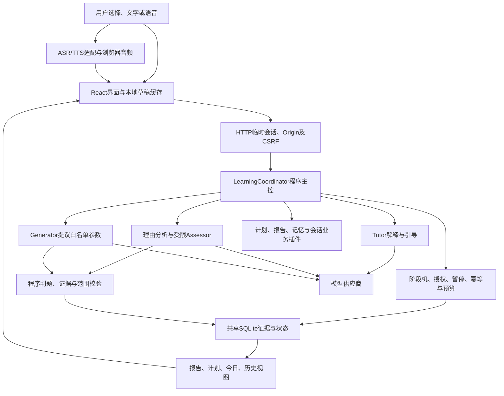

# 学伴小恩（小N）全维度产品评审与大众市场推广可行性分析

评审日期：2026年10月24日（Asia/Shanghai）。评审对象：本次冻结的工作区快照，起始HEAD `c14348f627cc7cd48d4a59bd889fb00b7280240a`，分支 `main`，**含24个产品源码/测试文件的未提交修改**。不是线上同版本验收。

**版本变动说明：** 收尾时HEAD已前进到 `59eec18`；`ProfessionalAnswer.tsx` 与 `src/voice/mic.ts` 另有后续语音输入改动。本报告测试/截图对应冻结快照，不给这些后续改动追加通过结论。已由起始HEAD＋当时补丁重建源码，237/237清单哈希一致，见[冻结源码包](/Users/ami/Documents/个人/ACC黑客松/文档/审查/2026-10-24-大众推广评审/evidence/reviewed-source.tar.gz)与[后续变动清单](/Users/ami/Documents/个人/ACC黑客松/文档/审查/2026-10-24-大众推广评审/evidence/later-source-drift.json)。当前主要风险相关服务端文件在本次收尾校验时与已审快照相同。

本报告由六种专业视角形成：产品负责人、教育学与学习科学、体验与交互、Agent架构、用户研究与增长、质量与安全。架构、教育/增长、质量安全分别独立审查，再由主评审交叉核对和综合。这是虚拟专家评审，不是六名现实从业者签字，也不是用户访谈或教育机构认证。

## 1. 执行摘要

**结论：现在不适合面向所有年龄段推广，也不适合把现有公网共享实例作为真实学生的正式服务。适合继续做合成材料演示，以及满足隔离和知情条件的受控可用性测试。应重新明确首批核心用户。**

推荐首批需求人群：**七年级、近期在基础代数某一步反复出错、愿意自己尝试、监护人知情的学生**。先完成一个明确场景：“把作业中卡住的一步想明白，下一道同类新题能独立尝试，隔天还能接着学”。成人可以先帮助发现操作问题，但成人体验者的好评不能代表学生需求成立。真实儿童测试须先通过本报告的安全与授权门槛。

### 最严重的三个问题

1. **共享公网服务没有用户隔离。** 不同cookie会话能读到彼此记忆、清空同一数据库；这是本次临时库HTTP探针复现的事实，不是仅缺一个登录页面。不能靠“轮流体验”扩展到正式用户。[S2、E2]
2. **“学习事实”并未在所有路径保持一致可信。** 普通think将含正确答案片段的疑问句当完成；非支持题型只凭两次模型答案相同就标为程序核验；生活算术与代数共用技能ID、跨情境观察相互“确认”，会让报告、进步卡或计划超出证据。[S3—S6、E3]
3. **没有证明目标用户会学得更好并主动回来。** 目前证据主要是代码、规则/HTTP测试、有限合成模型界面走查和历史实施者自验。没有可用于本次确认的真实学生长期独立表现、持续自愿使用或付费证据。全年龄拓展会同时放大内容、交互、安全与运营的不确定性。

### 最值得保留的三个优势

1. **程序保管原始尝试和帮助记录。** 严格评估路径区分提示后完成、原题改对、已见题和未见题独立完成，允许“未知/待核查”，比笼统的聊天后评分可靠。
2. **学生有控制权。** 主动开始、暂停、减量、确认计划、确认偏好、停用/更正/删除记忆已有具体实现；这比“越主动、记得越多越好”的Agent方向稳妥。
3. **有限领域的教学闭环值得验证。** 去括号负号的尝试、分级帮助、总结、新题核对和延迟复习具有可检验的结构。应修好并验证它，再讨论广覆盖。

### 三层能力不能混为一谈

| 层次 | 当前判断 | 需要的证据 |
|---|---|---|
| 技术上能支持很多人使用 | 当前共享实例连数据主体隔离都未建立；并发容量待验证 | 身份/数据隔离、授权、容量与恢复测试 |
| 产品对很多人有用 | 现有可信内容和引导仍主要是七年级有限数学；广泛效用未成立 | 多群体真实任务成功、范围覆盖、相对替代方案收益 |
| 很多人愿意持续使用 | 待验证 | 学生自主复访、延迟无帮助表现、留存原因、成本与付费意愿 |

### 评分规则与准备度

1=关键能力缺失/有阻断；2=局部可用但重要缺陷；3=有边界的受控试点水平；4=有目标群体稳定证据；5=多群体长期重复验证与可持续运营。**分数是本次评审判断，不是用户测量结果；未知不补零分，也不算平均总分。**

| 维度 | 评分 | 依据与可信度 |
|---|---:|---|
| 当前产品完成度（既定有限原型范围） | 3/5 | 有实际前后端、记忆、题库、报告、计划及测试；核心恢复和反馈仍有反例。源码/规则证据高 |
| 教育价值验证程度 | 待验证 | 机制有合理性，不等于本品产生学习增益；没有本次真实学习试验 |
| 用户体验成熟度 | 2/5 | 本次窄视口界面可操作、选项与理由分开；首次需求路由、模式目的、语音确认和错误反馈仍有风险。证据中 |
| 技术运营准备度（共享正式服务） | 1/5 | 无用户隔离，存在全库互删；预算及生产恢复SLA未证实。阻断证据高；容量待验证 |
| 大众市场适配程度 | 1/5 | 成年选项仍只配七年级；无大学/职场学习内容与产物核验。范围证据高；真实需求强度待验证 |
| 真实模型教学正确率、长期留存、单位经济性 | 待验证 | 不用合成provider、测试通过数或历史短句时延代替 |

## 2. 产品现状与证据清单

### 2.1 本次做了什么、没有验证什么

- 读取当前源码、PRD v1.1、主要实现/交接与最近语音检查文档，核对现有功能与旧文档差异。
- 本次运行：`npm test` **25/25**；`npm run test:agent` **280/280**，0失败0跳过；`npm run typecheck:agent`退出0；`npm run build`退出0。构建有>500kB chunk警告，主JS约558kB，gzip约174kB；这不是实测慢网性能。另有53条定向测试通过，与全套有重叠，**不相加报358或重复计数**。
- 用临时SQLite/内存库、合成模型做边界探针，复现跨会话互读互删、安全历史再次出站、宽松答案匹配、错误模型一致被标已验证、跨日片段恢复失败。日志和脚本随报告保留。
- 在Codex内置浏览器、本次约323×645视口走查：首次介绍→成年体验者资料→关闭可选记忆→首页文字请求→专业模式→生活故事选择→理由→下一站→今日→设置。真实HTTP、插件与临时数据库，**模型为脚本合成provider**。因此只证明这些界面/路由可达，不能证明真实模型措辞或教学质量。
- 未读取真实用户数据库/密钥，未调用收费真实模型，未录真人声音，未访问或修改生产学习数据。未做真机、读屏器、完整专业报告、计划确认到真实跨日的浏览器验收，也未做真实学生测试。评审团队未修改产品源码；新增文件仅是本次评审与证据。构建产物属于常规生成物。

证据等级：**A**=本次可复现规则/HTTP/界面行为；**B**=当前源码路径；**H**=历史文档、实施者自验，可能不对应当前工作区；**R**=外部一手资料；**J**=专家判断/场景推演；**U**=资料不足。可信度还依问题而定：A可证明互读，不能证明教育有效。

### 2.2 功能状态矩阵

“已实现且经过验证”均注明范围，绝不等于整版生产验收。

| 功能 | 状态 | 依据与边界 |
|---|---|---|
| 手机网页、四个主导航、设置/授权介绍 | 已实现且经过本次有限界面验证 | A+B；主导航为小N/专业模式/今日/成长，子页含报告、计划、任务、复习、记忆、监护演示等 |
| 首次年龄与教材选择 | 已实现但存在问题 | A+B；成人仍只能配七年级，年龄选择不等于服务端适龄策略 |
| 监护确认 | 部分实现；真实关联尚未实现 | 前端模拟确认；不验证真实监护人，不构成正式监护授权 |
| 综合对话阶段机 | 已实现但存在问题 | A+B；listen/probe/think/reflect等可执行；首次明确学习仍先倾听两轮 |
| 生活话题理解/逻辑观察 | 部分实现 | B；11类预置场景、一场最多一个场景；引用校验、拒绝中止；自然感与推断准确率U |
| 专业五模块访谈 | 已实现且有限验证；结论有问题 | A+B；本次完成第一模块及下一站可达；全套规则通过；标签/任务等值/完整真人流程未通过验证 |
| 静态题库与确定性判题 | 已实现且规则验证；存在内容映射风险 | A+B；58个新版唯一id/version：30生活故事+18核心+10补充；另16旧v1兼容题，总74，不能当74个独立知识点 |
| 六个子技能 | 已实现 | 数学语句、反例条件、去括号负号、合并同类项、一次/变化费用、二维旋转；不是全年级课程 |
| 去括号负号深教学闭环 | 已实现但存在问题 | A+B；分级帮助/总结/未见核对；本次复现跨日继续失败 |
| 受控生成题 | 已实现且规则验证 | A+B，真实模型效果主要H；只支持去括号与合并同类项模板参数，非任意学科出题 |
| 普通think完成与进步卡 | 已实现但存在问题 | A+B；子串匹配可产生虚假“自己算出”；严格loop路径另行判断 |
| 学习报告、计划、今日/复习、月阶段/历史 | 已实现；部分路径本次验证 | A+B；程序规则/HTTP通过；不代表真实跨月成效或所有真实模型流程 |
| 可选记忆确认、更正/停用/删除、期限与复核 | 已实现且本次规则验证 | A+B；已不是旧版stub；最多5条相关记忆入上下文、长期条目30天复核等机制存在 |
| 记忆语义相关性/真实个性化收益 | 部分实现，价值待验证 | B+U；目前含公共子串启发规则，不证明个性化更有效 |
| 完整聊天历史 | 已实现但存在隐私问题 | A+B；关闭偏好记忆仍存原文；缺单会话留存/删除与派生清除策略 |
| TTS与ASR/自动语音轮次 | 已实现；真机适用性资料不足 | B+H；最新语音文档已有真实服务端ASR/TTS短句证据，不能沿用旧PRD“ASR未配”作现状；本次未听验/真人麦克风验证 |
| 图片/OCR | 部分界面；真实识题尚未实现 | B；后端recognize仍抛not_implemented。上传入口不等于题目识别可用 |
| 公网托管/容器/备份脚本 | 已实现；生产保障待验证 | B+H；有部署记录，不等于当前工作区已部署或具备多用户运营能力 |
| 账号、云端用户隔离、真实监护关联 | 尚未实现 | A+B；临时会话+CSRF不是账号和租户边界 |
| 真实通知、教师端、付费闭环、通用多科目课程 | 尚未实现/只有方案 | 现有资料未见完整服务；不能据首页文案或模型通用知识补齐 |
| 全年龄动态课程、标准化五维测量 | 只有方向，尚未实现 | 无相应内容体系、常模/效度/公平性/跨群体验验证 |
| 真学生学习增益、持续留存、付费意愿、压测容量 | 缺乏资料，无法判断 | U；不是判定它们必然失败，而是不允许当已具备 |

### 2.3 真实功能架构

这是**程序编排的受控角色和插件系统**。存在独立prompt/权限/输出校验，不应宣传成多个自主Agent自由讨论就会产生更好的教学。当前事实层只有一个用户范围，模型和工具限制不能替代主体隔离。

### 2.4 关键证据索引

| ID | 当前依据 |
|---|---|
| S1 | [PRD v1.1](/Users/ami/Documents/个人/ACC黑客松/文档/PRD/学伴小N-产品需求文档-v1.1.md:73)、[当前App首次流程](/Users/ami/Documents/个人/ACC黑客松/outputs/xiaon/src/App.tsx:631)；PRD为较早设计/实现快照 |
| S2 | [HTTP会话与路由](/Users/ami/Documents/个人/ACC黑客松/outputs/xiaon/server/http/server.ts:31)、[全局view及reset](/Users/ami/Documents/个人/ACC黑客松/outputs/xiaon/server/agents/learning.ts:450)、[repository](/Users/ami/Documents/个人/ACC黑客松/outputs/xiaon/server/storage/repository.ts:59)、[部署单用户说明](/Users/ami/Documents/个人/ACC黑客松/outputs/xiaon/DEPLOY.md:111) |
| S3 | [答案匹配](/Users/ami/Documents/个人/ACC黑客松/outputs/xiaon/server/agents/stages.ts:84)、[进步卡](/Users/ami/Documents/个人/ACC黑客松/outputs/xiaon/server/plugins/progress/index.ts:25)、[普通完成写入](/Users/ami/Documents/个人/ACC黑客松/outputs/xiaon/server/agents/learning.ts:252) |
| S4 | [开放题模型一致核验](/Users/ami/Documents/个人/ACC黑客松/outputs/xiaon/server/plugins/problems/index.ts:46)、[verified写入](/Users/ami/Documents/个人/ACC黑客松/outputs/xiaon/server/plugins/problems/index.ts:76) |
| S5 | [生活题与技能映射](/Users/ami/Documents/个人/ACC黑客松/outputs/xiaon/server/plugins/assessment/catalog.ts:15)、[技能状态聚合](/Users/ami/Documents/个人/ACC黑客松/outputs/xiaon/server/plugins/assessment/state.ts:54)、[专业标签](/Users/ami/Documents/个人/ACC黑客松/outputs/xiaon/shared/learning-contracts.ts:164) |
| S6 | [专业观察confirmed](/Users/ami/Documents/个人/ACC黑客松/outputs/xiaon/server/plugins/interview/index.ts:182)、[对话观察趋势](/Users/ami/Documents/个人/ACC黑客松/outputs/xiaon/server/plugins/conversation/index.ts:59) |
| S7 | [跨日新场次](/Users/ami/Documents/个人/ACC黑客松/outputs/xiaon/server/agents/learning.ts:99)、[教学片段场次约束](/Users/ami/Documents/个人/ACC黑客松/outputs/xiaon/server/plugins/learning-loop/index.ts:85) |
| S8 | [安全规则](/Users/ami/Documents/个人/ACC黑客松/outputs/xiaon/server/agents/stages.ts:10)、[前端先缓存history](/Users/ami/Documents/个人/ACC黑客松/outputs/xiaon/src/components/learning/ChatPanel.tsx:84)、[localStorage写入](/Users/ami/Documents/个人/ACC黑客松/outputs/xiaon/src/agents/useLearning.ts:20) |
| S9 | [记忆实际实现](/Users/ami/Documents/个人/ACC黑客松/outputs/xiaon/server/plugins/memory-flow/index.ts:27)、[有效记忆过滤](/Users/ami/Documents/个人/ACC黑客松/outputs/xiaon/server/core/events.ts:55)、[聊天保存](/Users/ami/Documents/个人/ACC黑客松/outputs/xiaon/server/agents/learning.ts:206) |
| S10 | [生活观察11场景](/Users/ami/Documents/个人/ACC黑客松/outputs/xiaon/server/plugins/life-scenes/index.ts:9)、[两轮listen门槛](/Users/ami/Documents/个人/ACC黑客松/outputs/xiaon/server/agents/stages.ts:50)、[Tutor约束](/Users/ami/Documents/个人/ACC黑客松/outputs/xiaon/server/agents/roles.ts:28) |
| S11 | [专业选项交互](/Users/ami/Documents/个人/ACC黑客松/outputs/xiaon/src/components/professional/ProfessionalAnswer.tsx:1)、[专业流程及自由练习](/Users/ami/Documents/个人/ACC黑客松/outputs/xiaon/src/components/professional/ProfessionalModeView.tsx:94) |
| S12 | [真实语音历史证据与限制](/Users/ami/Documents/个人/ACC黑客松/文档/审查/2026-10-24-语音链路检查与时延实测.md:1)、[当前语音串行轮次](/Users/ami/Documents/个人/ACC黑客松/outputs/xiaon/src/voice/conversation.ts:1)、[模型非流式调用](/Users/ami/Documents/个人/ACC黑客松/outputs/xiaon/server/providers/glm.ts:18) |
| E1 | [本次源码237文件SHA-256清单](/Users/ami/Documents/个人/ACC黑客松/文档/审查/2026-10-24-大众推广评审/evidence/source-manifest.json)、[工作区补丁](/Users/ami/Documents/个人/ACC黑客松/文档/审查/2026-10-24-大众推广评审/evidence/product-diff.patch) |
| E2 | [本次HTTP/隐私探针结果](/Users/ami/Documents/个人/ACC黑客松/文档/审查/2026-10-24-大众推广评审/evidence/quality/probes.log)、[可复现脚本](/Users/ami/Documents/个人/ACC黑客松/文档/审查/2026-10-24-大众推广评审/evidence/quality/probes.ts) |
| E3 | [三个架构反例结果](/Users/ami/Documents/个人/ACC黑客松/文档/审查/2026-10-24-大众推广评审/evidence/xiaon-architecture-repros-20261024.log)、[脚本](/Users/ami/Documents/个人/ACC黑客松/文档/审查/2026-10-24-大众推广评审/evidence/xiaon-architecture-repros-20261024.mjs) |
| E4 | [本次Agent测试](/Users/ami/Documents/个人/ACC黑客松/文档/审查/2026-10-24-大众推广评审/evidence/quality/test-agent.log)、[原规则](/Users/ami/Documents/个人/ACC黑客松/文档/审查/2026-10-24-大众推广评审/evidence/xiaon-product-domain-test-20261024.log)、[构建](/Users/ami/Documents/个人/ACC黑客松/文档/审查/2026-10-24-大众推广评审/evidence/xiaon-audit-build-20261024.log) |

## 3. 大众用户适配性分析

下面评分只评价**当前内容与流程适配**，可信度中（B+A+J）；不是人群满意度或学习效果得分。低动机/学习困难是跨年龄需求，不能当一种统一人格。

| 用户群 | 最主要需求与使用动机 | 理想首次流程 | 最有价值 / 最不需要 | 当前适配 |
|---|---|---|---|---:|
| 小学生及监护人 | 读懂题、基础数感、少代做、降低亲子冲突 | 监护知情→一件熟悉问题→语音/图示→孩子尝试→有限过程反馈 | 一步帮助、朗读 / 代数先修、五维月报告 | 2/5；低年级更低，真实监护未就绪 |
| 初中生 | 当天一道卡题、怕被评价、希望次日自己会 | 输入卡点→确认题面→尝试→按需提示→未见题→回顾 | 限定知识点闭环 / 强制五维检查 | 七年级限定范围3/5；整个初中不可据此给3分 |
| 高中生 | 概念辨析、复杂题、证明、考试效率 | 学科/目标→具体题→关键步骤→变式核对 | 证据型纠错的方向 / 初一故事测评与固定慢节奏 | 1/5 |
| 大学生 | 课程材料、论文、推导、项目、来源 | 课程片段→引用出处的解释→应用或推导→自测 | 基于材料的反馈方向 / 儿童故事和五维画像 | 1/5 |
| 职场学习者 | 立刻解决Excel、编程、语言等真实任务 | 说明产物与时间→演示→自己操作→检查结果 | 短任务续学方向 / 全模块测试、泛月目标 | 1/5 |
| 成年自学/终身学习者 | 兴趣、补基础、自己掌握路径和节奏 | 选主题/水平/时间→解释/复述→小应用→复习 | 尊重自主、偏好与跨次进度 / 默认儿童身份 | 广义1/5；基础代数小群2/5，真实价值待验证 |
| 零基础/学习困难/低动机 | 知道第一步、可胜任感、减少挫败 | 极短选择→范例或图示→一个小动作→允许停 | 不评判、可暂停、分级帮助 / 连续追问和能力强弱标签 | 2/5；读写/执行困难专项适配待验证 |

| 用户群 | 认知/交互障碍 | 可能持续使用的理由（假设） | 可能放弃的原因（假设） |
|---|---|---|---|
| 小学生及监护人 | 长故事阅读、符号/坐标先修、成人代操作 | 孩子真的能独立做一步，家长少冲突 | 首题太难、监护只演示、家长被迫当翻译 |
| 初中生 | 支持题范围小；普通题没有OCR；模式不直观 | 今晚卡点得到解决，隔天新题还有反馈 | 上传作业不能识别、绕路做测评、跨日恢复失败 |
| 高中生 | 数学深度、证明和公式表达不足 | 只有真实高中专项完成后才存在可信理由 | 时间投入与有效内容不成比例 |
| 大学生 | 无课程材料真值/引用链，报告与课程目标脱节 | 自己的材料被理解并能用于应用 | 通用助手更直接，重复说明背景 |
| 职场学习者 | 未连接产物与实际标准，短句/固定追问过慢 | 工作成果能被核验、学后能执行 | 陪聊耗时、不能完成真实任务 |
| 成年自学者 | 成年选项没有不同内容、语气与目标 | 偏好被尊重、具体基础知识长期接续 | 被幼化、题库用尽、无自己主题 |
| 学习困难/低动机 | 读写负担、转写误差、解释即测评的压力 | 小成功可自主获得，失败可恢复 | 解析失败误当不会、被追问/贴标签、只由家长催促 |

**推荐：统一任务骨架＋按目标动态适配＋年龄与数据权限分层。** 统一的是“目标→问题→尝试→帮助→核对→回顾”；动态调整先修、解释长度、题材、输入方式与帮助强度；儿童/青少年/成人的数据授权和语气分层。现在无需做七套产品，也不能只换称呼就宣布自动适龄。

## 4. 完整产品与技术评审

### 4.1 六个视角分别判断

| 专业视角 | 独立判断 | 最优先行动 |
|---|---|---|
| AI产品负责人 | “陪伴、五维测评、月计划、生活闲聊、讲题”同时争夺首页价值；首批用户不知道首先买到什么 | 只承诺解决一个可支持的学习卡点；首页用实际任务而非Agent或能力维度组织 |
| 教育与学习科学 | 严格作答证据有价值，新故事映射和泛维度判断超出效度 | 拆开具体技能；撤下一般能力/进步断言；测无AI独立表现 |
| 体验与交互 | 温和视觉、停止与选项设计有基础；强制倾听、先测后练、空今日和技术文案形成价值绕路 | 首次明确需求一轮直达；测评后置；空态给一个直接可完成任务 |
| Agent架构 | 程序编排与权限正确，但普通think、strict loop、interview在“完成/掌握”上多套逻辑 | 一套可信证据API供卡片、报告、计划读取，Agent只做必要语义任务 |
| 用户研究与增长 | 生活题降低了部分表面陌生感，未证明持续真实需求；广投只会得到混杂且难解释的反馈 | 聚焦目标学生，自带卡题，观察自主复访而非宠物点击 |
| 质量安全 | 当前共享地址可能串记录、互删；未成年人保护仍是原型状态 | 真实用户接入前先隔离与授权，修跨轮敏感history，做真实设备与恢复验收 |

### 4.2 具体问题与严重程度

| 编号 | 类型 / 严重程度 | 问题与当前证据 | 产品影响 |
|---|---|---|---|
| F01 | 架构/安全 P0 | 不同cookie共享全库，reset全库，E2 | 真实用户互看与互删；所有成长记录可能串号 |
| F02 | 事实可靠性 P0 | `我不知道是不是 x+5，也可能是 x-5` 被普通think接受，进步卡称自己算出，E3/S3 | 犹豫/猜测被写成学习成就 |
| F03 | AI可靠性 P0 | 非支持题型双模型一致也记verified/program_computed，E3/S4 | 错误共识包装成可信参考答案，可能向后污染教学 |
| F04 | 恢复/留存 P0 | 未结束loop跨日新场次后help报invalid_state，E3/S7 | 最有意愿隔天回来的用户无法继续 |
| F05 | 教育/内容 P0 | 算零钱共用like-terms、方向/钟面共用坐标旋转技能，S5 | 不等价任务可升级技能/先修和计划，错误归因 |
| F06 | 评估/反馈 P0 | 单题+理由可获整模块“掌握得不错”；不同情境方向一致称confirmed；跨话题信号写进步，S5/S6 | 家长/学生容易把有限观察当一般认知测量 |
| F07 | 隐私 P0 | 安全轮后端本轮不入chatLog，但前端先持久缓存，下一正常轮history可出站，E2/S8 | 当前轮拦截不等于全生命周期隔离，告知不能承诺从不保存/发送 |
| F08 | 未成年人 P0 | 前端可自己点模拟监护；服务端无核验主体；风险规则中文关键词为主，S1/S8 | 真实未成年人保护与授权无法靠UI保障 |
| F09 | 定位 P1 | 成人体验仍七年级；首次明确学习也先listen两轮，S1/S10 | 用户认为产品不理解自己，首次价值延后 |
| F10 | 隐私/体验 P0告知、P1管理 | 关偏好记忆仍存原文/小结，过期不等于删除；云端仍称“这台设备”，S9 | 用户控制的心智模型和实际数据流不一致 |
| F11 | 功能缺失 P1 | OCR未接；真实作业进入闭环成本高，S4 | 面向“帮我看题”推广时出现关键入口落差 |
| F12 | 交互 P1 | 五模块至少10轮学生答复，错后可到20轮；完成前自由练习受限，S11 | 一道题需求被扩为一轮测评，价值与投入不成比例 |
| F13 | 运营 P1 | coordinator全局active、view全量、权限fingerprint频繁全表读、缺真实usage/预算账本 | 不能推出多人容量、历史规模成本或毛利 |
| F14 | 可靠性 P1 | 双模型、JSON修复、20秒hedge可增加HTTP调用；非流式模型与音频轮次，S12 | 等待感、额外计费与超时，取消不等于供应商免计费 |
| F15 | 可及性 P1/待验证 | 有标签、16px输入、focus/reduced-motion及大字设置；未做完整读屏/键盘/真机验证 | 不能称无障碍合规；空间题图像描述、语音错误公平性需实测 |
| F16 | 产品假设 待验证 | 无主动复访/学习增益/愿付价格证据 | 不应把用户增长投放替代产品价值验证 |

P0是进入相应推广阶段的门槛，不代表不修完全部P0就不能给成人看合成材料演示。涉及真实未成年人的P0须在该群体招募前完成。

### 4.3 本次界面走查的发现

按第6节截图步骤：①介绍清楚限定七年级，是诚实边界；②成人资料仍只七年级，直接否定当前全年龄定位；③可选记忆需显式选择、可关闭，是优势，但不说明关闭一切历史；④首页可说话，却没有同等显著的“直接解决一道题”任务入口，且记忆关闭提示含“去打开”，应避免作为持续劝开；⑤首次学习请求仍被倾听阶段处理，截图回复是fixture台词，不能声称真实模型一定无故共情；⑥“专业模式”实际是测评，不是用户自然理解的更专业讲题；⑦⑧按钮选择后再问理由，比首行字母输入更好，但长题面与理由输入需在窄屏来回滚动；⑨点亮地图后还要再进对话；⑩今日无计划时只有去建议，缺直接开始小任务；⑪设置有控制入口，但原型、离线/联网、开发失败演示与真实数据存储用语混杂，需在发布版精简。

这些是当前界面和源码的观察；实际年龄偏好、自然感、理解成功率及无障碍效果仍需用户测试。

## 5. AI Agent、记忆与能力评估专项审查

### 5.1 主对话：教育价值取决于用户做了什么

阶段控制、停止优先、限制直接泄题有帮助，但“多问一句”不自动产生学习。一直反问会让初学者耗尽工作记忆；只接住情绪会耽误明确求解者；只说短句也不能满足复杂推导。当前listen至少两轮和七年级口吻是程序策略，应改为：明确请求→直接进入适合的任务；表达情绪困扰→先回应与选择；纯闲聊→不默认教育化。

建议教学事件契约只记录可观察事实：`goal / taskRef / attempted / helpLevel / verifiedAttemptRef / explanationQuote / nextCheck / selfReportedConfidence`。用户说“懂了”可以结束，不能写成掌握；用户拒绝解释不等于能力弱。提示应可升级到范例或直接解释，而非把苏格拉底式追问当唯一教学方法。

### 5.2 自然观察：可以是辅导线索，不能是隐形测量

当前只有理解、逻辑两维观察，并非普通聊天评估完整五维。程序有逐字引文、次数限制、拒绝即止，提示词也提醒背景知识不是能力证据。这些限制值得保留，但**引文真实≠推断正确**；篮球犯规依赖规则知识，旅游/建筑、做饭也受生活经历影响。

改进：把观察明确设为可关闭的辅导线索；“只聊天”不产生观察；提供“我不熟悉这个例子/识别错了/我不同意这个记录”；将知识不足、读写/转写误差、歧义、拒答、疲劳、求助分别编码。一个负向信号最多生成“下次换一个例子确认”，不能直接降低能力、确定月计划或固化人格。

验证自然感应观察拒绝率、追问退出率、是否感到被测试，并比较说明观察与不说明观察的理解/信任，而不是以“用户没发现”当成功。

### 5.3 五维体系：合理的分类，不是已建立的测量模型

| 维度 | 当前实际可观察范围 | 可以说什么 | 不能说什么 / 应补的验证 |
|---|---|---|---|
| 理解 | 数学条件转换、复述、生活解释 | 本题如何解释了某个条件 | 一般理解力高低；需独立知识/阅读控制及多任务重复 |
| 逻辑 | 反例、条件、理由与结论关系 | 本次举出了满足条件的反例 | 一般逻辑能力已测准；需不同逻辑结构而非仅一道熟悉题 |
| 计算 | 六技能中很窄的算术/一次式 | 当前运算结果、帮助及错误类型 | 全学科计算能力；需领域与复杂度边界 |
| 想象 | 当前主要是空间想象、方向/旋转 | 某次方向或图形转换表现 | 创造力、开放想象、人格潜力；原“想象”应明确收窄 |
| 建模 | 一次费用与变化费用等线性关系 | 本任务变量/常数与现实量对应 | 通用建模能力；需假设、变量、约束、验证完整任务 |

五维有直观教学组织价值，但不是相互独立、穷尽所有学习能力的公认量表。当前没有常模、信度、构念/预测效度、跨年龄测量等值性或公平性证据。不要强打“科学测量分”。底层跨日期/场次/未见题规则是审慎的产品规则，也不能因2题2日期就称心理测量稳定。

**立即撤下或改写**：“掌握得不错”→“本题结果与理由已核实”；“专业模式确认了聊天能力”→“另一个任务出现了类似表现，不能直接比较”；“逻辑进步”→并列两个具体任务表现。远迁移需新结构/新情境，换数题只能说明同题族变化。

### 5.4 综合模式与专业模式：按用户目的重命名并减少断裂

当前综合模式是陪聊/卡点/思考/小结；专业模式是五模块访谈与报告、月阶段衔接。普通用户可能将“专业”理解成更强的讲题或专家解答；这与实现不一致。建议首页只有“解决一个问题 / 带我练一步 / 先聊聊”任务目的；“看一个学习卡点”作为可选入口，告知大致时长与输出，允许只做一项。不在用户解决问题前强制全模块测评。

共享同一作答事实、提示/暴露记录、任务ID和恢复状态。保留底层权限边界，隐藏后台角色和重复报告概念；综合聊天→专项练习→回顾应是一段连续任务，而不是用户学习多个模式制度。

### 5.5 记忆：先管理数据用途，再讨论记忆Agent

当前确认/更正/停用/删除、7/30天或长期复核、调用前有效性过滤已经实现。相关性包含两字公共子串启发、最多5条，不应立即加向量数据库或新Agent。先检验偏好是否实际改变回复、会不会错误联想和带来负担。

| 数据 | 建议保存 | 控制与边界 |
|---|---|---|
| 当前题面/作答/提示/判定 | 为继续学习所需的最小事实 | 明确期限与学习证据用途，附任务/帮助/时间和范围 |
| 用户认可的解释偏好、目标、时间预算 | 用户确认后保存，可到期 | 来源、确认、适用情境、有效/复核时间、冲突版本 |
| 经核实卡点与复习进度 | 引用证据对象，不复制泛化标签 | 证据修订时更新投影，保留可解释历史 |
| 聊天原文与小结 | 默认最小化；历史可单独选择 | 临时会话、单会话删除/导出、派生清除；不强求清空全部进度 |
| 情绪、家庭冲突、心理/智力标签 | 不默认长期保存 | 不从语气/声音推断诊断或能力；安全处理另定必要记录策略 |
| 真名、学校、联系方式、他人隐私 | 非当前辅导所需，不收集 | 用户输入时提醒/最小化，不能只依靠用户不输入 |

关“偏好记忆”不等于关“聊天历史”或“观察”。现在这些概念需要分别显示；过期不再入context也不等于物理删除。删除应覆盖派生小结/索引/操作回执相关内容，并在备份恢复时遵守删除账本，避免复活。公网应写“服务器保存”，而非笼统称“这台设备”。第三方ASR/模型/TTS处理与其保存政策必须独立核查。

### 5.6 成长反馈：从聊天活跃改为无帮助的可比表现

最小成长卡：本次具体问题；自己做到了什么；用了哪些帮助；一句学生总结（可跳过）；下一次怎样核对。不得由模型自行添加“更自信/更理解”的心理结论，信心必须由学生自己报告。

核心指标建议为：有效闭环完成、提示依赖变化、同技能未见题独立表现、延迟独立表现、任务耗时和退出原因。聊天次数、摸宠物、在线时长只作为行为数据，不能代表教育成效。跨情境/难度/帮助方式不可比时，不画增长趋势。

外部证据支持测试这些机制，而不是替代本品实证：[Karpicke与Bauernschmidt的间隔提取研究](https://pubmed.ncbi.nlm.nih.gov/21574747/)未发现某一种相对间隔安排天然最优，所以1/3/7/14天只能是可调策略。[Bastani等的高中数学实验原文](https://hamsabastani.github.io/education_llm.pdf)区分了有AI时表现与撤掉AI后的学习，说明“帮助时做对”不能当学会。结构化AI导师也可能在特定条件有效，但[Kestin等的特定大学物理实验](https://www.nature.com/articles/s41598-025-97652-6.pdf)不能外推成本品、全年龄或长期成效。

### 5.7 哪些需要Agent，哪些应是程序

| 工作 | 适合实现 | 取舍 |
|---|---|---|
| 解释、澄清、按需改写/类比 | 一个受控Tutor模型调用 | 有用户价值时才调用；当前任务意图优先 |
| 开放理由的证据提取 | 受限Assessor＋程序验证引文/结果 | 保留不确定性和教师抽检，不能完全信模型 |
| 标准算式、选项、完成判定、暂停/幂等/权限 | 确定性程序 | 不委托Agent判断真实点击或持久化事实 |
| 选题、复习到期、计划预算 | 规则/业务服务 | 不为“多Agent”再增加推理轮次 |
| 报告事实、成长数据 | 一套证据投影 | 可选模型润色，失败直接模板输出 |
| 记忆提议 | 与Tutor同轮结构化候选，用户确认 | 筛选/到期/删除用规则，暂不新增自主Memory Agent |
| 换数练习 | 程序模板优先；必要时受控参数提议 | 只有质量/难度收益成立才值得模型生成 |

先精简重复措辞调用、修复和双路hedging，再决定是否上流式复杂设施。测实际HTTP次数、tokens、费用和端到端等待；当前没有证据可以给出每位用户成本或承载人数。

### 5.8 专项评分

| 专项 | 1—5评分 | 证据与局限 |
|---|---:|---|
| 程序主控、工具权限、原始证据 | 3/5 | A+B；有受控边界与测试，跨路径事实仍不一致 |
| 普通think/严格loop/专业报告的一致性 | 2/5 | A+B；存在可复现错误与跨日阻断 |
| 自然观察的产品可解释性 | 2/5 | B+J；有引文/次数限制，效度、公平性与接受度U |
| 记忆生命周期基础 | 3/5 | A+B；确认与取用控制存在，聊天/派生/备份生命周期不足 |
| 五维科学测量有效性 | 待验证 | 没有量表、效度和跨年龄校准，不能打确定分 |
| 真实模型教学可靠性与语音体验 | 待验证 | 本次没有真实模型或真机教学验收 |

## 6. 典型用户完整使用流程评审

### 6.1 七个差异明显的场景模拟

**以下全部是基于当前范围的假设推演（J），不是访谈、真实留存或用户引语。心理反应也是假设。** 产品已确认响应引用源码/本次路径；未来时段描述的是可能结果，不冒充已经经历数周。

#### A. 9岁小学生与监护人：想做分数作业

| 阶段 / 用户想做什么 | 当前可能响应 | 问题与可能心理反应 | 优化建议 |
|---|---|---|---|
| 首次：找到年龄适合的练习 | 年龄可选未满14，但年级只有七年级、监护仅演示 | “是不是进错产品了”；家长接管操作 | 当前不作为正式招募对象，先真实告知支持范围 |
| 当天：读懂自己的分数题 | 无真实OCR，现有内容主要代数/生活故事 | 知识先修和阅读困难混在一起，“我又不会” | 未来另建小学先修与图示包，先让孩子做一个小动作 |
| 两三天：希望自己完成 | 今日依赖已确认计划和可信尝试 | 没有适龄任务就没有可重复价值 | 先验证小学单场景；家长端只看必要过程，不代做 |
| 两周：继续同课程学习 | 没有小学课程路径 | 无持续回来理由，家长可能放弃 | 先补内容/监护和公平性，再讨论低龄拓展 |

#### B. 12岁初一学生：去括号总漏一个负号

| 阶段 / 用户想做什么 | 当前可能响应 | 问题与可能心理反应 | 优化建议 |
|---|---|---|---|
| 首次：直接解决今晚卡题 | 综合模式先倾听；题面需确认，支持域有限 | 可能觉得绕；也可能因温和口吻愿意说 | 明确问题一轮进入题面核对，保留可选情绪支持 |
| 当天：先试、看提示、改对、做新题 | 严格loop已有分级帮助/新题路径 | 有价值；但普通think另有虚假完成风险 | 同一可信判题事实供所有卡片使用，改对写提示后 |
| 次日：从停下处继续或到期核对 | 计划复习可安排；旧loop跨日help已复现失败 | “不是说能接着学吗”；伤害高意愿复访 | 修episode/session绑定，旧题保留已见/帮助历史 |
| 两周：跟上课堂相邻知识 | 6技能/2类受控出题覆盖窄 | 初次有效也可能因课程换章流失 | 先补已核验的相邻高频卡点，用学习表现验证 |

#### C. 16岁高中生：想理解导数与证明

| 阶段 / 用户想做什么 | 当前可能响应 | 问题与可能心理反应 | 优化建议 |
|---|---|---|---|
| 首次：说明考试与题目 | 14—17年龄可选，但仍七年级内容与口吻 | “不是给我用的” | 宣传明确范围，不吸引无法服务的需求 |
| 当天：要求复杂推导 | 通用模型可能聊天，可信题库和核验不覆盖 | 回答听起来可懂，却没有可信高阶教学闭环 | 范围外明确提示，不能用模型会回答代替产品支持 |
| 数天：复习同考点 | 没有导数平行题/证明rubric | 无有效复习，转用现有工具 | 未来只选一个高中专项验证 |
| 数周：判断是否值得继续/付费 | 无相应独立表现与课程进度 | 时间成本过大 | 未有内容与效果证据前不推广高中版 |

#### D. 20岁大学生：学统计课程与论文

| 阶段 / 用户想做什么 | 当前可能响应 | 问题与可能心理反应 | 优化建议 |
|---|---|---|---|
| 首次：带课程片段/论文来 | 成人体验者但年级不变，缺完整材料知识源链 | “为什么让我选初一” | 成人材料学习作为独立假设，不混进现有首批 |
| 当天：解释概念并应用 | 短句/追问可以聊；不存在课程真值/引用验证路径 | 普通聊天可被替代，可能误信结论 | 引用原材料→应用→核对作为未来最小闭环 |
| 数天：接续上次课程目标 | 记忆能留偏好，小结能接话 | 偏好不补课程结构，报告不反映统计学习 | 保存课程目标/材料引用，不用五维替代知识进度 |
| 数周：看课程能力增长 | 当前五维/6技能不能覆盖 | 不再回来 | 先与基于材料的成熟工具比较，证明额外价值 |

#### E. 29岁职场学习者：20分钟学会一个Excel任务

| 阶段 / 用户想做什么 | 当前可能响应 | 问题与可能心理反应 | 优化建议 |
|---|---|---|---|
| 首次：给出报表产物目标 | 默认学伴式倾听、两句短回复 | “能直接帮我做吗” | 未来以产物、时间预算和现有水平进入 |
| 当天：自己操作并找错 | 未连接工作文档/公式执行/产物标准 | 短问答多，真实结果无人核验 | 教一步→本人操作→读可验证结果；勿以聊天作为完成 |
| 次日：换一张真实表格 | 没有工作任务体系 | 相同输入重复背景，工具负担加重 | 只存明确任务与偏好，按材料和目标接续 |
| 数周：考虑付费 | 实用任务价值尚未成立 | 对比通用助手没有额外理由 | 当前不投放，未来先一个职业专项盲测 |

#### F. 45岁成年自学者：重新补基础代数

| 阶段 / 用户想做什么 | 当前可能响应 | 问题与可能心理反应 | 优化建议 |
|---|---|---|---|
| 首次：承认基础薄弱但希望被尊重 | 成年体验仍配七年级及儿童故事 | 容易感到被幼化 | 可做成人基础数学小样本，语气与题材由用户选 |
| 当天：理解负号并试题 | 支持域恰好匹配，分步可能有用 | 这是成人中较可能有效的小群，不等于终身学习全覆盖 | 保留任务闭环，让用户选择直接解释或一步提示 |
| 数天：记住解释/时间偏好 | 确认可选记忆能参与上下文 | 关联规则可能不准；关记忆还留聊天可能误解 | 清晰区分历史与偏好，允许单会话删除 |
| 数周：沿自己的目标前进 | 知识点/未见题容量有限 | 有初始收获但路径断 | 验证成人需求强度，再补有限主题，不自动扩全学科 |

#### G. 14岁低动机、读写困难学生：想先休息

| 阶段 / 用户想做什么 | 当前可能响应 | 问题与可能心理反应 | 优化建议 |
|---|---|---|---|
| 首次：只想歇一会或聊游戏 | 可休息/拒绝，是优势；生活追问可能触发 | 若分享后被问原理，可能觉得又在被考 | “只聊天、不做学习观察”，拒绝不再追问 |
| 当天：愿意试一个很小动作 | 长故事/解释理由仍有读写负担 | 说不清可能源于表达、不是不会 | 短题/图示/范例/转写确认，允许跳过解释并保留未知 |
| 数天：希望失败不要变成标签 | 观察partial可能被后续报告确认 | 羞耻、隐藏真实困难或离开 | 分开内容陌生、解析失败、疲劳/拒绝与技能表现 |
| 数周：寻找持续小成功 | 无自发回访证据，家长催促容易混淆留存 | 表面使用时长可能没有学习收益 | 统计自主任务尝试和无帮助表现，不以聊天次数激励 |

### 6.2 本次实际界面流程与健康状态

下面11步是实际走查，不是上述模拟。所有截图使用本次保存且复核的原始文件。视口图只显示当时可见部分；不是全页图，也不把需要正常滚动误判为页面丢失。第5步台词来自合成fixture，不代表真实模型。

| 步骤 | 实际操作 / 健康状态 | 关键观察 |
|---|---|---|
| 01 | 首次介绍 / 可用 | 清楚写七年级与AI边界，长页需要滚动 |
| 02 | 年龄/年级资料 / 适配问题 | 成年可以选择；年级仍只有七年级，监护演示可见 |
| 03 | 记忆选择 / 局部清楚 | 默认未代选，显式选择不记住；观察和历史范围需更清楚 |
| 04 | 关闭记忆首页 / 可用但价值不明确 | 宠物/对话突出，直接学习入口不够显著；关闭提示不等于所有历史关闭 |
| 05 | 明确学习请求 / 路由需改 | 仍走倾听；fixture共情台词不用于真实模型结论 |
| 06 | 专业模式介绍 / 可达、定位模糊 | 实际是五站测评，专业含义不清，输出后置 |
| 07 | 生活故事选项 / 按钮可用 | 题面长，选项单选式操作；该截图是选项区 |
| 08 | 原因说明 / 可用、负担待测 | 选项后再说理由，有语音转写再确认说明；未启麦克风 |
| 09 | 第一站后下一站 / 可达 | 正确作答/理由后进入下一站；没有据此审查完整报告 |
| 10 | 今日空态 / 可用但接续弱 | 无计划/队列时可去建议，缺当前小任务 |
| 11 | 设置 / 可达、发布语义需改 | 有记忆/授权控制；“本地”“这台设备”与公网存储不一致 |

**01 首次介绍**

**02 资料与年龄选择**

**03 可选记忆选择**

**04 关闭记忆后的首页**

**05 明确学习请求后的倾听阶段（合成台词）**

**06 专业模式介绍**

**07 故事题的选项区**

**08 理由输入**

**09 第一站完成后的接续区**

**10 今日空态**

**11 设置**

## 7. 竞品差异化与大众推广可行性

### 7.1 已核实的事实与本报告推断

本次核查官方文档，不冒充已实际体验这些竞品，也不比较未经验证的正确率、国内可达性、价格或留存。不同产品适用地区/计划/年龄需另核。

| 产品/工具 | 本次核实的官方事实 | 对小N的推断（J） |
|---|---|---|
| ChatGPT通用对话/学习工作流 | 官方文档列出自然语言解释信息、文件上下文、来回讨论；官方学习用例可将研究/课程资料组织为可核查的学习报告。[官方使用文档](https://learn.chatgpt.com/docs/use-chatgpt)、[学习概念用例](https://learn.chatgpt.com/use-cases/learn-a-new-concept) | 不能用“别人只给答案、小N会追问”构建差异；追问、解释和个性口吻容易被请求。小N须证明具体流程和学习证据带来额外收益 |
| Khanmigo | 官方介绍引导学习者思考、用提示/问题帮助发现答案，并与Khan Academy学习内容关联；可用范围与商业条件本次不比较。[官方介绍](https://www.khanmigo.ai/)、[社区与使用说明](https://support.khanacademy.org/hc/en-us/articles/13860282793869-What-are-the-Community-Guidelines-for-Khanmigo) | 受控启发并非独占；课程资产与教师设计对信任很关键。小N应建立窄而可信的本地内容与核验 |
| NotebookLM相关官方帮助（当前页称Gemini Notebook） | 可围绕用户源材料问答、选择来源，用引用定位材料并供核查；提供Learning Guide风格。[官方帮助](https://support.google.com/gemininotebook/answer/16179559?hl=en-MY) | 大学生/成人更需要“我的材料”与可核查出处，小N目前在此缺能力；不宜只改成成人口吻争夺该场景 |
| Anki | 官方说明主动回忆与间隔重复是其学习基础。[官方手册](https://docs.ankiweb.net/manual/background) | 复习不需要复杂Agent才有价值。小N若不能把对话变成可信、低负担的再次独立尝试，可能不如简单工具 |

以上是功能文档事实，**不是这些产品教育效果优于小N的实测结论**。本次没有对它们的最新学习模式做完整操作或效果评测；不宣称竞品缺少记忆、成长追踪或安全机制。

### 7.2 用户为什么选择小N

目前能提出的是**待验证的差异化主张**：

> 不会写提示词也能从一个具体卡点开始；小N记清你在哪一步卡住、用了什么帮助，给你一个可核验的下一步，并在之后用未见题检查能否独立完成。

这个主张比“有五维、多Agent、长期记忆、情绪陪伴”更容易理解与验证。必须同时满足：题目确实支持、回应不绕路、判题可靠、记录可控、隔天能继续、看得出下一步收益。当前代码给出了部分基础，上述反例尚未解除，因此不能直接写成已兑现的营销承诺。

对只需快速问百科、读论文、生成工作产物的用户，当前没有充分理由要求其从通用工具迁移。产品负责人应接受这一点，而不是用功能堆叠追平所有场景。

### 7.3 获客、留存与付费

首批入口是具体问题：“去括号总丢一个负号，怎样下次自己发现？”而非“测你的五维能力”。用真实学习场景招募，允许只解决一题。教师/家长可协助招募，但**学生主动愿意使用**须单独确认；学校采购不等于学生留存。

建议付费价值先验证为“可持续解决高频卡点＋可靠复习与有限家长过程反馈”，不是为Agent数量、人格记忆或测评标签收费。先问现有替代方案/实际投入/愿意放弃什么，再做真实价格与继续使用选择；问卷里的“愿意付费”不等于付款行为。本次不能给合理售价、LTV/CAC、转化率或市场规模数字。

增长漏斗按有效行为定义：看到适用范围→提交支持题/选任务→自己尝试→完成核验闭环→在到期窗口自发再次尝试。区分研究员协助、家长催促、奖励诱导与自主回访；所有用户安全退出不应被当失败KPI挽留。

## 8. 缺失能力与产品优化优先级矩阵

复杂度为相对判断：低=局部规则/文案；中=多模块/状态与证据迁移；高=身份/安全/内容与运营体系。不是工期承诺。预期收益均为假设；验收阈值为建议，不是本次已达成。优先先简化与纠正，再扩展。

### P0：相应推广前必须完成

| ID / 问题与受影响者 | 为什么重要 | 建议工程方案 | 复杂度 / 预期收益 | 验证方式与验收标准 |
|---|---|---|---|---|
| P0-01 共享数据/全库reset；所有公网用户 | 串号使隐私与学习结论均失去可信度 | 正式多用户：服务端Principal、userId全链路作用域、幂等/队列也分主体；reset仅自身，运维删除独立权限。修好前每人独立实例/合成演示 | 高；阻止互看互删 | 两账号全路由读/写/重试/删除负向测试；浏览器B不能读取/变更A对象，猜ID失败；关页/重登/恢复仍隔离 |
| P0-02 普通think虚假完成、模型一致假核验；学习用户 | 错误事实会污染反馈与信任 | 删除答案子串成功判定；所有完成引用Attempt/Grading；真值来源枚举program_verified/curated/model_consensus/student_provided/unknown；范围外硬降级 | 中；学习事实可信 | 疑问/否定/多候选/引用不写成功；两个一致错误答案仍待核实；受支持算式重新计算后才verified |
| P0-03 技能混用、泛维度掌握与跨话题趋势；学生/家长 | 把知识/表达/熟悉度混为能力，计划会错 | 拆生活算术与代数、方向与坐标旋转ID；旧证据做可逆重分类不删原记录；停用confirmed及泛维度强弱，报告限具体任务范围 | 中；阻止误测与误导 | 零钱对/代数错不升级代数；认钟对/坐标错不升级坐标旋转；单题不出现一般掌握，异情境不产增长趋势；教师复核 |
| P0-04 跨日旧loop不能续学；回访用户 | 直接破坏长期陪学核心 | 显式episode resume事件重绑新session，保留旧提示/暴露/尝试，重开题仍算已见；幂等恢复 | 中；高意愿用户能继续 | 注入时钟：进行中→跨日/重启/暂停→恢复→求提示/提交均成功；预算不重置；旧题不伪装未见；重复恢复一次效果 |
| P0-05 安全history再出站及数据告知不实；真实用户 | 单轮拦截不保护跨轮敏感内容；不知数据保存位置无法有效控制 | 服务端从允许消息引用构建上下文，每次出站重做敏感过滤；临时安全UI状态不进持久cache/pending；说明云端位置/第三方、聊天历史/偏好区别和期限 | 中；减少敏感暴露与误解 | 安全轮→正常轮→刷新/重试/恢复：provider输入及持久缓存无原文；如选择必要安全留存须明确告知/权限期限；8/10理解“关偏好不等于删历史”（建议阈值） |
| P0-06 真实监护/适龄与风险处置缺失；未成年人 | 原型点击不能满足儿童数据与安全责任 | 先定年龄/监护/撤回/风险受理方案并服务端执行；规则＋经离线评估分类器，人工响应责任明确；拒绝观察不影响基本学习 | 高；建立儿童试用底线 | 监护未有效授权无法进入相应处理；撤回取消任务与停止取用；已知高危多语言/含蓄/否定/转述集正确处理并检验误报；专业安全复核 |
| P0-07 没有当前目标设备和真实教学链验收；首批对象 | 规则/合成浏览器不代表真机及真实模型 | 冻结候选、支持域和供应商用途；完成当前版本支持题全链、取消/断网/幂等、目标手机音频与文字fallback；设全局预算/服务熔断 | 中；防止首批体验立即失败 | 真实模型＋合成材料从输入到未见核验可追溯；手机Safari/目标Android文字/权限拒绝/中断/后台恢复通过；已知P0无复发，不假装真人教学效果 |

对中国境内真实未成年人服务，应核对《个人信息保护法》关于不满14周岁信息、监护同意、专门处理规则与数据权利的要求。[官方法律文本](https://gxca.miit.gov.cn/zwgk/zcwj/flfg/art/2022/art_eb6d44a5fa7e4be4ad503c9301abd70c.html) 产品若提供持续情感拟人互动，还须核对新增规范的实际适用；官方解释明确“不涉及持续性情感互动的学习教育”有适用区别，不能见到“AI学伴”就自动认定全部适用。[网信办2026年官方说明](https://www.cac.gov.cn/2026-04/10/c_1777558395284407.htm) 正式发布还需按实际服务核实内容标识、供应商商用用途及相关申报/安全评估责任；本报告不是法律合规认证。

### P1：近期重点完善

| ID / 问题与受影响者 | 为什么重要 | 建议方案 | 复杂度 / 预期收益 | 验证与验收 |
|---|---|---|---|---|
| P1-01 首次绕路/模式重叠；所有初次用户 | 不能很快获得价值就不会回来 | “解决问题/练一步/只聊天”按目的分流；明确学习跳过强制listen；测评可选；去掉必经月计划和重复润色 | 中；降低首用门槛 | 8–12名目标用户任务测试，至少80%无研究员教导完成首次支持任务；≤5分钟达成一个有效步骤（建议门槛） |
| P1-02 聊天原文/派生/备份控制不完整；隐私敏感者 | 清空全部学习进度不该是唯一删闲聊方式 | 临时会话、单会话导出/删除，偏好与证据分别控制；派生来源索引与删除账本，恢复过滤已删信息 | 中至高；提高信任与可控性 | 删会话不删无关练习；摘要/索引不复活；备份恢复受删除约束；期限到达的使用/删除状态分别可查 |
| P1-03 真实卡题进不来、支持范围不清；学生/家长 | 自带作业才是高频动机 | 明确可处理题型，先手动题面/结构式输入＋本人确认；内容教师审查；OCR未接时隐藏/标清；OCR仅在输入瓶颈被证实后做 | 中；提升真实任务覆盖 | 目标群近期卡题集按支持/不支持统计；支持题解析失败单独归因；范围外明确退路，无假识题 |
| P1-04 输入/语音/无障碍差异；读写或表达困难者 | 解析误差不能变能力弱 | 保留现有选项按钮；明确字母/唯一文本规范化，歧义确认；学习证据前可看转写；键盘焦点、读屏、大字、图形替代描述实测 | 中；减少错误挫败 | 按钮/“选A”/“答案是A”同义一致，多候选保留待确认；200%缩放及目标读屏可完成；拒绝语音可全文字操作 |
| P1-05 成本/延迟/历史增长未知；运营与用户 | 多调用不能自然转为学习收益 | 记录真实HTTP lane/usage/修复/取消/费用；per-user/IP与全局预算、排队/熔断；分页view；模板省掉纯措辞调用；按测量决定hedge | 中至高；控制费用与等待 | 超限零provider调用；账本含双路/修复，p50/p95首字/完整/语音响应与错误率可查；预先冻结设备网络/并发/历史量下达标 |
| P1-06 没有学习/自愿复访实证；产品与增长 | 不知道价值便扩张会放大浪费 | 做2周可行性与随后有对照的学习试验；指标以独立表现/有效复访，不以聊天时长 | 中；给继续/砍掉的证据 | 完整记录分母、帮助、退出原因、家长催促；独立未见题与延迟测；未达门槛先缩范围不投放 |

### P2：中期增强

| ID / 问题与受影响者 | 为什么重要 | 建议方案 | 复杂度 / 预期收益 | 验证与验收 |
|---|---|---|---|---|
| P2-01 内容短、重复题很快耗尽；连续学习者 | 题量不够会制造假进步与流失 | 先补相邻高频技能、教师审定平行题/错误解释；技能族/难度/先修版本化；一般维度只导航 | 高；延长有效覆盖 | 内容盲审、平行题难度校准；未见池真实充足；题库不足降回顾，不计新题增长；支持题覆盖由试用数据提高 |
| P2-02 成人/大学材料学习缺失；潜在扩展者 | 新群体需要新任务，不是皮肤 | 只选成人基础代数或单一材料学习其中一项独立试点；课程来源引用、任务产物与年龄语气分层 | 高；验证相邻市场 | 目标群真实任务盲测与替代工具比较；证明同等/更好效果且成本可接受后才扩大定位 |
| P2-03 个性化规则粗、家长收益不清；长期用户/监护人 | 偏好应提升有效学习，监护不能变全量监视 | 做最小相关记忆对照；按任务/帮助适配；家长仅看经同意必要进度/风险，不默认完整私聊 | 中；有效个性化/亲子信任 | 记忆误提/过期错误下降；与无记忆相比任务成功/负担改善；学生和家长均理解可见范围 |

### P3：长期探索，先证价值

| ID / 问题与受影响者 | 为什么重要 | 建议方案 | 复杂度 / 预期收益 | 验证与验收 |
|---|---|---|---|---|
| P3-01 一般五维/跨年龄测量未成立 | 容易产生高风险伪精确 | 只有明确决策用途时才与测量专家建立构念、任务与公平性研究；否则永久保留为任务分类 | 很高；收益不确定 | 信度/效度/跨年龄等值/误差与异议机制有独立研究；未满足前不售卖能力诊断 |
| P3-02 更多自主Agent/全双工语音/长期人格陪伴 | 成本和依赖风险可能大于教学收益 | 各自独立实验，对照简单Tutor＋规则；先证额外学习收益或明显降低交互负担 | 很高；收益不确定 | 同任务/模型/成本条件对照；延迟/费用/安全不恶化且学习收益可重复；不达标就不增加 |

**明确删减/降级项：** 五维总览不作为首页核心承诺；移除单题推泛能力与跨话题增长；测评、整月目标不做必经；生活聊天能力观察默认可选；发布版去开发失败演示/重复报告术语；暂缓更多Agent、积分排名、人格标签、面向全科的自由出题。保留宠物作为可关闭的轻反馈，不能把它当留存主引擎。

## 9. 短期、中期、长期改进路线图

下面是阶段顺序，不是未经估算的交付日期。任何真实未成年人测试前先满足对应安全门槛；没有验证结果不能靠日历自动进入下一阶段。

### 阶段0：冻结范围与证据，先修事实及安全

范围固定为少数已审题的基础代数；保护现有脏工作区和原始证据。建立候选版本/哈希、支持域清单、风险登记；每个F01—F08保留先失败证据再修复，不用改fixture掩盖产品错误。

交付：P0-01—07与下阶段相关项通过；可信完成判定/证据投影唯一来源；数据告知和风险受理明确；至少独立实例隔离策略可执行。受控演示仍可继续，真实共享用户暂不接入。

### 短期：一条流程、一次独立完成、一次回来

先8–12名可用性参与者；真实未成年人需要有效监护与安全审查。用最近卡题观察“独立开始→实际尝试→按需帮助→新题→停止/继续”。先修首次路由、空态、错误恢复和输入，不加更多模式。

建议产品门槛：至少80%无研究员教学即可完成首个支持任务、≤5分钟得到一个有效学习步骤；已知P0零复发；无串号/敏感历史泄漏。比例/时间是拟议门槛，8–12人只用于发现问题，不能推广为总体统计。

然后20–30名、2周可行性试验：研究D7有效自主复访、到期新题尝试、帮助依赖、解析错误、任务退出原因；记录未回来的原因。**不以该样本宣称教育有效或市场匹配。** 可先设D7有效自主复访≥30%、≥60%完成至少一个有效闭环作为是否继续投资的探索线；须报告人数/分母/不确定性，不能把家长强迫或研究员提醒计入自主。

### 中期：验证学习效果与特定群体小规模正式服务

按正式效力分析确定样本量，进行4–6周等时对照；至少有教师独立平行前测/后测/延迟测、无AI未见题，必要时加通用AI学习工作流比较。阅卷盲化，预注册主要指标，区分提示后与独立、同族变化与迁移；分层看低先验、读写/语音困难和设备差异。

同时补相邻内容、真实恢复演练/外部备份、usage与支持成本、投诉/纠错响应。建议先确定最小值得的教育改善和可接受时间/成本，再看数据；不能事后换指标。若结果无改善、成本更高或学生不自愿回来，缩减陪聊测评/月计划，重新选择场景。

进入正式窄群推广须：安全与隔离过关、目标设备/真实模型链稳定、数周自主价值信号、范围内学习结果至少不劣且有预设改善证据、可承担的成本和可执行客服。不能仅凭测试全绿/学校愿试就进入付费大投放。

### 长期：一次只扩一条相邻轴

先扩相邻技能或相近用户，**不要同时扩年龄×学科×情绪陪伴×自主Agent**。例如基础代数延伸到同年级相邻高频卡点；成人基础代数另验证语气、目标与隐私；大学材料学习要另建来源与产物核验。每次扩展复用事实层，但重做内容/可用性/安全与效果测试。

只有连续多个清晰群体均有稳定证据，账号、权限、恢复、预算和运营成熟，才逐步把品牌定位扩到更广大众。全年龄不是一个最终开关，而是一系列各自通过门槛的任务覆盖。

### 阶段决策仪表盘建议

| 指标 | 定义 | 防止误读 |
|---|---|---|
| 有效激活 | 支持题上本人尝试＋可信核验，非仅打开/聊天 | 范围外输入计覆盖缺口，不假装已服务 |
| D7有效自主复访 | 首次后第7天附近预定义窗口内主动开始并尝试真实学习任务 | 报样本分母；排研究提醒/家长强迫；不拿摸宠物计 |
| 延迟独立表现 | 未见、未受提示、无AI帮助的预定义平行任务表现 | 与练习内答对、重复题分开 |
| 负担与退出 | 完成时间、无效轮次、追问拒绝、错误反馈/延迟退出 | 不把越久越投入当成功 |
| 可靠性/公平性 | 错判/误记、恢复失败、语音/读写/设备分层成功 | 聚合平均不能掩盖弱势组失败 |
| 单位有效闭环成本 | 实际模型双路/修复/语音＋内容审核与支持分摊 | 没有真实usage与价格不报毛利 |

## 10. 最终推广建议

| 推广阶段 | 现在的决定 | 进入/继续条件 |
|---|---|---|
| 单操作者、合成材料的演示 | 可以继续 | 明确原型/单用户/范围；不用真儿童信息；无教学有效性夸大 |
| 小范围成人可用性测试 | 有条件可以 | 每人独立实例/数据，清楚告知范围/留存，避免敏感真实资料；不能用其好评代替学生验证 |
| 真实目标学生的小范围研究测试 | 先补门槛再开展 | 对应P0、有效监护/适龄与数据规则、风险响应、真实设备链、退出/删除路径 |
| 向七年级核心群体正式推广 | 当前不建议 | 不只是功能修好；要有数周自主价值、有限学习效果、可持续内容与成本/支持证据 |
| 向所有年龄段/大众推广 | 不适合 | 各相邻群体分别证明有用、易用、愿回来；多用户/运营/安全成熟 |
| 长期留存和规模化运营 | 尚不具备已验证条件 | 留存、付费、真实成本与容量均待验证；已确认的用户隔离缺口须先修 |

### 对最大资料缺口的排序

1. **真实学生的整段使用与复访资料**：是否自愿、在哪里退出、是否需要成人翻译操作、支持不了哪些真实题。它决定核心需求是否成立。
2. **撤掉AI后的独立与延迟表现**：决定究竟学会了什么，不用聊天观察替代。
3. **目标版本实际公网身份/存储/供应商/恢复情况**：本次是工作区审查，最新部署是否含哪些改动需另核；决定能否接触真实数据。
4. **内容与测评专家审查/等值数据**：决定标签与计划是否可信，特别是生活任务与代数技能映射。
5. **真实usage/端到端延迟/故障/客服/愿付价格**：决定能否长期可承担运营。历史三轮短句、health开关、模拟测试都不足。

没有这些资料，本报告仍能确认源码/反例对应的缺陷，也能给出阶段性不推广判断；不能确认市场一定失败、长期教育一定无效，或给出准确商业预测。

### 如果我是最终负责人

**我会重新确定首批核心用户，不会现在推广给所有年龄段。** 选择七年级基础代数有具体卡点的自愿学生，是因为当前最可信的内容、受控判题和深教学闭环就在这里；这是一条成本最低、最容易被真实结果证伪的路线，不是因为其他年龄不值得服务。

**砍掉/后置：** 一般五维能力测评的对外承诺；不同生活话题的自动成长比较；强制先陪聊两轮；全模块测评/整月计划前置；为措辞拆分更多Agent；广泛学科自由出题、排行和人格标签。生活观察改为可关闭的辅导线索，宠物保持轻量可选。

**保留：** 温和但尊重效率的交互、学生开始/暂停/减量的权利、原始作答与帮助快照、程序可核验的题库与受控模板、未见题/跨日核对、可更正且有期限的偏好。

**优先做：** 隔离和保护真实用户；修学习事实与跨日恢复；把真实的一道卡题从输入到独立新题跑通；用目标学生的无帮助表现和自发回来决定下一笔投入。首页、报告和增长都围绕这一条价值，不再同时证明“能陪聊、能测五维、能规划一月、能服务所有人”。

产品走向大众的正确起点，是先让一种真实需求被稳定满足，并且能诚实展示这种满足发生了什么、没有发生什么。

---

附：三份独立审查意见及全部探针/本次测试日志在同目录。旧记忆只用于定位风险和核查变化，所有当前状态以本次源码/运行结果为准；没有把旧通过数或旧截图当本次验收。文档中场景心理、商业价值和预期收益均为待验证判断。
