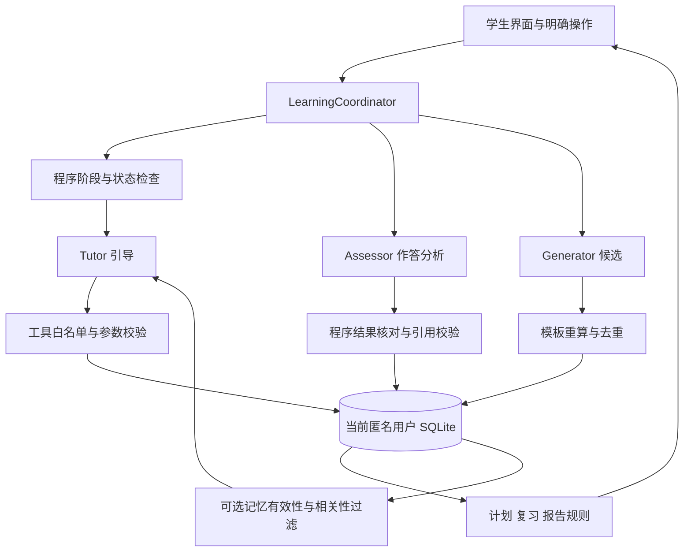

# 学伴小N技术讲解稿：Agent、记忆与学习证据

核对日期：2026-10-25。依据为当前工作区，Git HEAD 为 `55329b8`，另有未提交的对话回放等修改。本稿描述源码中已有的实现，不等于这些修改都已部署。

阅读范围：项目目录与运行入口、前后端主流程、Agent协调器与角色、工具注册、记忆、作答与评分、教学片段、专业模式、生成题、计划复习、存储隔离、语音及相关测试；同时对照PRD、任务书、交付和近期审查。历史审计副本、构建产物、图片、音频、ZIP和PPT没有逐文件逐行复读，也没有读取真实学习数据库或凭据。

## 一、最适合讲的技术主线

**小N用受控Agent组织学习，用可追溯的作答证据记录变化，用学生可管理的记忆延续陪伴。**

讲技术时，围绕一个例子展开：学生在去括号时漏改负号，系统如何从发现卡点，走到保存尝试、提供提示、核对新题，再形成回顾和复习安排。框架、模型和数据库的名字放在这个过程里介绍，听众更容易明白它们各自解决什么问题。

| 技术 | 当前实现 | 台上怎么说 |
| --- | --- | --- |
| 受控Agent编排 | LearningCoordinator、程序阶段机、按阶段拼接Prompt和允许字段 | 程序管理学习流程，模型在当前阶段内引导 |
| 角色分工 | Tutor、Assessor、PlannerReporter，加Generator辅助角色 | 引导、分析、计划报告、出题各有职责和权限 |
| 原生工具调用 | 角色白名单、严格参数Schema、真实工具结果、工具轨迹 | Agent通过工具读学习事实，工具能不能用由服务端决定 |
| 分层上下文与记忆 | 最近对话、LearningEpisode、学习事实、学生确认的可选记忆 | 区分正在聊什么、实际做过什么、学生希望记住什么 |
| 证据评分 | 先存作答，程序判客观结果，模型按rubric引用解释，程序定位引用 | 每个判断尽量回到学生实际写过的内容 |
| 受控生成题 | 两个知识点、五种模板、参数约束、程序重算、内容指纹去重 | 模型提出候选，程序验算后发布 |
| 复习与版本 | 规则排程、学生确认计划、证据修订重算、历史保留 | 复习安排取决于实际表现，并保留学生的选择 |
| 用户隔离与持久化 | 匿名Cookie身份、每人独立SQLite和运行时、事务与幂等收据 | 不同浏览器身份有各自的学习数据 |
| 语音交互 | Web Audio、端点判断、豆包ASR/TTS、分句预取播放 | 支持语音轮次，听完一句、回复后再听下一句 |

## 二、可直接念的技术讲稿

预计约5—6分钟，按个人语速调整。方括号是演示提示，不用念。

大家好，下面我介绍学伴小N的技术实现。

我们从初中数学切入，希望系统能陪学生走过一个具体的学习过程：他卡在哪里，自己试到了哪一步，用过什么帮助，之后遇到一道没见过的同类题，还能不能独立完成。

围绕这个过程，我们主要做了三部分：Agent编排、学习证据和长期记忆。

第一部分，是受控的Agent编排。

小N的后端有一个学习协调器，由程序管理当前学习阶段，再把相应任务交给模型。比如，现在需要倾听、需要澄清卡点，还是已经进入一起思考和回顾阶段，模型会拿到不同的上下文、提示词和可用工具。

在职责上，我们划分了几个角色。Tutor负责对话和引导；Assessor负责按评分点分析已保存的作答；PlannerReporter依据学习记录组织计划和报告；Generator负责提出新题候选。它们目前共用同一个模型接入层，由程序按流程调用。

这些角色都有明确的权限。例如，Tutor可以查询学习记录、提出候选题，但真正打开题目、确认计划、保存可选记忆，都需要学生操作。服务端会检查工具白名单、参数和当前状态。这样，模型提出的建议才会通过受控的入口变成系统里的实际操作。

[展示“学生确认卡点—尝试—提示”的过程。]

第二部分，是可追溯的学习证据。

学生提交后，我们先把原始作答保存下来，再开始评分。系统也会记录作答前是否看过提示、答案，或者获得过聊天帮助。

对于支持的一次式计算题，程序会核对表达式和已写出的等号步骤。对于需要说明理由的题，模型按照预设评分点分析，并引用学生作答里的原话；程序再检查这段引用是否真的存在。引用不成立、证据不足，或者程序与模型判断冲突时，结果会进入待核查状态。

这些记录让我们能够区分几种不同的“做对”。比如，同一题在提示后改对了，和第一次遇到同类新题、没有帮助就做对了，是两种不同的证据。小N会把它们分别记录，而不是只保存一个对错结果。

之后，报告和复习计划就能继续使用这些证据。对于跨次表现，我们还会检查题目是否见过、学习日期和场次是否满足规则。不过，这些都是产品里的观察规则，目前还不能当作标准化的能力测评。

第三部分，是记忆。

我们在设计上区分了三类信息。

第一类是当前对话上下文。Tutor会拿到最近几条消息，以及当前题目、阶段和最近的判题反馈，帮助它接住正在进行的交流。

第二类是结构化学习记录，包括作答、提示、评分、学习片段、计划和报告。它回答的是“这个学生实际做过什么”，会保存在SQLite里，供后续查询和复习使用。

第三类是学生主动选择保留的可选记忆，比如一个兴趣、一件事，或者一个对自己有用的方法。模型可以提出记忆草稿，学生能改写、拒绝，也能选择记七天、三十天，或者长期保留。长期保留的条目还设有三十天复核时间，到时需要重新确认是否适用。

[展示“要我记住这件小事吗”以及记忆管理页。]

当Tutor准备回复时，系统先过滤掉停用、过期和待复核的记忆，再根据当前话题筛选相关条目。初始上下文最多放五条、总共三百字。这样可以控制上下文的大小，也减少无关内容对回答的影响。

这里有一个需要说清楚的地方：关闭可选记忆，会停止使用这些偏好条目；作答、计划和对话记录目前属于另一类学习记录，并不会随这个开关一起删除。

在出题方面，我们也做了程序校验。当前支持去括号负号和合并同类项两类变式。模型只在允许的模板和参数范围内提出候选；程序会重新构造题面、计算答案、核对步骤，并检查内容是否重复。只有通过校验的题，才会进入正式题目记录，后续沿用同一套作答和证据流程。

最后，简单介绍工程实现。前端使用React和TypeScript，后端使用Node.js和TypeScript，共享Zod数据协议；不同匿名用户分别使用自己的SQLite数据库和运行时。关键操作带有操作编号和版本检查，用来核对重复请求与状态冲突；模型调用也设置了轮次、工具次数和超时预算。

我们目前已经实现这些核心机制，也有对应的本地测试。但真实学生的长期学习效果，还需要后续试用验证。我们希望小N的每一次引导，都能联系到具体记录；每一次关于进步的反馈，都能说清楚依据。

谢谢大家。

## 三、时间只剩90秒时的版本

学伴小N的技术主要有三个重点。

第一是受控Agent。后端协调器管理学习阶段，再调用负责引导、作答分析、计划报告和出题的不同角色。工具权限由服务端检查，模型不能代替学生确认计划或保存可选记忆。

第二是学习证据。我们先保存原始作答和提示使用记录，再进行评分。计算结果由程序核对，理由分析要求模型引用学生原话，并由程序检查出处。因此，提示后改对、原题重做和新题首次独立做对，可以分开记录。

第三是记忆。我们区分当前对话、结构化学习记录和学生确认的可选记忆。可选记忆支持改写、删除、关闭和有效期；Tutor初始上下文会筛选相关条目，最多五条、三百字。

出题也有一道程序校验：模型提出模板参数，程序重新验算、检查步骤和去重后再发布。目前覆盖两类计算变式。

这些机制让一次对话能连接到尝试、反馈、回顾和复习。现阶段已有实现和本地测试，真实学生的长期效果还需要继续验证。

## 四、评委追问时怎么回答

**1. 你们的Agent和直接调用模型接口有什么区别？**

模型调用之外，我们实现了服务端的学习协调器、阶段状态、按角色开放的工具、学生确认入口和持久化学习记录。模型需要结合当前阶段和真实工具结果工作；它说“已保存”本身不能成为数据库里的完成事实。

**2. 用了LangChain、LangGraph或向量数据库吗？**

当前代码使用自建的TypeScript协调器和工具注册层，没有这些框架和向量数据库依赖。记忆量和任务范围较小时，我们先用SQLite、有效期过滤和文本相关性筛选，把确认、失效和使用路径做清楚。

**3. 是几个不同的大模型协同吗？**

当前是同一Provider下的职责分工，主要包括Tutor、Assessor、PlannerReporter和Generator；不同任务使用不同Prompt、输入和权限。代码默认模型为`glm-5.3-flash`，可通过服务端环境配置覆盖。本次没有检查线上实际模型配置。

**4. 记忆检索是怎么实现的？**

Tutor初始上下文先筛选有效条目，再把记忆文本与最近六条学生消息做归一化后的公共子串匹配，至少两个字符才进入相关候选，按匹配长度和新旧排序。协调器再用服务端自己的条目核对ID，限制最多五条、三百字。这是轻量文本相关性检索，尚不是向量语义检索。工具查询和Generator有各自的上下文路径，不能把这个上限概括成所有模型请求的全局上限。

**5. 是不是所有角色都会使用学生偏好？**

Tutor和Generator有使用有效辅导偏好的路径。Assessor的作答分析只接收必要题目、rubric、已保存作答和帮助暴露快照，不接收可选偏好。计划的核心选择和复习排程由程序规则完成。

**6. 如何防止模型幻觉？**

我们针对不同环节做不同约束：客观结果由受限判题器核对，理由分析校验评分点和原文引用，生成题重新计算，报告引用已有证据。不确定时保留待核查。这能约束部分错误；原文引用真实并不保证模型对理由的理解一定正确。

**7. 能证明孩子已经掌握了吗？**

现阶段能展示具体任务中的表现。严格作答证据路径的默认跨次规则要求至少两道未见题、两个可信日期和两个场次，才进入对应的跨次独立状态。这些阈值是产品规则；有限题族的表现还不能外推为整个能力维度，更不能代替长期教学效果研究。

**8. 关闭记忆，聊天记录也会消失吗？**

当前不会。可选记忆和学习记录分开管理，关闭后不再取用可选偏好，但作答、计划、小结和对话回放仍保留。过期表示停止取用，当前没有自动物理删除全部过期数据的机制。清除整套学习记录需要使用另一个重置入口。

**9. 多用户做到什么程度？**

服务端为浏览器签发随机匿名身份，每个身份对应独立SQLite和运行时，幂等回执和重置也在各自库内。身份依赖浏览器Cookie；清Cookie或换设备不会自动找回原身份。目前还没有完整的实名账号、跨设备登录和账号找回体系。

**10. 语音是不是实时、全双工？**

当前前端先录完一句，识别成文字后再获取模型回复，然后合成并播放语音，播放完成继续收音。已有语音端点判断、取消、分句合成和下一句预取。这个实现支持连续轮次；模型回复本身是非流式，也没有全双工打断。本次没有重测真实语音链路，不引用旧报告的速度作为当前性能。

## 五、讲解时应保留的准确边界

- 五个维度是理解、逻辑、计算、建模、空间想象，属于学习观察维度；不是五个独立Agent。
- 当前静态v2题库为58题，其中30道`life-*`生活故事题，覆盖6个子技能。旧文档中的“28题”已不是当前总数。
- 有状态的完整单点教学闭环聚焦去括号负号；受控模型生成覆盖去括号负号和合并同类项。
- `memory-flow`已有实际实现。旧材料中“只有手动填偏好”“没有筛选”“只是桩”的说法已过时。
- 匿名用户隔离已实现；旧稿中“所有用户共用一个库”的说法已过时。
- 学习事实大多追加保存，评分与报告修订保留历史；可选记忆另有停用和删除路径。不要把所有数据一概说成永不修改的事件日志。
- 普通首页`think`仍有较宽松的答案子串匹配；严格教学闭环走保存作答和评分的路径。展示证据分类时优先解释后者，不能用普通聊天里一句“我懂了”证明掌握。
- 口述题参考答案路径仍存在“双模型一致”被标成已核验的可信度边界；不能把“所有题目都经过程序数学验算”作为项目整体承诺。模板生成题的重算与校验有独立实现。
- 跨日教学片段续学仍有旧场次绑定的代码风险，不能仅凭同日刷新或TestClock到期测试宣称所有跨日恢复都已验证。
- 拍照识题后端`recognize()`仍返回`not_implemented`；有拍照、裁剪和遮挡界面不等于已有OCR。
- 当前家长摘要界面不展示聊天和作答原文，但没有独立监护身份核验，不能称为完整的家长权限系统。

## 六、源码对照入口

以下路径相对项目根目录，行号对应本次核对的工作区。

| 技术内容 | 关键位置 |
| --- | --- |
| 主服务、每用户运行时装配 | `outputs/xiaon/server/index.ts`、`server/bootstrap.ts` |
| 学习协调与上下文 | `outputs/xiaon/server/agents/learning.ts:71`、`:225`、`:238` |
| 阶段决策与允许输出字段 | `outputs/xiaon/server/agents/stages.ts:30`、`:43` |
| 角色Prompt、预算及调用轨迹 | `outputs/xiaon/server/agents/roles.ts:83`、`:94`、`:105`、`:187` |
| 工具白名单与参数、权限检查 | `outputs/xiaon/server/tools/registry.ts:7`、`:28` |
| 原始作答与暴露快照 | `outputs/xiaon/server/core/events.ts:38` |
| 记忆草稿、确认、问候、筛选 | `outputs/xiaon/server/plugins/memory-flow/index.ts:27`、`:41`、`:51`、`:104` |
| 记忆失效与开关过滤 | `outputs/xiaon/server/core/events.ts:49`、`:55` |
| 记忆期限与上下文上限 | `outputs/xiaon/shared/learning-contracts.ts:145`、`:152` |
| 客观判题与rubric合并 | `outputs/xiaon/server/plugins/assessment/grading.ts:8`、`:29` |
| 引用核验及模型分析输入 | `outputs/xiaon/server/plugins/assessment/model-analysis.ts:23`、`:43`、`:52` |
| 独立性与跨次观察规则 | `outputs/xiaon/server/plugins/assessment/state.ts:5`、`:24`、`:54` |
| 单点教学闭环 | `outputs/xiaon/server/plugins/learning-loop/index.ts:62` |
| 生成候选重算与发布 | `outputs/xiaon/server/plugins/generation/validator.ts:55`、`server/plugins/generation/index.ts:90` |
| 计划与复习 | `outputs/xiaon/server/plugins/planning/index.ts`、`server/plugins/stages/index.ts` |
| 存储版本、事务与幂等 | `outputs/xiaon/server/storage/repository.ts:28`、`:77` |
| 匿名身份与分库 | `outputs/xiaon/server/storage/users.ts:13`、`:38` |
| 对话观察、小结与回放 | `outputs/xiaon/server/plugins/conversation/index.ts`、`src/components/learning/home/ChatHistory.tsx` |
| 语音端点、轮次与分句播放 | `outputs/xiaon/src/voice/vad.ts`、`conversation.ts`、`voice.ts` |

简化调用关系：



## 七、本次验证记录

本次仅检查本地代码，使用临时数据库和合成Provider进行定向测试，没有调用真实模型、语音服务或生产学习库，也没有重新部署。

- `npm run typecheck:agent`：退出0。
- 以下定向测试：37项通过，0失败，0跳过。

```sh
node --import tsx --test \
  tests-agent/i/memory.test.ts \
  tests-agent/a/user-isolation.test.ts \
  tests-agent/g/learning-loop.test.ts \
  tests-agent/b/model.test.ts \
  tests-agent/e/templates.test.ts
```

覆盖记忆草稿与授权、期限与筛选、用户之间的读写/重置隔离、评分引用、模板校验、严格教学闭环及部分恢复场景。未跑全量浏览器、全部Agent测试、真实模型、真机语音、生产容量或真实学生学习效果验证。

本次只新增本讲稿，保留原有产品代码及未提交修改。
