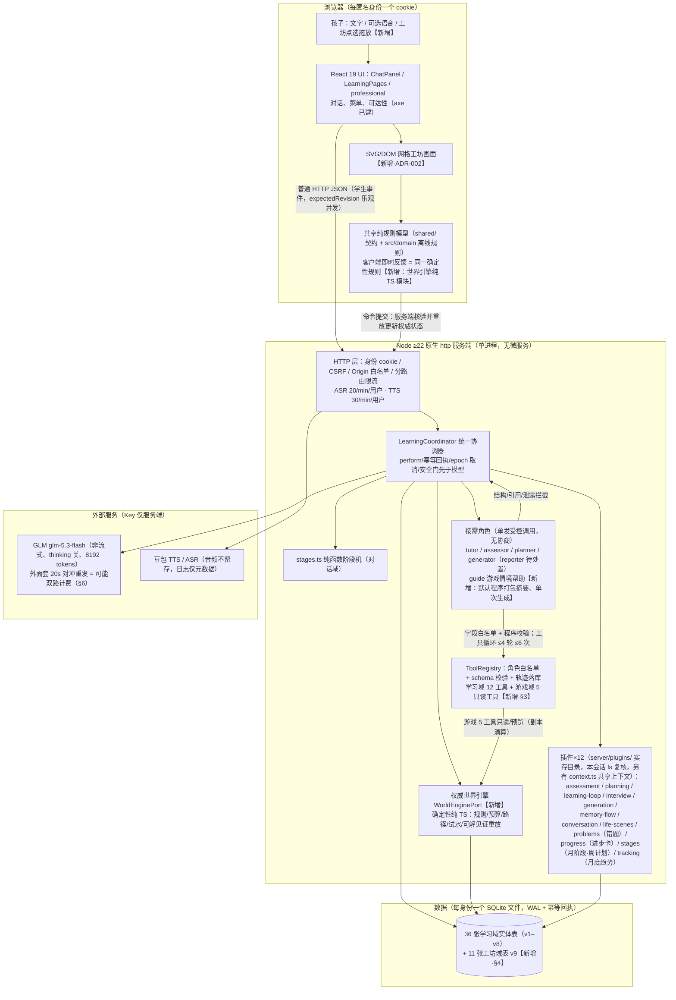

# 架构与数据模型 v1（草稿）

- 生成日期：2026-10-28。作者：工作流 D · 架构数据设计师。
- 修订：v1.1（2026-10-28，按评审意见修订）——§5 补 R-05-85/87/88、R-03-42、R-05-83 子项、R-05-86、R-08-69 并显式裁剪 R-07-9；§3.1 登记 ControlledRoles 调用通道必要改动；§5.1 chatLog 出口核正为 6 处且 legacy 流不写；§2 插件清单补全为 12 个；两处证据引注核正（App.tsx:545；repository.ts:27 注释原文边界）。
- 输入材料：`文档/产品/需求矩阵-v1草稿.md`（583 行需求、文件 790 行，下称「矩阵」）、`文档/工程/2026-10-28-第一轮审查与规划/01-现状审查报告.md`（下称「审查报告」）、`文档/研究/2026-10-28-教育产品深度研究/05-Agent与技术架构建议.md`（下称「研究05」，只读）、`outputs/xiaon/` 源码（本会话只读实读）。
- 性质：**v1 草稿 / 待批准**。矩阵 4.1 节明确「候选定位须用户确认后才能解锁温室方向的实施」（R-08-100、R-08-1）；本档一切游戏域设计都是**方案草案**，不含任何已获授权的实施。ADR 编号延续 `文档/工程/2026-10-28-第一轮审查与规划/05-技术决策记录.md`（已有 ADR-001..006）。
- 代码基线：2026-10-28 工作区（`outputs/xiaon` 有 8 个未提交修改文件，本会话 `git status --porcelain` 复核：learning.ts / repository.ts / learning-contracts.ts / .schema.json / ChatPanel.tsx / LearningPages.tsx / ChatHistory.tsx / style.css——即 chatLog 回放功能，与研究05 §4「文件已有用户未提交修改，不能覆盖」一致）。**本档未改动任何代码**。

---

## 1. 差异审计：现有 Agent / 工具 / 存储 vs 研究05 增量建议 【R-05-1 ~ R-05-104；冲突行 R-05-21 / R-05-64 / R-05-97 / R-03-26】

研究05 §4（`05-Agent与技术架构建议.md:47-57`）给出「当前文件 → 增量建议 → 实施前要核对」清单。下表逐行对照，代码证据均为本会话实读。

### 1.1 总体结论

**架构骨架与研究05的推荐路线天然一致，差异集中在「游戏域尚不存在」与两处阶段机判定口径**——与任务预期「差异小」基本相符，但 stages.ts 一行是矩阵裁定的「与现状冲突」，需如实单列：

1. **程序主控已成立**（R-05-2/3 已实现）：单一协调器 `LearningCoordinator`（`server/agents/learning.ts:71`），全部 `/api/learning/*` 路由经它委托；阶段由纯函数 `decideStage()` 决定，「模型和前端都不能自己跳」（`server/agents/stages.ts:1,40-76`）。
2. **受限工具面已成立**（R-05-4/6 已实现）：`ROLE_POLICIES` 白名单（`server/tools/registry.ts:7-14`），`maxRounds≤4、maxToolExecutions≤6`（`shared/learning-contracts.ts:52`）；工具轨迹含参数哈希冲突检测（`registry.ts:38-39`）与统一落库（`registry.ts:110-111`）。
3. **游戏域零存在**（R-05-12/22/25/48/62/72 未实现）：`ToolArguments` 12 个键全部是学习域（`learning-contracts.ts:209-222`）；`EntityMap` 36 个集合无任何 world/mission 实体（`learning-contracts.ts:349-367`，与 `server/storage/repository.ts:8-18` 的 `entitySchemas` 一一对应）。这是本档 §3/§4 的全部内容。
4. **stage 机判定口径冲突**（R-05-21、R-03-26 与现状冲突，矩阵 4.3 待裁决）：`LISTEN_MIN_TURNS=2`（`stages.ts:3`）、`ASK_STUDY_AFTER_COMPANION_TURNS=6`（`stages.ts:4`）、`STUDY_PATTERN` 子串族（`stages.ts:12`）、`matchesAnswer` 子串匹配（`stages.ts:84-88`）仍在通用判定路径上。**本档不改代码**，仅登记：游戏域新增入口不得复用这些判定做掌握判断（R-08-21 已实现的口径：掌握判定只来自判分作答）。

### 1.2 逐文件对照表

| 研究05 §4 对象 | 增量建议（研究05原文） | 代码现状（本会话实读） | 差异结论 | 去向 |
|---|---|---|---|---|
| `server/agents/learning.ts` | 保留协调入口，增加工坊状态/帮助边界；不能覆盖未提交修改 | 协调入口完整（`learning.ts:71`）；`view()` 无任何工坊数据（`learning.ts:449-463`）；帮助边界已在学习域实现（FR16 一次一级，`learning.ts:263-267`）；8 文件未提交（本会话 git status 复核） | **小差异**：只差「工坊状态」注入点；未提交改动须先按审查报告 §9 处置（跑 `test:agent` 基线后作为 feature 提交） | 本档 §2/§3；ADR-007 |
| `server/agents/stages.ts` | 意图路由与任务状态接口对齐；不沿用固定倾听轮数/子串匹配作通用判定 | 固定轮数与子串/正则判定仍在（`stages.ts:3-4,12,84-88`） | **非小差异**：矩阵 4.3 两条冲突（R-05-21、R-03-26）落在此文件 | 留给对话升级工作流（ADR-003 已立案）；本档仅要求游戏域不复用 |
| `server/tools/registry.ts` | 增加最少游戏只读/预览工具；核对权限、引用、主体ID、限额与取消 | 无任何游戏工具（`registry.ts:7-14`）；但注册模式完备：schema 校验（:35）、角色白名单（:37）、逐字引用门（:88）、限额先例（:61 计算题上限、:90 每轮一次）、学生确认门（:83） | **结构性零差异、内容零实现**：模式可直接复用 | 本档 §3；ADR-007 |
| `server/plugins/generation/*` | 借鉴模板＋参数＋程序校验思想；代数模板不直接当游戏模板 | 白名单模板+整数参数+程序构建答案（`templates.ts:1-10`，`TEMPLATE_VERSION='e1-templates-1'`，仅 negative-brackets/like-terms）；候选逐项比对、失败不发布（矩阵 R-05-23/R-05-69 已实现） | **无冲突**：E1 在线生成与「P0只用固定任务」（R-05-64）的冲突是游戏域发布策略问题：游戏任务发布走 MissionDefinition 审核态（§4），不复用 E1 在线路径 | 本档 §4；ADR-008 |
| `server/storage/repository.ts` | 新增版本化作品/试验/帮助事实；核对历史 schema 迁移、删除与派生清除 | v1–v8 追加式迁移框架（`repository.ts:34-55`）；append 不可覆盖、同 key 异内容抛冲突（:69）；幂等回执 `once()`（:77-83）；删除=整体 reset（:94）+ 单条记忆停用/删除并改写回执（:86-92） | **中等差异**：迁移与追加机制齐全；缺「按会话/按期限的派生清除」与「新实体版本化键规则」（tasks 的 `id:v<version>` 特例在 :67，需扩展） | 本档 §4；ADR-008；隐私表 §5 |
| `shared/learning-contracts.*` | 明确新协议与版本边界；不把新游戏观察混入旧学科技能ID | 冻结契约 `SCHEMA_VERSION='1.0.0'`（`learning-contracts.ts:3`）；观察实体已存在且叫 `observations`（ChatObservation，:123）——与研究05 的游戏 `Observation` **重名** | **需命名决策**：游戏观察必须独立命名，不得混入（R-05-25/74） | 本档 §4（`WorldObservation`）；ADR-008 |
| `src/components/professional/*` | 再决定独立工坊入口或受控接入 | 前端，本档不审（矩阵 R-05-26 未实现：仍为五站测评外壳） | 登记待工作流 C | 不在本档范围 |
| 匿名浏览器身份 | 不能代替可恢复账号、真实监护关联或同意证明（研究05:57） | 随机令牌哈希身份、伪造 cookie 不建库（`server/storage/users.ts:13-31`）、每身份独立 SQLite（:50-51）；试用时限/名额（`server/index.ts:27-29`） | **现状=研究认定的限制**：隔离充分（R-05-84 已实现）、监护同意缺失（R-05-27/89 未实现）→ 隐私表 §5 承接 | §5 隐私表 |

### 1.3 审计中发现的两个附加事实（矩阵之外，本会话实读补充）

- **reporter 是注册未路由的死角色**：`ROLE_POLICIES.reporter`（`registry.ts:11`）有白名单，但 `ControlledRoles.invoke` 只接受 `'tutor'|'planner'`（`roles.ts:107`），`run()` 的类型签名显式排除 reporter（`roles.ts:187`）。与审查报告 §4「死代码候选」一致。游戏域新增 guide 角色时建议顺手处置（合并或删除，见 ADR-007 风险节）。
- **`request_hint` 拒绝注册先例**：`registry.ts:36` 显式抛 `unavailable`（「由学生提示事件入口处理」）——这是「工具名存在但职责归程序」的既有模式，§3 的游戏 `get_hint` 复用同一语义门（学生先请求、程序定级）。

---

## 2. 目标架构（mermaid） 【R-05-1 / R-05-2 / R-05-28 ~ R-05-33 / R-05-44 / R-04-7 / R-04-25 / R-04-37 / R-08-41】

实线=现有（本会话实读核对）；`【新增】`=本档建议。与 ADR-001（程序主控+LLM负责语言）、ADR-002（2D/SVG-DOM 起步）一致。



要点（对应矩阵行）：

- 客户端即时运行同一纯规则、服务端核验重放（R-05-29 部分实现 → 引擎模块补齐）；学习记录以服务端确认事件为准（R-05-30 已实现）。
- 普通 HTTP + 已有通道，不引入微服务/消息总线（R-05-33 部分实现——现状即 HTTP JSON，SSE 仅在需要流式时再加）。
- 模型上下文最小化：Tutor 仅最近 8 轮（`learning.ts:48,176`），记忆 ≤5 条 ≤300 字（`learning-contracts.ts:152-153`）→ 游戏态同样走「程序打包摘要」（§3.3）。

---

## 3. 游戏域 5 个只读工具的注册方案 【R-05-22 / R-05-48 ~ R-05-54 / R-05-49 / R-08-45 / R-08-46 / R-04-23 / R-03-75】

对齐 `server/tools/registry.ts` 既有模式：ToolArguments 冻结 schema（`learning-contracts.ts:209-222`）→ descriptions 语义约束（`registry.ts:15`）→ ROLE_POLICIES 白名单（`registry.ts:7-14`）→ execute 内 switch + 程序门 → 统一轨迹落库（`registry.ts:110-111`）。

### 3.1 新角色 guide 与工具白名单

```ts
// shared/learning-contracts.ts —— RolePolicy.role 枚举追加 'guide'（additive；zod enum 扩值对已存 AgentRun.role 兼容）
// ROLE_POLICIES 追加（server/tools/registry.ts）：
guide:{role:'guide',allowedTools:['get_world_summary','get_allowed_actions','preview_action','get_hint','offer_mission'],maxRounds:2,maxToolExecutions:3},
```

- `maxRounds:2 / maxToolExecutions:3`：严于契约上限（≤4/≤6，`learning-contracts.ts:52`），落实研究05 §7.2「P0 可不让模型循环选工具」（R-05-49）。
- **默认路径不是工具循环**：协调器把「程序打包的世界摘要 + 当前允许提示级别」直接放进 `data.context` 单次生成回应；只有模型回应显示确有信息缺口时，下一轮才允许 guide 查工具。「打包优先」必须写进 guide 的 prompt（`PROMPTS` 增 `guide:{version:'guide-w1',text:…}`，风格对齐 `roles.ts:94-99`）。
- **调用通道的必要改动（v1.1 补登记——只加枚举与 PROMPTS 不够，本会话实读核对）**：
  1. `ControlledRoles.invoke` 的角色参数是字面量类型 `'tutor'|'planner'`（`roles.ts:107`），**不接受枚举新值 'guide'**——须扩签名才能承载「信息缺口轮」的受控工具循环；
  2. 单发通道 `compose()` 内部硬编码 `run('tutor',…)` 且不传任何工具定义（`roles.ts:159-163`）——直接复用会让 guide 回复的 `AgentRun.role` 被记成 `'tutor'`，**审计轨迹失真**。须给 `compose()` 增可选 `role` 参数（默认 `'tutor'`，既有调用不变），guide 单发如实记 role；
  3. guide 更紧的 2 轮/3 次限额须按 `ROLE_POLICIES.guide` 判界——现状工具循环上限是契约极值硬编码（`roles.ts:117` `while(run.rounds<4)`、`:151` `toolExecutions>=6`），不读角色策略值；guide 通道须显式按策略收紧。
  「信息缺口→下一轮允许查工具」是**新控制流**：缺口标志由协调器按该轮 guide 回复判定并暂存（不落库、随会话失效），第二轮才走 `invoke('guide',…)`；此属 learning.ts 协调器改动，与 §1.2 对 learning.ts「增加工坊状态/帮助边界」的差异合并实施。
- 现有 tutor/assessor/planner 白名单**不**追加这 5 个工具（研究05 §7.2 最少工具面；域不混用）。

### 3.2 ToolArguments 与 descriptions（草案）

```ts
// shared/learning-contracts.ts → tools 追加（get_hint 见 3.4 特例）：
get_world_summary: z.strictObject({}),           // 无主体参数：ctx 本身绑定到该用户的独立运行时/库（users.ts:50-57），结构上杜绝「传任意主体ID」(R-05-50)
get_allowed_actions: z.strictObject({ expectedStateVersion: z.number().int().nonnegative() }),
preview_action: z.strictObject({ actionId: id,
  arguments: z.record(z.string(), z.string().max(200)).refine(o => Object.keys(o).length <= 8, '参数过多') }),
offer_mission: z.strictObject({ topicHint: z.string().min(1).max(200).optional() }),
// get_hint：z.union([既有学习域参数, {worldSessionId:id, level:version}])，见 3.4
```

```ts
// server/tools/registry.ts → descriptions 追加（中文一句话语义约束，对齐 :15 风格）：
get_world_summary:'只读本用户当前工坊任务的程序摘要（目标/预算/送达/最近试验）；世界事实以程序判定为准，不能从对话改写',
get_allowed_actions:'只返回引擎当前真实可操作的动作清单与位置；expectedStateVersion 过期即拒绝，须重新取摘要',
preview_action:'在副本上演算一项候选动作的后果；不产生任何持久写、不改变奖励或完成状态；每轮对话最多预演 3 次',
get_hint:'只读取学生已主动请求的该级审核提示；模型不能自行升到完整解答（H4 完整示例须学生显式求示范）',
offer_mission:'只从已审核目录生成可拒绝的任务邀请卡；不能直接启动世界或新增世界，启动是学生事件',
```

### 3.3 execute 内程序门（对齐既有先例）

| 工具 | 程序门（先例） |
|---|---|
| `get_world_summary` | 无入参；从当前用户库取活动 `worldSessions` 最新快照 + 最近 ≤3 次 `worldTrials`（R-05-76 检索预算）。**主体绑定结构性成立**：`ctx = this.ctx()` 即该用户运行时（`registry.ts:29`，运行时按身份分库 `users.ts:50-51`） |
| `get_allowed_actions` | `expectedStateVersion !== engine.stateVersion` → `RuntimeError('conflict','状态已更新，请重新取摘要')`（先例：`learning.ts:392` 测评 revision 冲突；R-05-56 版本一致性） |
| `preview_action` | ① 引擎在**内存副本**上演算，无 repository.append（先例：生成校验在副本比对、通过才事务发布，矩阵 R-05-51）；② 每轮限额：统计 `toolCalls` 中同 `runId` 且 `name='preview_action'` 的行 ≥3 → `budget_exhausted`（先例：`registry.ts:90` 每轮一次卡点；`registry.ts:61` 计算题上限）；③ 返回不含任何「最优解」提示，只有该动作的直接后果（防自动代做，研究05 §7.2） |
| `get_hint`（世界支） | 镜像既有学习域门（`registry.ts:69-72`）：必须存在 `worldEvents` 中 `kind='hint_shown'` 且 `level=请求级` 的学生暴露事件，否则 `forbidden('学生尚未主动请求这级提示')`；H4 完整示例额外要求学生显式「看完整示范」事件（R-05-52） |
| `offer_mission` | 只从 `missions` 集合 `reviewStatus='approved'` 目录选（先例：select_task 只查真实题库 `registry.ts:54-68`）；返回 `{card, requiresStudentConfirmation:true}`（先例：propose_memory `registry.ts:83`）；世界启动走协调器学生事件 `mission_start`（先例：open 的存在/先修检查 `learning.ts:107-111`；R-03-75 模型不能以聊天文字打开任意世界） |

全部 5 个工具：无 SQL/文件/删除能力（`repository.ts:27` 注释原文即 "No SQL, file or deletion capability is exposed as a model tool"），且不含网络/支付/通知类能力——后者出自研究05 §7.2 口径与工具清单事实（矩阵 R-05-54 已实现：`registry.ts:41-105` 全部为本地读/提议工具），非该注释原文；abort 检查沿用 `registry.ts:31,107`；轨迹（含失败）自动落 `toolCalls`（`registry.ts:110-111`）。

### 3.4 get_hint 重名处理（唯一非纯增量点）

`get_hint` 已被学习域占用（`learning-contracts.ts:216`）。为保住研究05 §7.2 与任务书指定的工具名，采用**判别并集**：

```ts
get_hint: z.union([
  z.strictObject({sessionId:id, taskId:id, taskVersion:version, level:version}),          // 学习域（原样）
  z.strictObject({worldSessionId:id, level:z.number().int().min(0).max(4)}),              // 工坊域 H0–H4
]),
```

两个 strictObject 键完全不相交（`worldSessionId` vs `sessionId/taskId`），判别无歧义；execute 内 `case 'get_hint'` 按键分流。旧调用方（tutor/hint 路由 `learning.ts:116`）不受影响。**替代方案**（改名 `get_world_hint`）被否：偏离研究冻结的工具名。此为契约上唯一一处「修改既有条目」（union 化），已列入 ADR-007 风险。

### 3.5 世界引擎挂载点

`EngineRegistration` 追加可选端口（additive，`learning-contracts.ts:406`）：

```ts
export interface WorldEnginePort {
  readonly id: string;                 // 如 'greenhouse-water'
  readonly engineVersion: number;
  summary(ctx: EngineContext): WorldSummaryView;                       // 程序判定的事实摘要
  allowedActions(ctx: EngineContext): { actions: WorldAction[]; stateVersion: number };
  preview(ctx: EngineContext, actionId: string, args: Record<string,string>): PreviewDiff;  // 纯函数副本演算
  hintCatalog(missionId: string, missionVersion: number): MissionHint[];                   // 审核过的 H1–H4 阶梯
}
// EngineRegistration 增加 world?: WorldEnginePort
```

引擎=纯 TS 确定性模块、与渲染解耦（R-05-37 已实现原则的延伸；ADR-002）。`ToolResult.data` 联合追加 4 个变体（WorldSummaryView / WorldActionList / PreviewDiff / MissionCard），沿用 `registry.ts:108` 的 `schemas.ToolResult.parse` 收口。

---

## 4. 新增实体清单与 zod 契约扩展草案（v9 起） 【R-05-24 / R-05-25 / R-05-62 / R-05-72 / R-05-73 / R-05-74 / R-05-76 / R-05-77 / R-04-9 / R-04-14 / R-04-15 / R-04-55 / R-04-64 / R-08-39 / R-08-40】

### 4.1 命名决策（先说清，再给清单）

1. **游戏观察改名 `WorldObservation`**：`observations` 集合已被 ChatObservation 占用（`learning-contracts.ts:123`、`repository.ts:11`）。重名是实读发现的硬冲突；且矩阵 R-05-25（P0）要求「游戏观察不混入旧学科技能ID体系」、R-05-74「不得把已有代数 skillId 借给生活水路」——独立命名即边界本身。
2. **集合名 `world*` 前缀 + `missions`**：`missions` 对齐 `tasks`（同为不可变版本化定义）；其余 10 个以 `world` 前缀保证全库可 grep、不与 36 个既有集合冲突。
3. **单一迁移 v9**：对齐 v4（G0 一波）/ v5（G2 一波）惯例——一个功能波次一个版本号；建表由统一循环完成（`repository.ts:36-39` 对 `entitySchemas` 全键 `CREATE TABLE IF NOT EXISTS`），旧库首开新代码即自动补表，`INSERT OR IGNORE INTO migrations VALUES(9)` 仅记账。
4. **`SCHEMA_VERSION` 维持 `'1.0.0'`**：G0/G2 均为「1.0.0 内 additive」（chatTurns、interviews 等都这么加的）；本档沿用。文件头「Frozen」与实践的张力在 ADR-008 登记（约束：只加不减不改类型）。

### 4.2 实体清单（11 张，研究05 §9:162 的 11 类 ↔ 集合名）

| # | 研究05 实体 | 契约名 | 集合名 | 存储/键规则 | 承接需求 |
|---|---|---|---|---|---|
| 1 | MissionDefinition | MissionDefinition | `missions` | **不可变版本化**：append 键 `id:v<version>`——需把 `repository.ts:67` 的 tasks 特例扩成 `['tasks','missions'].includes(collection)` | R-05-62、R-05-69、R-08-33 |
| 2 | WorldSession | WorldSession | `worldSessions` | 追加式；revisioned？否——状态走快照 | R-05-14、R-08-41 |
| 3 | WorldSnapshot | WorldSnapshot | `worldSnapshots` | 追加式，每 `stateVersion` 一条，`get()` 取最新 | R-05-61、R-04-25 |
| 4 | WorldEvent | WorldEvent | `worldEvents` | 追加式；`trial_run/objective_satisfied` 只由程序写（R-04-54） | R-04-14、R-04-15、R-05-72 |
| 5 | TrialResult | TrialResult | `worldTrials` | 追加式 | R-04-24、R-08-29 |
| 6 | Prediction | Prediction | `worldPredictions` | 追加式；`lockedAt` 时序锁；缺失记 `missing` 不填零（R-04-51） | R-04-24、R-04-51 |
| 7 | HelpExposure | HelpExposure | `worldHelpExposures` | 追加式；对应 world get_hint 门（§3.3） | R-04-12、R-04-17 |
| 8 | ArtifactVersion | ArtifactVersion | `worldArtifacts` | 追加式；功能版/装饰版分开保存（R-04-55） | R-04-32、R-04-55、R-08-15 |
| 9 | Explanation | Explanation | `worldExplanations` | 追加式；儿童解释/模型分析/程序分开（R-04-56） | R-04-56、R-04-28 |
| 10 | Observation | **WorldObservation** | `worldObservations` | 追加式；不引 skillId（R-05-74） | R-05-73、R-05-25 |
| 11 | TransferProbe | TransferProbe | `worldTransferProbes` | 追加式；异题核对、missing 单列 | R-04-60、R-08-19 |

配套仓储改动（全部 additive）：`entitySchemas` 追加 11 键（`repository.ts:8-18` 处）；`repository.ts:55` 的索引行追加 world 表的 `json_extract('$.worldSessionId')` 索引（现有行抽 `$.sessionId`，字段名不同需并列新语句）；`reset()` 自动覆盖新表（迭代 entitySchemas，`repository.ts:94`）；**evidence_revision 计数器不扩**（`repository.ts:71` 名单不动）——游戏证据暂不进学科技能证据版本，跨域结论留待 TransferProbe 分析期再议（ADR-008）。

### 4.3 zod 契约草案（节选关键实体，风格对齐 `learning-contracts.ts`：strictObject + base/operation/sourceTime 复用）

```ts
// ---- 工坊域（2026-10-28 草案）：只做加法。SCHEMA_VERSION 不变，迁移记 v9。----
const missionRef = z.strictObject({ missionId: id, missionVersion: version });

const MissionDefinition = z.strictObject({ ...base, version,
  ruleDomain: id,                          // 'greenhouse-water'
  title: text, goal: z.strictObject({ kind: z.enum(['deliver','compare','explain']), required: z.number().int().nonnegative() }),
  layout: z.record(z.string(), z.string().max(200)),        // 交点/边/物件，引擎 schema 内校验
  resources: z.strictObject({ budget: z.number().int().nonnegative(), inventory: z.record(z.string(), z.number().int().nonnegative()) }),
  allowedActions: ids, termination: z.strictObject({ condition: text, witnessSolutions: z.array(z.record(z.string(), z.string().max(200))).min(1).max(4) }),
  multiSolution: z.boolean(), hints: z.array(hint).max(4),   // 复用既有 hint（id/text/level），H1–H4
  safetyNotes: z.array(text), estimatedMinutes: z.number().int().min(1).max(60),
  templateVersion: id, engineVersion: version,
  reviewStatus: z.enum(['draft', 'approved', 'retired']),   // 只有 approved 可被 offer_mission 引用（§3.3）
});

const WorldSession = z.strictObject({ ...base, ...operation, ...missionRef.shape,
  status: z.enum(['active','paused','closed']), startedAt: utc, updatedAt: utc,
  latestSnapshotId: id.nullable() });

const WorldSnapshot = z.strictObject({ ...base, worldSessionId: id, stateVersion: version,
  facts: z.record(z.string(), z.string().max(200)),   // pathValid / budgetRemaining / delivered / leakCount…程序判定
  createdAt: utc });

const worldEventKind = z.enum(['mission_started','goal_rephrased','prediction_saved','component_changed',
  'trial_run','hint_shown','revision_saved','explanation_submitted','objective_satisfied','undo']); // R-04-14 九类 + undo
const WorldEvent = z.strictObject({ ...base, ...operation, worldSessionId: id, stateVersion: version,
  kind: worldEventKind, actor: z.enum(['student','program']),           // 模型不是 actor（R-04-54）
  payload: z.record(z.string(), z.string().max(200)).refine(o => Object.keys(o).length <= 10), sourceTime });

const TrialResult = z.strictObject({ ...base, ...operation, worldSessionId: id, stateVersion: version,
  trialNo: version, input: z.record(z.string(), z.string().max(200)),   // 如 {water:'8'}
  delivered: z.number().int().nonnegative(), changedEdgeIds: ids, pathValid: z.boolean(), sourceTime });

const Prediction = z.strictObject({ ...base, ...operation, worldSessionId: id,
  text: shortText, lockedAt: utc,                       // 时序锁：预测先于试验（R-04-51）
  trialId: id.nullable(), outcome: z.enum(['pending','confirmed','refuted','missing']) });

const HelpExposure = z.strictObject({ ...base, ...operation, worldSessionId: id,
  level: z.number().int().min(0).max(4),                 // H0–H4（R-04-11）
  kind: z.enum(['position','relation','partial_demo','full_example','explanation']),
  eventId: id });                                        // 指向 worldEvents 的 hint_shown

const ArtifactVersion = z.strictObject({ ...base, ...operation, worldSessionId: id,
  version, kind: z.enum(['functional','decorative']),    // 分开保存（R-04-55）
  name: shortText, note: z.string().max(600).nullable(), snapshotId: id, createdAt: utc });

const Explanation = z.strictObject({ ...base, ...operation, worldSessionId: id,
  text: z.string().min(1).max(600), source: z.enum(['student','model','program']), at: utc }); // 三方分开（R-04-56）

const WorldObservation = z.strictObject({ ...base, ...operation, ...missionRef.shape, worldSessionId: id,
  kind: z.enum(['reproducible_fact','sourced_candidate','unobserved']),   // R-05-73 三分
  quote: shortText.nullable(), evidenceRefs: ids, helpExposureIds: ids,   // 带帮助暴露（R-05-49）
  uncertainties: z.array(text), status: z.literal('unverified'), sourceTime });

const TransferProbe = z.strictObject({ ...base, ...operation,
  sourceMission: missionRef, targetMission: missionRef,   // 异题，不复述训练提示（R-06-48）
  predictionId: id.nullable(), delayDays: z.number().int().min(0).max(30),
  status: z.enum(['pending','offered','completed','skipped','missing']),
  independent: z.boolean().nullable() });                 // 判定只来自程序重放，非自报
```

`EntityMap` 追加 11 行对应类型；`schemas` 导出与 `export type` 同步（对齐 G0/G2 的追加方式，`learning-contracts.ts:239-240,248`）。

### 4.4 与既有体系的边界（防混用清单）

- 世界事实（pathValid/delivered/预算）**只**由 WorldEnginePort 程序判定；模型输出中任何世界事实字段一律丢弃并记 dropped（对齐 `filterStageFields`，`stages.ts:78-82`；R-05-45 孩子声明不得覆盖引擎权威）。
- `WorldObservation.missionId` 与学科技能ID 互不引用；专业模式报告/技能状态不读 worldObservations（R-05-74）。
- `missions` 发布走「见证解重放 + 全参数程序验证」后写 `reviewStatus:'approved'`，不走 E1 在线生成路径（R-05-64 冲突的规避方式：游戏任务定义不在线生成；E1 保持代数域现状）。

---

## 5. 隐私合规对照表（个保法 / 拟人化办法 / 未成年人条例） 【R-03-39 ~ R-03-43 / R-05-27 / R-05-78 ~ R-05-89 / R-07-4 ~ R-07-10 / R-08-67 ~ R-08-70】

> 「要求」列均转写自研究05 §10（`05-Agent与技术架构建议.md:174-190`）与矩阵 R-07-4~R-07-10 原文；研究自述这些是「待审核设计值/适用性待专业判断，不是法律允许上限」。法律定性本身在代码核证范围之外（矩阵 R-05-91/R-08-72 不可核证），本表是工程侧的差距与工作量盘点，不构成合规结论。工作量为人日粗估（1 主开发者口径，对齐 06 §4）。
> **覆盖声明（v1.1）**：表头所引矩阵行中所有「部分实现/未实现」的 P0 工程差距均已入表（本版补齐 R-03-42、R-05-83 子项、R-05-85/86/87/88，并收入 R-08-69）。**显式裁剪**：R-07-9（COPPA，矩阵 :515，P2 条件性——「进入美国市场前另行评估」）不入本轮工作量盘，触发条件（进入美国市场）未成立，届时单独评估；R-07-5/6/7/8/10 分别落在行 4/3/5/5/6。

| # | 法规/依据 | 要求（研究口径） | 现状（代码证据） | 差距 | 工作量 |
|---|---|---|---|---|---|
| 1 | 个保法：不满14岁儿童个人信息=敏感个人信息，处理须监护同意+专门处理规则（R-05-89、R-07-4） | 可核验监护同意、同意版本/用途可查、拒撤真实生效（R-05-82） | `ConsentState` 仅 `optionalMemory` 布尔（`learning-contracts.ts:48`）；监护确认为演示流程（src/App.tsx:545「现在是演示，不会真的联系家长」——v1.1 实读核正；:566/:577 为「发起监护人确认演示/模拟监护人阅读并确认」按钮文案，矩阵 R-05-82 引用的即按钮行）；可选记忆同意/退出/删除本身真实生效（矩阵 R-03-36/41 已实现） | 无同意版本、无用途记录、无可核验监护链路 | 受控试点口径 5–8 人日（ConsentState 增量字段+同意文案版本化+回执）；真实监护核验（短信/人脸等）另立项，且与「无账号」定位冲突，须决策 |
| 2 | 个保法：最小必要、告知、删除权（R-05-83、R-03-40/43） | 最小上下文、日志去标识、**核验 API 适用性与供应商数据处理协议、不默认训练、模型请求样本核查**（R-05-83 全子项，矩阵 :394）、删除覆盖原文/摘要/派生/缓存（R-05-80） | 最小上下文已实现（Tutor 最近8轮 `learning.ts:48,176`；记忆≤5条/300字 `learning-contracts.ts:152-153`）；日志仅元数据（ASR 音频转发不留存，`server/http/server.ts:102-103` 本会话实读）；删除=整体 reset 清全部集合（`repository.ts:94`）+单条记忆停删并改写回执（:86-92）；模型轨迹只存指纹/原因码（矩阵 R-05-83：learning.ts:453-455） | 逐条删除的派生清理（小结/观察引用链）无机制（R-05-80 部分实现）；备份恢复后无删除标记重放（R-05-81）；**供应商 DPA 与「不默认训练」属外部条款、不可代码核证，模型请求样本核查流程不存在**（R-05-83 部分实现） | 3–5 人日（chatLog 选项A 联动，见下）；备份重放 2–3 人日；出站样本抽查 0.5–1 人日/轮（按指纹导出请求样本人工核对）；DPA 确认=法务外部流程 |
| 3 | 拟人化互动服务管理暂行办法（2026-07-15 施行）：第2条排除不涉及持续情感互动的纯教育服务；加入持续情感陪伴须重新评估（R-05-90、R-07-6、R-08-71） | 暂不提供虚拟亲属/伴侣亲密关系；不因「教育伙伴」名称认定豁免；依赖场景探针验收（R-05-86） | 无亲密角色设定（roles.ts:28「温和的同学」；矩阵 R-05-90/R-08-13 已实现：companion 有边界、无保密/排他话术）；明示 AI（矩阵 R-08-3/R-02-40） | 行为层无差距，但**依赖场景探针验收未见**（R-05-86 部分实现，矩阵 :397：拒绝退出/「唯一朋友」/亲密角色类探针套件不存在）；**触发条件**=若加入持续情感陪伴功能须整体重估 | 依赖探针套件 1–2 人日（合成探针+断言，对齐 tests-agent 风格）；触发重估时法务+改造另计 |
| 4 | 未成年人网络保护条例：信息收集、防沉迷、（若属网络游戏）游戏身份义务适用性待判（R-07-5、R-05-91） | 上线前专业判断是否受监管网络游戏及实名/防沉迷 | 名额 XIAON_MAX_USERS（`server/index.ts:27` 实读，2026-10-30 起线上默认 1000）；试用限时 XIAON_TRIAL_MINUTES 曾于 10-27~10-30 以 30 分钟/50人 上线、现已撤除（转内部使用，代码同删）；无实名/防沉迷机制（矩阵 R-05-91） | 教育游戏是否落入网络游戏监管=外部法律判断，代码无从核证；AI 生成内容标识零实现（R-08-70） | AI标识显式落地 2–3 人日（界面声明+导出物标记）；法律定性外部流程 |
| 5 | 生成式 AI 服务/AI 合成内容标识（面向公众时，R-07-7/8） | 按具体形态落实标识责任 | 已有出站披露 MODEL_DISCLOSURE（矩阵 R-05-83：core/agent.ts:6）；导出/下载环节无 AI 标识（矩阵 R-08-70） | 交互内已披露、导出物未标 | 并入 #4 的 2–3 人日 |
| 6 | 儿童试点数据义务（封闭试点也不豁免，R-07-10） | 事件按所需期限留存、到期去标识/删除（R-05-79）；原始语音不持久化 | 语音不留存已实现（server.ts:102-103 元数据日志）；学习事实/chatLog 长期保留至 reset，无期限机制（R-03-39/R-05-78 部分实现） | **chatLog 保留期未决（ADR-005）**，两选项见下表 | 见下表 |
| 7（v1.1 补） | 个保法/研究05 §10：情绪原文、家庭秘密、健康信息不作为默认个性化记忆（R-03-42，P0 部分实现，矩阵 :192） | 敏感类内容须**程序级拦截**，不能仅靠提示词 | 默认关闭+情绪/评价词程序丢弃已实现（矩阵 R-03-42：memory-flow/index.ts:18,34）；但「家庭、身体等敏感信息」仅提示词约束（矩阵证据：memory-draft.ts:6），此类事件草稿可被提议并经学生确认入库 | 敏感类内容无程序级校验，把关仅剩提示词与学生点击 | 1–2 人日（memory-flow 草稿过滤正则扩展家庭/身体/健康词族，复用情绪/评价词丢弃管线） |
| 8（v1.1 补） | 研究05 §10：任务/活动白名单、输入输出审核、**举报/人工处置入口**；危险/自伤/虐待/性/歧视/隐私探针验收（R-05-85，P0 部分实现，矩阵 :396） | 六类探针套件+举报闭环 | 程序安全门与输出字段丢弃在位（`learning.ts:154-155,317-318` 实读）；举报入口与六类探针验收套件**不存在**（矩阵 R-05-85：tests-agent 已检索无；反馈入口为演示不发送） | 无举报人工处置通道/责任人流程；无探针套件 | 探针套件 3–5 人日（合成探针+断言，对齐 tests-agent 风格）；举报通道 2–3 人日（含责任人流程定义） |
| 9（v1.1 补） | 研究05 §10：文字/图卡替代、触摸键盘、读出可关闭、**ASR 可修正**，真机/弱网/误识别验收（R-05-87，P0 部分实现，矩阵 :398） | 识别结果可先显示修正再发送；真机弱网实测 | 文字常在/朗读可关/触摸键盘已实现（矩阵 R-05-87：ChatPanel.tsx:136,173,181）；语音识别结果**直接发送不可先修正**（矩阵证据：src/voice/conversation.ts:17-27）；真机/弱网验收未运行（README.md:100，矩阵 R-06-67） | 无「低置信先显示可修正」机制；无真机证据 | 可修正交互 2–3 人日（识别结果先入输入框可编辑）；真机/弱网实测 1–2 人日执行（流程性，须设备） |
| 10（v1.1 补） | 研究05 §10：高风险通知**事先说明触发/接收者/人工流程**；无自动外发时明确告知未通知（R-05-88，P0 部分实现，矩阵 :399） | 通知机制正式化（触发/接收者/人工流程三要素事先说明） | 无自动外发且如实告知已实现（矩阵 R-05-88：App.tsx:1981,2279,2865「通知仍为演示/所有通知均为模拟」）；但三要素「未形成正式机制」，页面为演示口径 | 风险政策文档+正式说明机制缺失；家内风险的替代成人支持口径未定义 | 2–3 人日（机制定义+页面文案+安全页联动） |
| 11（v1.1 补） | 匿名浏览器 ID 不是匿名化数据、也不是监护身份（R-08-69，边界红线） | 不得宣称匿名=匿名化 | 未作此宣称：隐私披露如实说明记录与浏览器绑定、清除浏览器数据即丢失（矩阵 R-03-43 已实现：App.tsx:894；R-08-69：现实现未声称匿名化/监护身份） | 无（**红线**：未来文案不得把匿名 ID 宣称成匿名化或监护核验） | 0（维持） |

### 5.1 chatLog 保留期：两个选项 【R-03-39 / R-05-78 / R-05-79 / 矩阵开放问题 4.2 / ADR-005】

现状（实读，v1.1 核正）：`replayLog()` 每轮两条逐字写入（`learning.ts:208-212`），**6 处调用点**（`learning.ts:161,164,172,180,277,350`，本会话 `grep -n "replayLog("` 复核）——覆盖 **home 流与学习环（loop）流的全部出口**；**legacy 两步流（`learning.ts:186-202`）不写 chatLog**，保留期分析的对象仅是这 6 个出口产生的记录；安全轮在 `chat()` 入口拦截永不写入（`learning.ts:154-155`，先于包括 activeLoop 分支在内的一切路径）；集合注册于 `entitySchemas`（`repository.ts:15`）与 v8（:54）；reset 清除（:94）。**无任何期限**。

| 选项 | 内容 | 实现要点 | 工作量 | 适用期 |
|---|---|---|---|---|
| **A：7 天滚动清理 + 孩子/监护人可删**（研究05 §9 建议值；ADR-005 选项b） | chatLog 按 `at` 滚动 7 天清理；提供单条/整场删除；删除覆盖原文与引用链（小结引用 observationIds 而非 chatLog id，派生面有限）；备份内无法立即物理擦除须如实告知（R-05-81 口径） | 惰性清理（chat 读写路径顺带 `DELETE WHERE at<now-7d`，免常驻定时器）+ 删除学生事件 + 备份重放说明 | 3–5 人日 | **正式试点前必须** |
| **B：保留期跟随匿名身份生命周期**（ADR-005 选项c） | 30 分钟试用身份生命周期内全留，重置即清（reset 已覆盖 chatLog，实读 `repository.ts:94`）；家长页不读 chatLog（矩阵 R-04-61） | 仅需隐私文案对齐 + 确认线上 trial 配置覆盖 | 0.5–1 人日 | 演示/黑客松评审期 |

建议：演示期 B，正式试点前切 A（与 ADR-005 建议一致）。**未决**：A 的「7 天」是研究设计值非法定上限（研究05 §9:168 自述），最终值待合规确认；学习事实（attempts/evidence 等）的期限研究05 同样要求「不能无限保存」，本档未展开，留给隐私专项。

---

## 6. 成本模型（含对冲双路计费说明） 【R-05-94 ~ R-05-97 / R-06-69 / R-08-83 / R-08-98 / R-08-99 / R-07-1】

### 6.1 公式与算术基线（转写研究05 §11:196-198，单价为假设值）

```
C = 输入token/1e6×输入单价 + 输出token/1e6×输出单价 + ASR分钟×费率 + TTS量×费率 + 审核/检索 + 基础设施 + 人工内容/运营
```

研究05 算术示例（20 分钟任务、16 次语言交互、每次 1500 入/200 出）：假设方案 A（2元/百万入、8元/百万出）单场文字成本 **0.0736 元**，方案 B（10/40）**0.368 元**；+30% 预留后 **0.096 / 0.478 元**；30 名孩子×8 场=240 场约 **23 / 115 元**——不含语音、审核、服务器、税费与人工，也不表示可采购到该价格。

### 6.2 对冲双路计费（本档必须说清的项）

实读 `server/providers/hedge.ts:4-26` + `config.ts:4`：请求超过 `hedgeMs`（默认 **20000ms**）未返回即**原样重发一路**，先回先用、另一路 abort。计费后果：

- **两路的输入+输出 token 都会计费**，「取消了就不收费」不能默认成立（研究05 §11:202 原文警告）。对冲触发时该次调用成本最坏 **2×**；期望放大系数 = `1 + r`（r=对冲触发率）。
- **r 目前不可测**：`AgentRun` 无 token/用量字段（实读 `learning-contracts.ts:77`：仅 rounds/toolExecutions/callIds/时间戳/指纹；矩阵 R-06-69、R-08-98 未实现），GLM 响应中的 usage 字段在 `glm.ts:18-26` 解析后被丢弃。
- 修正后单场成本：方案 A 有 `r=20%` 时约 `0.096×1.2≈0.115` 元/场（240 场 ≈28 元）；`r` 须实测（见 ADR-009）。
- 语音计费独立于对冲：ASR ≤20 次/分/用户+全局 ≤6 并发、TTS ≤30 次/分/用户（实读 `server/http/server.ts:97-98,117-118`），费率按豆包侧字符/时长口径另算。

### 6.3 已有控制与缺口

| 控制 | 现状（证据） |
|---|---|
| 轮次/工具预算 | maxRounds≤4、maxToolExecutions≤6（契约 `learning-contracts.ts:52`；超预算 budget_exhausted） |
| 修复轮上限 | 回复超限只改写一次再截断（`roles.ts:123-129`）；E1 生成 ≤2 轮（`roles.ts:169-181`） |
| 省调用的结构选择 | listen/companion 无工具单发（`roles.ts:110-112` TOOLLESS_HOME_STAGES）；helpLevel 程序定级无模型轮 |
| 固定提示/离线回退零成本 | 分级提示程序生成；OfflineProvider 抛 unavailable 走本地文案（`glm.ts:30-33`；矩阵 R-05-95/96 已实现） |
| **缺口：金额+token 双预算** | 不存在（R-05-94 部分实现——只有次数限额：生成 12次/日、语音频控） |
| **缺口：计费统计台账** | 不存在（R-08-98 未实现）；「重试/对冲备用请求均计费统计」无从谈起 |
| **缺口：端点口径** | 默认 baseUrl=Coding Plan 端点（`config.ts:4`），订阅不能作运营成本/授权依据（R-05-97 冲突、ADR-006）→ 标准 API 确认前不给正式运营成本承诺（R-08-99） |

落地建议归 ADR-009：`AgentRun` additive 增 `promptTokens/completionTokens/hedged:boolean`（可空，旧记录兼容）；`glm.ts` 把响应 usage 透传；协调器在 invoke 前查「日/会话 金额+token 双预算」。

---

## 7. ADR 草案 ×3（延续 `文档/工程/2026-10-28-第一轮审查与规划/05-技术决策记录.md` 编号与六段格式；状态全部 proposed，须你确认后转 pending/adopted）

### ADR-007 游戏域最少工具面与 guide 角色（proposed）

- **采用（拟）**：新增 `guide` 角色（maxRounds 2 / maxToolExecutions 3）持有研究05 §7.2 五工具（get_world_summary / get_allowed_actions / preview_action / get_hint / offer_mission），全部只读或副本预览；默认路径为协调器程序打包世界摘要后单次生成（经 `compose()` 增可选 `role` 参数如实记 `AgentRun.role='guide'`，并同步扩 `invoke()` 签名与按 `ROLE_POLICIES.guide` 收紧循环上限——三处 ControlledRoles 必要改动见 §3.1 v1.1），工具仅在信息缺口时使用（§3）。主体绑定由每身份独立运行时结构性保证；preview 每轮 ≤3 次；offer_mission 仅出可拒绝邀请卡，启动为学生事件；get_hint 与学习域同名工具以判别并集共存（§3.4）。
- **为什么**：注册模式全部复用已验证先例（白名单 `registry.ts:37`、逐字引用门 `:88`、学生确认门 `:83`、每轮限额 `:90`）；R-05-48..54 逐条可落；「打包优先」直接满足 R-05-49（P0 不让模型循环选工具）。
- **替代方案**：把 5 工具并入 tutor 白名单（否：域混用+4轮循环违背 R-05-49）；游戏提示改名 get_world_hint（否：偏离研究冻结工具名）。
- **风险**：模型借 preview_action 枚举逼近最优解——副本演算+每轮3次+返回不含最优解提示缓解；get_hint union 判别歧义——两 strictObject 键不相交，无歧义；reporter 死角色（`registry.ts:11` 注册未路由）与 guide 并存加剧混淆——建议本 ADR 落地时一并删除或合并 reporter。
- **如何验证**：对齐 tests-agent 既有模式为每工具写门控测试（未请求级别 forbidden / 过期版本 conflict / preview 无持久写 / offer 卡仅 approved 目录 / 主体不可传参）。
- **重评时机**：第二个规则域上线（N2/L2，R-04-69）或发现 guide 实际需要 >3 次工具执行的真实场景。

### ADR-008 工坊域契约 v9 增量与命名边界（proposed）

- **采用（拟）**：单一迁移 v9 追加 11 张 `world*`/`missions` 表（§4.2）；游戏观察命名 `WorldObservation`（避免与既有 `observations`=ChatObservation 冲突，且落实 R-05-25/74 不混学科技能ID）；`missions` 走 `id:v<version>` 不可变版本化（扩展 `repository.ts:67` 特例）；`SCHEMA_VERSION` 维持 '1.0.0'（沿用 G0/G2 additive 惯例，只加不减不改类型）；游戏证据不计入 evidence_revision（`repository.ts:71` 名单不动），跨域证据合并留 TransferProbe 分析期再议。
- **为什么**：v4/v5 一波次一版本号的惯例；建表循环统一自动补表；命名前缀保证 36+11 集合全库可 grep、零冲突（实读 EntityMap 核对）。
- **替代方案**：独立 schema 文件（否：单一事实源+JSON Schema 导出是既有资产，`learning-contracts.ts:1-3`）；复用 exposures/observations 集合加 kind（否：字段形状不同，恰是研究禁止的混用）。
- **风险**：契约文件头「Frozen v1.0.0」与持续 additive 的张力——以「不破坏旧解析」为硬约束（新字段/新键/枚举加值），任何减改走新版本号决策；missions 键规则改动触碰 append 主路径——迁移须先在真实用户库副本上演练（`scripts/agent/backup.ts` 在线备份可用，矩阵 R-05-39）。
- **如何验证**：新实体 round-trip parse 测试 + 旧库（v8）打开自动补表迁移测试 + append 冲突（同 key 异内容）测试。
- **重评时机**：3D/B 路线立项（布局 schema 需扩展）或 TransferProbe 需要进技能证据版本时。

### ADR-009 模型用量计量与对冲双路计费口径（proposed）

- **采用（拟）**：① `GlmProvider` 透传响应 usage（additive，失败不影响主流程）；② `AgentRun` 增可空 `promptTokens/completionTokens/hedged`（旧记录兼容）；③ 对冲两路各自计量，`hedged=true` 标记触发；④ 协调器 invoke 前查「日/会话 金额+token 双预算」，达限回退固定提示并保留游戏与保存能力（R-05-94/96 口径）；⑤ 成本报告口径：单场成本含 `r`（对冲触发率）与语音分项，Coding Plan 端点数据只作开发参考、不作运营成本依据（依赖 ADR-006）。
- **为什么**：§6 实读确认 usage 被丢弃、AgentRun 无用量字段、r 不可测；「所有审核/重试/备份请求计费统计」是研究05 §11 初始控制要求。
- **替代方案**：仅网关层汇总计量（否：无逐 run 归因，预算门做不了）；信任订阅额度口径（否：E06 明确限制，R-05-97 冲突）。
- **风险**：usage 字段口径因供应商而异——透传时保留原始 JSON 指纹；预算门误伤正常使用——初期只告警不阻断，观察一周后再启用硬门。
- **如何验证**：真实 API 冒烟 N 次调用，比对平台账单与本地台账（误差<5%）；人为压低 hedgeMs 验证 hedged 标记与双路计量。
- **重评时机**：切换标准 API（ADR-006 落地）或引入第二模型对比（R-05-93）时。

---

## 8. 未决问题（本档声明）

1. **产品定位未决**（矩阵 4.1）：本档 §3/§4 全部游戏域设计以「10–12 岁探索工坊/温室水路切片」候选定位获批为前提；未获批前均为纸面方案（R-08-1/R-08-100）。
2. **四条「与现状冲突」待裁决**（矩阵 4.3）：R-03-26、R-05-21、R-05-64、R-05-97——本档只做了登记与规避设计（游戏域不在线生成任务定义、不复用子串判定），未裁决。
3. **chatLog 保留期**：本档给两选项（§5.1），决策归 ADR-005；「7 天」终值待合规确认；学习事实期限未展开。
4. **监护同意机制**：隐私表 #1 的 5–8 人日是受控试点口径；真实监护核验与「无账号」产品定位冲突，须产品决策。
5. **monetary 成本数字**：§6 所有单价为研究假设值，非报价；标准 API 账单确认前不给正式运营成本承诺（R-08-99）。
6. **本会话未运行任何测试**（审查报告 §7 的 `npm test`/`typecheck:agent` 通过为 2026-10-28 工作流 A 时点结果，非本档执行）；§4 契约草案未经编译验证，实施轮须先过 `npm run typecheck:agent`。
