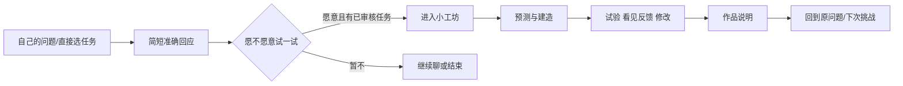

# 学伴小N：产品定位与差异化

研究建议v1.0｜2026-10-28｜与01竞品、03对话、04游戏、06路线图配套。以下推荐尚不是用户已批准的开发范围。

## 1. 独立结论

建议将小N收敛为：**面向10–12岁儿童的“可聊天的探索工坊”，让一个自己的问题变成能试、能改、能解释的小作品。** 第一阶段聚焦具体的预测、比较和控制变量行为；提供准确问答，但不与通用聊天工具竞争知识广度，不承诺训练通用智力。

这比“培养五维能力的AI全能学习伙伴”更容易被验证：孩子能否主动开始一次尝试，遇到失败会不会修改，换一个情境能不能独立解释。一个好的结果示例是“这次在水路里学会比较只改一个接头的前后差异，隔周面对灯泡实验也能提出公平比较”；不是“建模力82分”。远迁移主张需要更强证据，认知训练研究尤其提醒不能从局部进步外推一般能力。[R08](https://pubmed.ncbi.nlm.nih.gov/31939109/)、[R09](https://doi.org/10.1525/collabra.203)（核验2026-10-28）

## 2. 谁是第一批用户

### 2.1 新方向首批建议：10–12岁、主要五至六年级

年龄只是招募边界，不用来替代实际阅读、数学基础和操作水平筛查。优先家庭已有平板/电脑，孩子对搭建/解谜有兴趣，监护人愿意支持两周测试。允许孩子随时拒绝、暂停和退出。

选择理由（J/H）：

- 通常更能阅读短指令、比较多个结果和说出理由，降低对连续语音和成人代操作的依赖；具体差异需招募时核对，不按发展阶段理论机械分组。
- 更容易围绕有目的的制作活动验证解释、逻辑和简单数量关系；计算可限于整数，不让学科门槛主导表现。
- 相比低龄，输入/抽象负担较小；相比高中，未必必须以考试提分证明即时价值。均为待验证的市场假设。

**与现有项目的区别**：当前可核验内容主要含七年级基础代数等有限领域。以前围绕七年级修复卡点的路线可以作为现有产品验证方向，但不能声称它已服务本次建议的10–12岁探究任务。若选择新方向，先做一个独立内容切片；不同时招募小学探究组和初中代数组后合并效果。资源只够一条线时，建议先用低成本样机验证本报告的新主张，再决定投入，现有代数路径作为可复用资产保留。

### 2.2 暂不覆盖

学龄前、需要高强度特殊教育支持的人群、广泛心理咨询、全学科考试提分和成人学习暂不作为首批承诺。后续是否扩展需要专门内容、可达性和效果证据，不通过切换年龄标签实现。

## 3. 孩子、家长与团队各自要什么

| 决策主体 | 需要完成的事 | 可接受的价值证据 | 容易误用的替代指标 |
|---|---|---|---|
| 孩子 | 我想修好/造出一个属于我的东西，卡住时有人帮我 | 能自主选择、很快做出变化、失败后能再试、作品留下来 | 说喜欢吉祥物、聊得久、为奖励上线 |
| 家长 | 给孩子值得投入的探索，而非再添刷题和依赖 | 看懂作品、帮助程度、独立变化；孩子愿意讲 | 五维雷达、每日时长、AI夸奖 |
| 团队 | 用有限内容验证AI是否带来额外价值 | 同内容对照、独立迁移、合理成本、可重复任务生产 | 功能数、Agent数、生成任务数 |

候选家长说明：“小N陪孩子把一个想法做出来。你会看到他怎样试、改了什么，以及哪些地方还需要帮助。”不写“全面提升五维智能”“精准发现天赋”或“替代家教”。

## 4. 五种能力划分的评估

**五个维度可作为内容设计视角，不适合作为已证实的五因子心理模型。** 维度粒度不同且重叠：理解是几乎所有任务的条件，计算是相对具体的领域技能，想象横跨表达与空间，建模同时需要理解、逻辑、数量知识和元认知。本次没有发现能直接为小N这套五维提供结构效度、常模或公平性证明的资料。

| 原名称 | 建议产品用语 | 可观察的具体行为 | 必须控制的替代解释 |
|---|---|---|---|
| 理解能力 | 理解与解释 | 用自己的话说目标、找关键条件、在图与语言间对应 | 阅读难度、口语表达、术语不熟、ASR错误 |
| 逻辑能力 | 推理与验证 | 预测结果、找反例、分开必要/充分条件、比较证据 | 猜中、游戏经验、提示已泄露、偶然操作 |
| 计算能力 | 数量与运算 | 估量、算预算、选择单位、检查结果 | 手部操作、注意波动、题目表征、计算工具 |
| 想象能力 | 构想与创造 | 生成多种方案、改变约束下重组、解释创作意图 | 素材可得性、绘画技巧、审美偏见、语言差异 |
| 建模能力 | 表示与建模 | 选变量、画关系、预测、用试验修正模型、说出局限 | 先验学科知识、模型术语、引擎提示、任务熟悉度 |

共同过程另记为“计划—尝试—检查—调整—解释”，不要凑第六个能力总分。元认知的教学需要具体任务内的示范和逐步撤架，不能只要求孩子填写“我反思了”。[EEF R11](https://apiv3.educationendowmentfoundation.org.uk/education-evidence/guidance-reports/metacognition)（2026-10-28）

建议内部使用多标签内容地图：`domain=flow_network`、`concept=control_one_variable`、`practice=predict_compare`；一个任务可涉及多个视角，但每个切片只验证一到两个明确目标。对外展示作品证据和“本次表现/还需核对”，暂不展示五维分数、排名、年龄百分位。

若以后真做测量，须先明确构念和用途，建立足够多样任务，控制难度及提示暴露，检验评分者一致性、信度、结构与预测/迁移效度、年龄语言与设备公平性，邀请测量专业人员参与；不能把LLM输出JSON和多题平均当效度。

## 5. 两种模式怎样调整

建议保留两种活动形态，弱化儿童必须理解的“综合/专业”层级。面向孩子可用“问一问”和“做一做”，也可直接在当前对话旁出现一个可拒绝的小任务邀请。名称只是待测文案；本次不直接改UI。

综合模式的主要职责是理解意图、回应和邀请，不在每段生活交流中“暗中测试”。专业模式的主要职责是承载动作与证据，不做“只有答对才能玩”。两者共享经过许可的兴趣和作品上下文，但学习事实、偏好、情绪原文分别管理。

兴趣桥接示例：“你刚才想知道水为什么流不到花园。工坊里有一条漏水管，要不要用它试试？”若孩子拒绝，不再强推；没有对应已审核任务时明说“这个世界还没做好”，可以只给安全的现实观察建议。

## 6. 什么体验可能真正吸引孩子

第一分钟应能做出一次改变：点亮一盏灯、看到水从接头漏出、把自己的装置命名。好玩来自可理解的后果、有两种以上选择、能保留的作品以及“我改了它就不一样”的控制感，不只来自动画和奖励。

设计方向与证据关系：

- **自主选择**：选挑战、装饰主题、帮助方式，允许拒绝；但选择必须有意义，不能只有颜色。SDT支持自主、胜任与关系的设计方向，不保证具体菜单提高动机。[R03](https://selfdeterminationtheory.org/wp-content/uploads/2020/06/2020_RyanDeci_IntrinsicandExtrinsic.pdf)（2026-10-28）
- **可胜任的困难**：反馈让人知道哪里需要改，求助不惩罚；无辅助发现对新手风险较大。[R01](https://journals.sagepub.com/doi/10.3102/0034654315627366)、[R02](https://app.nova.edu/toolbox/instructionalproducts/edd8124/articles/2011-Alfieri_et_al.pdf)（2026-10-28）
- **作品归属**：改半成品后保存自己的版本，能给真实家人讲解；建造主义提供理论依据，但需实际验证兴趣与学习。[T03](https://web.media.mit.edu/~calla/web_comunidad/Reading-En/situating_constructionism.pdf)（2026-10-28）
- **短期完成感和自然结束**：一次约15–20分钟为初始设计预算，孩子可提前停。不是文献规定的最佳时长；不设置“离开会让小N伤心”。

## 7. 差异化、复制风险与护城河

“中文AI＋可爱角色＋游戏化”易复制。可累积的资产可能是：经过儿童实际观察打磨的任务库、任务状态和帮助时机的映射、可审核的教学评价样本、易解释的作品档案，以及儿童与监护人信任。它们只有在持续内容生产和真实验证后才形成优势。

| 对比对象 | 小N候选优势 | 必须诚实承认的弱项 | 如何证明 |
|---|---|---|---|
| 通用聊天工具 | 能看懂可信游戏状态、给可执行小步 | 世界外知识广度不占优 | 任务帮助正确率和无效建议率 |
| 题库/学习机 | 自己创作、从兴趣开始 | 课程覆盖与应试价值弱 | 自愿参与、解释与新任务表现 |
| Scratch/Minecraft | 操作更聚焦、中文卡点帮助 | 自由度/生态规模小 | 新手启动、完成与独立表达 |
| 普通益智游戏 | 能连接概念和现实问题 | 娱乐品质可能弱 | 同内容比较、延迟迁移 |
| 纸笔/家庭实验 | 减少材料门槛、可复现反馈 | 不能替代真实触感、社交与实验技能 | 与低成本现实活动比较增量 |

## 8. 产品应守的边界

1. 对知识可直接解释；对练习可以分级帮助；对情绪先倾听，不把孩子的烦恼改成逻辑考题。
2. 角色明确是AI，不承诺真实情感、不要求保密、不排斥父母老师或朋友。没有“永久陪伴”订阅和惩罚性签到。
3. 建议定位为教育探索而非持续情感依恋服务。现行《拟人化互动服务管理暂行办法》第2条对不涉及持续情感互动的学习教育服务作出区分；实际产品若越过该边界，需要重新判断适用要求，不能仅改名规避。[L03](https://www.cac.gov.cn/2026-04/10/c_1777558395078289.htm)（2026-10-28）
4. 暂不开放陌生人社交、公共UGC、任意联网搜索和摄像头常开。对家长提供可理解学习概况与必要安全支持，明确孩子哪些信息谁能看见。
5. 不推断心理诊断、智力高低、性格类型、家庭关系质量；没有观察就说不知道。

## 9. 最重要的反对意见

**“孩子真的要这个吗？”** 尚不知道。儿童可能选择真正的Minecraft而非有限教育世界，家长可能只愿为提分付费。应先用样机观察，不能凭竞品成功为自己的需求背书。

**“没有3D就不像我的世界。”** 视觉、空间导航和操作自由确实不同；2D不会自动覆盖3D空间学习。当前最值得验证的控制变量、关系表示和改进方案不依赖自由镜头，先做2D更容易定位教育问题。若要验证旋转视角/空间建模，则应专门做体素切片，不能以2D结果替代。

**“没有AI也能做这个游戏。”** 很可能成立。AI必须证明它能理解不同说法、减少卡住和改善独立思考，而不只是让反馈更长。无AI对照是必要部分。

**“五维很好宣传。”** 宣传清楚不等于科学成立。可以作为活动分类，但不以分数和人格化标签向儿童/家长作超范围承诺。

## 10. 本报告建议的决策顺序

先确认目标用户和单一学习目标→做一个可操作任务→检验是否愿玩→比较帮助方式→测延迟独立表现→再扩内容和3D。若前两项不成立，调整任务与定位；若娱乐成立而学习不成立，承认为创作游戏或重做学习桥接，不能改指标宣布“全面成长”。
