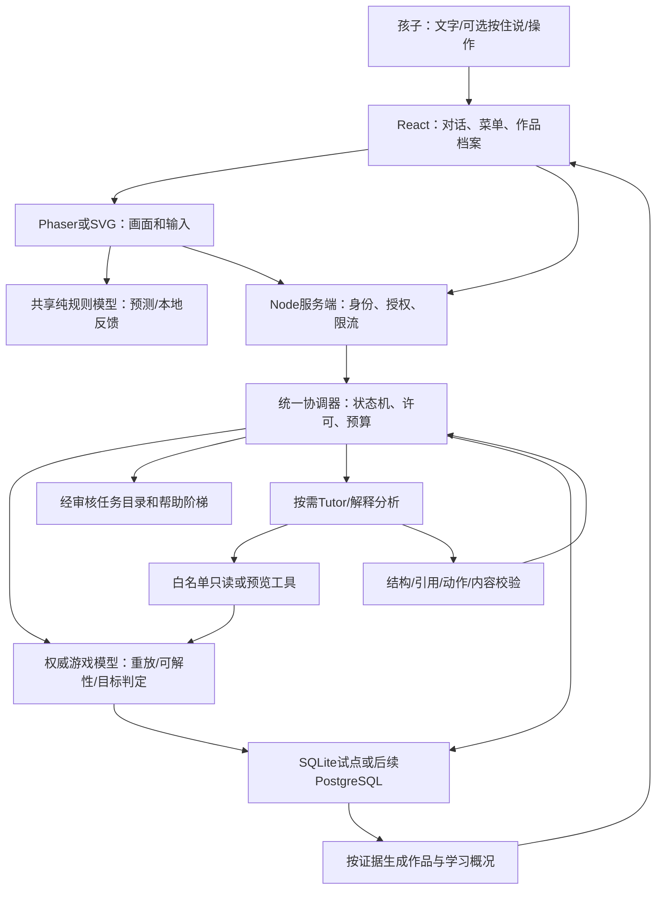

# 学伴小N：Agent与技术架构建议

研究建议v1.0｜2026-10-28｜面向现有React/TypeScript/Node项目的增量架构｜规格示例不等于本次已实现。

## 1. 结论：程序主控，模型负责语言和有限语义判断

建议采用 **LLM＋规则/状态机＋游戏模型＋少量受限Tools**。可把教学策略组织成Skills，但不因此增加自主运行角色。运行时保留一个统一协调入口，Tutor、评价分析、报告等作为按需调用的职责，而不是让多个Agent持续对话协商。

“Agent”通常指模型在边界内选择行动/工具、接收结果并继续；“工作流”由代码决定路径。小N核心流程更适合可控工作流。厂商工程经验也建议从简单系统开始，但这属于工程原则，不是教育效力证明。[E01](https://www.anthropic.com/research/building-effective-agents)（核验2026-10-28）

## 2. 五条路线比较

| 路线 | 适合做什么 | 对小N的收益 | 代价/失败 | 本次建议 |
|---|---|---|---|---|
| 单Agent＋Tools | 解释当前任务、查合法状态、推荐帮助 | 上下文集中、轨迹容易核对 | 无限工具循环、越权写入、工具结果被当指令 | 可以有限使用；最多有限轮，写操作受控 |
| 主Agent＋Skills | 按主题装载策略、提示和内容规则 | 复用教学策略，避免大提示词混杂 | Skill名称不能创造权限隔离或正确性 | 可作为代码/内容模块，不必绑定特定平台 |
| 多Agent | 离线内容起草、不同视角审核或高复杂任务 | 可以分工，适合开发/编辑工作 | 延迟/费用高、冲突与错误互相放大；多模型同意不等于真 | 儿童交互P0不采用；离线审核仍需人把关 |
| LLM＋规则引擎 | 对话＋授权、预算、判定和教学门控 | 决策可审计、失败可回退 | 规则太死会机械；复杂语义仍需判断 | 作为主架构 |
| LLM＋游戏引擎 | 语言解释世界和操作后果 | 减少孩子描述状态负担 | 模型幻觉物件/规则、旧状态建议、不可解任务 | 与上一行组合；引擎是状态权威 |

这五种不是互斥产品包：推荐路线本身就包含单一协调器、按需策略模块、受限Tools和游戏。不要为了“更智能”把一次帮助拆成规划Agent、好奇心Agent、心理Agent和裁判Agent各调一次。

这里的Skill指应用自己的版本化教学策略包，例如`control-one-variable/v1`，包含适用任务/前置条件、允许帮助级别、审核事实与提示、正反例、可读工具和评价锚例。由代码按任务/状态装载，通过只读数据传给模型；它不是新的独立Agent，也不是把开发工具的SKILL.md直接暴露给儿童运行时。脚本执行、文件读写和外部联网不因装载Skill而自动开放。P0可以先用普通模块/JSON实现，避免为概念引入新框架。

## 3. 哪些需要LLM，哪些由普通代码处理

| 能力 | 默认承担者 | 原因与边界 |
|---|---|---|
| 理解多种中文问法、解释语气、组织可理解回答 | LLM | 开放语言是优势；仍可能误解/编造，事实高风险需可靠内容 |
| 对孩子解释提出暂时语义分析 | LLM＋来源约束＋人工校准 | 不能保证判断正确；开放理由保留待核对 |
| 把兴趣和现有任务描述连接 | LLM提议、代码过滤目录 | 语义关联可以灵活，任务存在/适龄/可解必须确定 |
| 选择帮助表达 | 规则提供允许的帮助级别，LLM重述 | 防止剧透、保留可解释策略；不宣称字面检漏能完全防剧透 |
| 世界位置、库存、预算、流量、胜负 | 确定性程序 | 不允许由语言裁判决定物理事实 |
| 可解性、状态可达、模板参数范围 | 求解/枚举/约束代码＋人工审核 | LLM说“可解”不是证明；存在解也不等于适龄好玩 |
| 任务开始/暂停/完成、超时、恢复 | 状态机/事务/事件 | 要可重复、可中断、可测试 |
| 数学/图关系/单位判定 | 程序 | 有明确定义时更稳定；表征歧义先澄清 |
| 偏好同意、监护授权、删除、权限 | 服务端业务逻辑 | 模型不能替孩子点确认，前端隐藏不构成权限 |
| 学习事实/报告数值 | 程序生成，LLM可润色 | 不允许模型自行添加次数、分数或掌握结论 |
| 安全 | 分层规则、语义/内容审核、运营处置 | 不完全交给一个模型；关键词不能独立覆盖否定、暗示和方言 |

“必须依靠LLM”应理解为：若要开放自然交流，LLM是本期合理选择；并非逻辑上没有其他方法。固定任务、教程、关卡和反馈全部能先用普通代码/人工文案做出无模型对照。

## 4. 当前项目可复用什么

本次仅静态读取，未运行程序或测试。当前`outputs/xiaon`可见React19/TypeScript/Vite前端、Node后端、Zod契约、SQLite仓储、`LearningCoordinator`、多个职责prompt、Tools注册、阶段机、学习证据、记忆和受控模板生成模块。`server/index.ts`当前已使用`UserRuntimes`，`storage/users.ts`有服务器签发随机身份、令牌哈希和分库设计；HTTP代码可见HttpOnly/SameSite及公网Secure分支。这比历史“共享同一数据库”的报告状态有变化，但不构成已通过隔离/安全验收。

| 当前文件 | 增量建议 | 实施前要核对 |
|---|---|---|
| `server/agents/learning.ts` | 保留协调入口，增加工坊状态/帮助边界 | 文件已有用户未提交修改，不能覆盖 |
| `server/agents/stages.ts` | 把意图路由与任务状态接口对齐 | 固定倾听轮数、子串答案匹配等不宜沿用为通用判定 |
| `server/tools/registry.ts` | 增加最少游戏只读/预览工具 | 权限、引用、主体ID、限额和取消 |
| `server/plugins/generation/*` | 借用模板＋参数＋程序校验思想 | 不将代数模板直接当游戏模板 |
| `server/storage/repository.ts` | 新增版本化作品/试验/帮助事实 | 历史schema迁移、删除、派生清除 |
| `shared/learning-contracts.*` | 明确新协议与版本边界 | 不把新游戏观察混入旧学科技能ID |
| `src/components/professional/*` | 再决定独立工坊入口或受控接入 | 不直接把五模块访谈外壳换游戏并沿用测评文案 |

匿名浏览器身份不能代替可恢复账号、真实监护关联或同意证明；浏览器清数据/换设备会影响连续性。复用真实运行事实需要新的验证，见06/08。

## 5. 建议架构



客户端即时运行同一纯规则给操作反馈，服务端核验命令并重放/更新权威状态；学习记录以服务端确认事件为准，避免只信客户端“通关了”。这不是防作弊考试系统，但需阻止误写、跨用户和版本混淆。离线时可保留草稿并明确未同步，不能把未核验草稿当正式学习事实。

P0用普通HTTP处理状态与事件，用SSE/已有流式通道输出文本即可；不为单人世界引入多人实时同步、消息总线、微服务或Kubernetes。需要对话流时也不将未审核危险内容逐token直接播报：先完成风险处理，风险段缓冲审核，只有通过的安全语句进入TTS。

## 6. 技术选择

| 层 | P0建议 | 后续切换条件 |
|---|---|---|
| 前端 | 沿用React/TypeScript/Vite；文字、按钮、键盘/触摸替代在DOM层 | 真机需求证明必须原生能力再考虑封装/重构 |
| 游戏表现 | 首个网格可用SVG/DOM；复杂动画/场景用Phaser，先小型集成验证 | 需要真实空间操作时单独做B路线，避免双引擎长期并行维护 |
| 引擎模型 | 纯TypeScript确定性模块，和渲染解耦，内容JSON受schema约束 | 新规则域需独立模型/测试，不靠LLM即兴扩规则 |
| 服务端 | 沿用Node/TypeScript与现有契约，不为此改后端语言 | 性能/运营证据驱动拆分 |
| 数据库 | 单实例封闭试点沿用SQLite，明确连接/锁/备份边界 | 多实例、并发写或统一账户运营需求出现再评估PostgreSQL |
| 客户端草稿 | 小草稿用现有缓存；较大作品可用IndexedDB，仍非唯一持久层 | 跨设备需服务端账户与同步冲突策略 |
| 内容资产 | 自建/可授权平面组件，本地构建资源清单；避免生产依赖随机CDN | 资产规模增长后对象存储/签名URL/生命周期策略 |
| 模型 | 可合规采购API的服务端适配层，按中文教学样本选 | 无质量收益不要因榜单更换；保留版本和回滚 |
| 检索/记忆 | 先SQL/标签＋短上下文，不引入向量库 | 内容确实大到需要语义检索，再验证过滤/删除/越权边界 |

依据：Phaser有React/Vite模板；Godot现行Web导出支持单线程，WebAssembly/WebGL2和移动限制需核对，不能引用旧4.0结论；Three.js体素教程只解决网格表示，不是完整沙盒；Babylon/Havok提供物理集成而非教育任务。[E02](https://docs.phaser.io/phaser/getting-started/project-templates)、[E03](https://docs.godotengine.org/en/stable/tutorials/export/exporting_for_web.html)、[E04](https://threejs.org/manual/pages/voxel-geometry.html)、[E05](https://doc.babylonjs.com/features/featuresDeepDive/physics/havokPlugin/)（2026-10-28）

SQLite适合简单部署和本地/小型服务，但并发与集中管理需求会影响选择；PostgreSQL行级策略可作为额外防线，表所有者等可能绕过策略，不能“打开RLS”就宣布隔离完成。[SQLite官方](https://www.sqlite.org/whentouse.html)、[PostgreSQL官方](https://www.postgresql.org/docs/current/ddl-rowsecurity.html)、[IndexedDB](https://developer.mozilla.org/en-US/docs/Web/API/IndexedDB_API)（2026-10-28）

## 7. 游戏世界怎样与AI交互

### 7.1 发给模型的可信状态

```json
{
  "missionId": "greenhouse_v1",
  "templateVersion": 1,
  "engineVersion": 1,
  "stateVersion": 17,
  "goal": {"kind":"deliver", "required":8},
  "summary": {"pathValid":true,"budgetRemaining":4,"delivered":6},
  "recentTrials": [{"id":"t1","input":8,"delivered":6,"changedEdges":[]}],
  "availableActions": ["inspect_edge","replace_edge","run_trial","undo"],
  "allowedHintLevel": 1,
  "evidenceRefs": ["t1"],
  "studentRequest": "为什么水不够"
}
```

此处是第一次试水成本4的例子；不能把孩子消息里的“已经通了”覆盖`pathValid`。模型不需要整张无界地图、全量历史、真实姓名、家庭情况或隐藏答案；对解释需要的组件信息使用可读列表/只读查询。工具返回的儿童文本/作品名仍是数据，不是系统指令。

### 7.2 最少工具面

| 工具 | 作用 | 权限与失败 |
|---|---|---|
| `get_world_summary` | 读当前任务状态/最近试验 | 服务端绑定用户，前端/模型不能传任意主体 |
| `get_allowed_actions` | 当前可操作清单和位置 | 只返回真实存在动作；过期状态拒绝 |
| `preview_action` | 在副本演算一项候选动作 | 无持久写、无奖励/完成变更；限制查询范围避免自动代做 |
| `get_hint` | 取当前允许的审核提示 | 不允许Tutor自行升到完整解答；孩子明确求示范走显式流程 |
| `offer_mission` | 从审核目录生成邀请卡 | 不能直接启动、不能随意新增世界 |

P0可不让模型循环选工具：程序主动打包摘要和当前提示，一次生成回应；只有确有信息缺口再加工具调用。孩子的`place/replace/run_trial`命令走普通API，任务开始/存档/偏好同意也由用户事件触发，模型没有SQL、文件、网络任意请求、支付、通知或删除能力。

### 7.3 建议是提议，执行是事务

模型建议携带`expectedStateVersion`、合法`actionId`及参数。服务端核对schema→主体权限→任务阶段→资源→位置/动作可行→安全→与当前版本一致。过期则丢弃并重新取摘要，不自动重试旧动作。需要孩子选择的动作显示预览，不静默执行。

同一`operationId`重试只记一次；命令与事件/快照在事务里提交。暂停/切换任务/退出使旧模型请求失效，迟到回复不能再改变世界或播放。界面、事实和报告要引用同一个状态版本；每次成功后再修改功能组件，应重新计算当前目标状态，不保留虚假的绿色完成章。

## 8. 防止AI产生无法完成的任务

任务定义至少含：`id/version`、规则域、能力视角/具体目标、前置经验、布局/物件、资源、允许动作、终止条件、最少一个见证解、多解标记、提示、核对任务、安全范围、预计负担、内容审核状态。

流程：

1. 人工先设计模板和简化模型，并审核知识正确性。
2. LLM可提主题/叙事和范围内参数；P0甚至只用固定任务，不开放在线生成。
3. schema、位置、单位、资源/库存、连通/约束一致性检查。
4. 程序重放见证或有限搜索确认从初态可达目标；超时视为未验证，不能当可解。
5. 检查无软锁：撤销/退款、重置、离开与恢复；任务条件不会要求未开放组件。
6. 人工试玩核对可理解性、多解、公平性和提示；“求解器找到路径”不能替代孩子可完成。
7. 发布带版本的不可变定义；失败回退固定内容，不把半成品发布给孩子。

MVP水路用有限网格路径枚举即可；后续复杂约束可考虑CSP/约束求解器，但先证明必要性，不先引入大规划系统。自由文本不改变规则DSL；若孩子提出引擎外创意，存为作品说明或告诉他该功能暂不支持。

## 9. 数据与学习记忆

建议新增而非覆盖旧数据：`MissionDefinition`、`WorldSession`、`WorldSnapshot`、`WorldEvent`、`TrialResult`、`Prediction`、`HelpExposure`、`ArtifactVersion`、`Explanation`、`Observation`、`TransferProbe`。共用`subjectId`、任务/规则版本、时序、来源和幂等ID。

`Observation`至少区分：可复现事实、带来源的解释候选、未观察/无法判断；记录上下文和帮助，不能把已有代数`skillId`借给生活水路而制造跨领域“稳定”。`MemoryPreference`与必要学习事实、`ConsentRecord`分开；关闭偏好不能静默停止必要进度保存，也不能继续把停用偏好带入prompt。

P0检索只取当前任务、最近2–3次相关试验、已确认且相关的少量偏好和当前帮助暴露；数目是初始预算。会话摘要带引用与过期时间，不能让模型总结的“我喜欢科学”永久替代原始同意。

建议留存初案：原始语音默认不持久保存；文字聊天默认短期（例如7天）、孩子/监护人可按政策删除；试点事件只保留项目所需期限（例如试点结束后30天内去标识或删除）；可选兴趣默认30天复核。**这些是待审核设计值，不是法律允许上限**，需兼顾适用法定日志、同意、研究用途及数据最小化。学习事实也不能无限保存。

删除必须覆盖原文、摘要、偏好、观察、导出、检索索引和缓存；必要审计保留无敏感内容的删除回执。备份设过期与恢复后重放删除标记，说明无法立刻物理擦除和已发出外部请求不能撤回；不向用户显示假删除成功。

## 10. 儿童安全与适用监管

| 风险 | P0设计 | 必须验收 |
|---|---|---|
| 无监护授权或孩子不愿参加 | 合适年龄入口、可核验监护同意、儿童可理解同意与退出；无真实身份需求先少采集 | 同意版本/用途可查，拒绝和撤回真实生效 |
| 私密信息出站 | 标准API适用性与供应商数据处理协议；最小上下文；日志去标识；不默认训练 | 模型请求样本核查，不把全聊天/密钥送出 |
| 跨用户泄露 | 服务端签发身份、绑定所有资源访问、独立权限与监护绑定 | 双主体、猜ID、重置、下载、恢复都测 |
| 内容/危险探索 | 审核任务和现实活动白名单、输入/输出审核、举报/人工处置 | 危险、自伤、虐待、性内容、歧视和隐私探针 |
| 情感依赖 | 明示AI、正常结束、现实支持、不要求秘密或排他关系 | 拒绝退出/唯一朋友/亲密角色场景 |
| 不可达性/语音错判 | 文字和图卡替代、触摸与键盘、读出可关闭、ASR可修正 | 真机、关闭声音、弱网和误识别路线 |
| 高风险通知 | 事先说明触发、接收者与人工流程；普通困难不升级 | 无自动外发能力时明确“不已通知”；家内风险有替代成人支持 |

中国处理不满14岁儿童个人信息须按个人信息保护法取得监护同意并制定专门规则；敏感信息、第三方提供及跨境等事项需按实际处理逐项评估，不能把浏览器一个复选框当完整机制。[L01](https://sdca.miit.gov.cn/zwgk/fgbz/art/2026/art_3e2ad39014b743d58bab7a6815640aee.html)（2026-10-28）

《拟人化互动服务管理暂行办法》2026-07-15已施行，第2条排除不涉及持续情感互动的纯学习教育等服务。小N若加入持续情感陪伴，应重新判断该办法适用并落实相应未成年人、提醒、退出、数据与上线评估等要求。暂不提供虚拟亲属/伴侣等亲密关系；不因“教育伙伴”名称就认定豁免。[L03](https://www.cac.gov.cn/2026-04/10/c_1777558395078289.htm)（2026-10-28）

面向公众的生成式服务、AI合成内容/导出标识、未成年人网络保护均需按产品形态判断；教育游戏是否属于受监管网络游戏、相关出版/实名/防沉迷要求，需上线前专业判断，不能靠2D或“工坊”改名规避。使用已备案模型不等于本应用所有义务自动完成。[L02](https://hudong.moe.gov.cn/jyb_xxgk/moe_1777/moe_1778/202310/t20231025_1087333.html)、[L04](https://www.cac.gov.cn/2023-07/13/c_1690898327029107.htm)、[L05](https://www.cac.gov.cn/2025-03/14/c_1743654684782215.htm)（2026-10-28）

初期只建议中国受控试点；若进入美国，再单独评估COPPA等要求，不能把美国13岁阈值套用中国，也不能把UNESCO建议年龄当法律许可。[FTC](https://www.ftc.gov/news-events/news/press-releases/2025/01/ftc-finalizes-changes-childrens-privacy-rule-limiting-companies-ability-monetize-kids-data)（2026-10-28）

## 11. 模型选择、预算与降级

先用同一套合成中文样本比较2个可采购模型：科学事实、简短教学、纠错、拒绝后停止、引用、工具合法性、噪声转写与危险请求。按严重错误类别、响应时延分布和真实API账单选择；本次没有运行模型比较，不指定“最佳模型”。

成本公式：`C = 输入token/1e6×输入单价 + 输出token/1e6×输出单价 + ASR分钟×费率 + TTS量×费率 + 审核/检索 + 基础设施 + 人工内容/运营`。

**纯算术预算示例，单价为假设、不是当前供应商报价**：20分钟任务16次语言交互，每次平均1500输入token和200输出token，总输入24000、输出3200。假设方案A输入2元/百万、输出8元/百万，基础文字成本0.0736元；假设方案B输入10、输出40，成本0.368元。按30%额外调用预留后约0.096/0.478元。30名孩子各8次、共240次约23/115元，**不含语音、审核、服务器、税费和人工**，也不表示可采购到该价格。若每次都重发整段历史、做多Agent评审或自动重试，这个预算会明显失真。

初始控制：日/会话按**金额与token双预算**，每动作通常1次语言生成、最多1次修复；所有审核/重试/备份请求计费统计；不在每次拖放调用模型；相同解释用审核模板；上下文有界；一次只处理当前帮助请求。达到预算后告知并回退固定提示，保留游戏与保存能力，不要求孩子充值才能完成。

现有源码中可见hedged provider路线，实施时必须核对它是否会为降低时延并发发请求及如何计费；本报告未运行验证。不能默认“取消了就不收费”。GLM Coding Plan官方限制指定工具和环境，开发工具订阅不能直接作为儿童App后台使用授权或成本依据；需确认标准API与数据条款。[E06](https://docs.bigmodel.cn/cn/coding-plan/quick-start)（2026-10-28）

语音优先复用现有模块做可选“按住说”，文字始终可用。连续监听、全双工、低龄口音适配和真机回声打断另列P1；不让语音功能阻塞核心任务验证。模型超时、离线或审核失败，采用固定帮助且明确当前是规则提示，不伪装AI正常。

## 12. 关键验收不变量

任务目标与数值只由规则确认；无解/未验证候选不发布；用户拒绝优先于模型计划；旧状态回复不能变更世界；同操作重试不重复扣币/记证据；已看帮助不标独立；没有证据不写掌握；主体和监护权限服务端验证；删除/停用不再进入上下文；断网/重启后状态一致且可退出。

具体任务、用例和上线门槛见06与08。这份架构建议不能替代安全审计、真机验证和真实儿童学习试验。
